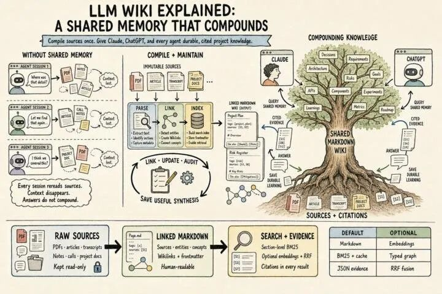
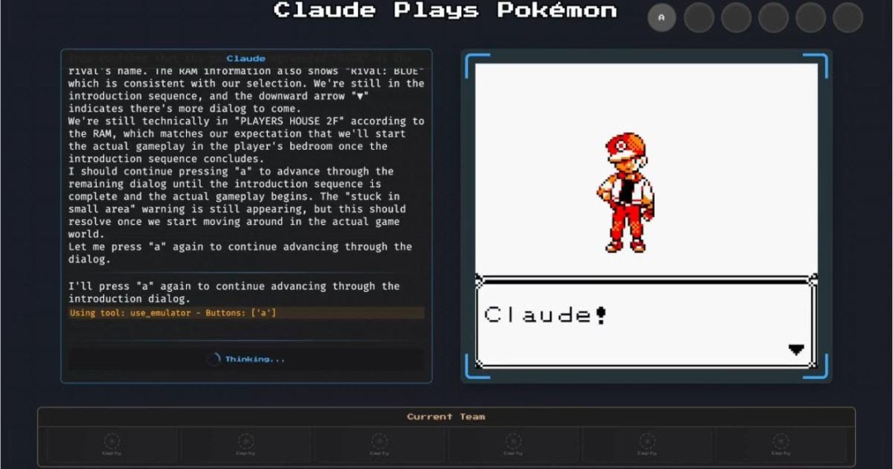
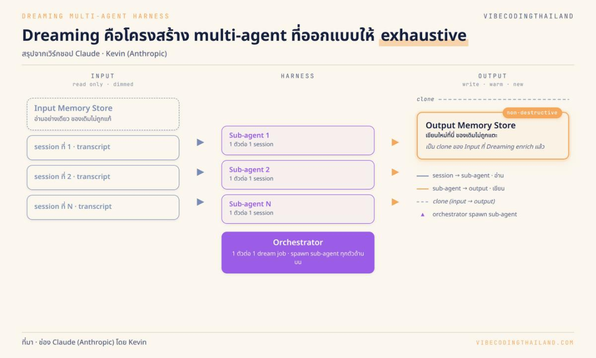

# Anthropic重磅公开Agent记忆内幕！

> 来源：DataFunTalk
> 链接（原文）：https://mp.weixin.qq.com/s/cpjAuL6FuiLFVWt2lfUK6A
> 日期：2026-11-09
> 原始素材：`assets/anthropic-agent-memory-wiki/`（original.html + 6 张图）

导读 用 35 万份企业文件建一套 Wiki，Claude 能把题答得多好？Anthropic 11 月 6 日公布了结果。25 道题，只查 Wiki，最高满足 48% 的评分项。直接搜原文，反而拿到 53%。两样一起用，得分最高升到 61%，每题还比只搜原文少用了约 2 万 Token。
想象你问公司的 Agent，上周去上海出差的酒店费能不能报。它翻了翻 Wiki，回你一句“按差旅标准提交发票就行。”你补了一句“我是外派的”，答案就可能变了。Wiki 写着通用流程，决定你这笔钱能不能报的那一行，可能躺在另一份补充规定里。可要是每次都从几十万份文件里重新找，Agent 又得读多少无关材料？
主要内容包括以下几个部分：
1. 整理了 128 轮，为什么只查 Wiki 还是差一点？
2. 两样都能查，为什么每题还省了 2 万 Token？
3. Claude 写错的记忆，下一轮还会当真
4. 哪些内容可以压缩，哪些最好逐字保留？

01

整理了 128 轮，为什么只查 Wiki 还是差一点？
这批文件来自软件公司 Stainless，约有 4.2 亿 Token。面对这样的体量，Claude 要靠工具一点点找。Anthropic 让 Opus 5 在 128 个会话里逐步搭建 Wiki。每轮都接着前几轮的工作往下做，用共享日志记录进度，再去探索文件、增补页面、合并重复内容，有疑问就回原文件核对。Wiki 里是按主题组织、彼此链接的页面。
只让 Claude 查 Wiki，整理两轮时，它只能拿到 13% 的评分项。整理到 128 轮，升到了 48%。再把原文搜索打开，结果又往上走了一截。
Claude 答题时能用什么
评分项达成率

只查 Wiki
最高 48%

只搜索原文
53%

Wiki 和原文搜索都能用
最高 61%

表1｜不同检索方式下的评分项达成率
这些百分比统计的是回答满足了多少评分要求。一道题可能同时考时间、涉及的人和决策结果，Claude 写对其中两项，仍可能漏掉第三项。
Wiki 的麻烦在于，写下摘要时，你还不知道下一位读者会问什么。“外派员工走单独流程”对大多数员工只是个脚注，对来提问的那个人却是整张报销单的关键。只让 Agent 查整理好的页面，它看到的是当时被挑出来的内容。即使关键词已经摆在眼前，只要那条规则没写进 Wiki，Agent 就得去原文件里找。
02

两样都能查，为什么每题还省了 2 万 Token？
想象 Claude 只拿到一个搜索框。它搜“酒店报销”，看到差旅标准、申请表、财务答疑，还有几份旧通知。读完这一批，才知道还该搜“外派”“项目派驻”或者“费用归属”。等找到那份补充规定，它可能已经读过好几轮跟这张单子关系不大的材料。
如果 Wiki 的“差旅报销”页提前串起了“派驻政策”和“费用归属”，Claude 就有了几个更准的起点。它可以先沿链接确定该去哪个部门、找哪份制度，再把原文读到具体条款。省下的是摸索的那几步。好的 Wiki 帮 Agent 更快找到该读哪几份文件，也提醒它别漏查另一份。
Anthropic 还做了一个更能说明问题的对照。一组并购题里，不少问题得把多份文件拼起来，有些还要做判断或计算。在这类题项上，查 Wiki 的得分是 87%，仅搜索原文是 73%。换到另一项法律文书测试，大部分评分项用关键词在单份文件里就能定位，Wiki 的增益就不明显了。
这两个结果放在一起，很容易想到企业里哪些东西值得提前整理。查某份合同的到期日，搜到签署版就能读。要回答“这家供应商下个月能不能停供”，可能得把主合同、补充协议、尚未交付的订单和采购团队的记录连起来。前一种问题考定位，后一种问题得先知道哪些材料彼此有关。
还有一笔账要算。每题少用约 2 万 Token，说的是这次实验的答题阶段。前面跑 128 轮、后面修订页面，都要用算力。同一批资料被反复问，整理的投入才有机会被后续查询摊薄。每周都换一套材料、每套只查一两次，收益就得另算。
03

Claude 写错的记忆，下一轮还会当真
漏记让 Agent 找不到东西。记错更麻烦，它会拿着一个看似可靠的结论继续往下走。
Anthropic 用《宝可梦 红》做了一次演示。Claude 把宝可梦中心记在月见山东侧，其实它在西侧。后来 Claude 从中心出来，一看自己的笔记，以为已经穿过月见山，接着往前走，结果跳下了只能单向通过的台阶，回到来时的路线。沿用错误笔记的那次运行里，Claude 在那里掉下去三次，始终没到下一座城。

图1｜Claude 玩《宝可梦 红》时的界面：左侧是它的推理与工具调用记录，右侧是实时游戏画面
研究团队让 Claude 在后台回查那段会话记录，把笔记和当时发生的事对一遍。位置纠正以后，Claude 知道自己还得重新进洞，后来抵达了华蓝市。Anthropic 把这类后台整理叫作 dreaming。Agent 可以在两次会话之间回看记录、检查笔记、修正 Wiki，再把整理好的内容留给下一次会话。对这次游戏而言，会话记录保存了 Agent 当时看到什么、做了什么，足以拿来核对那条笔记。

图2｜dreaming 的流程示意：会话记录只读输入，由子 Agent 与 Orchestrator 分工整理，产出写入不改动原始输入的输出记忆（图源：VibecodingThailand）
放回企业里，一条“外派员工走普通差旅流程”的旧笔记，可能来自某次特批，也可能是 Agent 当时理解错了。复盘历史会话，能找出这句话是从哪次处理里来的。要判断它能不能用于今天这笔报销，还得查当时的文件和现在生效的制度。会话记录能解释 Agent 为什么这么记，业务原文才能证明这条规则适用于谁。
这也决定了后台整理该盯什么。频繁被引用、刚被新版本替代，或者已经与原文发生冲突的页面，值得先检查。把每一条旧#记忆 都定期重读一遍，算力花得多，还可能赶不上最急着纠正的那条。
04

哪些内容可以压缩，哪些最好逐字保留？
#Anthropic 的合同测试里，#Claude 一开始让多个 Agent 往同一张表填条款。表格看起来挺规整，但摘要漏掉了一些细节，并行写入时还有内容被别的 #Agent 覆盖。最后用这份 Wiki 写出的文书，覆盖了 57 项事实中的 41 项。随后研究团队同时改了两处。每份合同由一个 Agent 单独写一页，关键条款保留原句。重建 Wiki 后，同一任务覆盖了 57 项。两处改动一起生效，这组结果能说明保存方式有影响，具体有多少来自保留原句、多少来自避免覆盖，还得拆开测。
这正好给报销 #Wiki 划了一条线。“到哪提交、一般谁审核、相关制度有哪些”适合写成容易扫一眼的页面。至于外派员工是否适用、适用到哪一天、超过多少金额要另行审批，几个字就可能改掉最后的结论。这样的条款可以摘录，但最好同时记下原文出处、版本、生效日期和条款位置。制度更新后，Agent 能顺着这条线找到哪些页面受影响，回答时也能把依据一起带回来。
怎么知道这套设计有没有用？拿几道日常问题试，再加几道容易掉坑的。比如两位员工住了同一家酒店，费用一模一样，一个是普通出差，一个是外派。再把新旧两版规定都放进文档库，看看 Agent 会不会引用已失效的那份。除了最后答没答对，还可以记录它找没找对条款、读了多少无关材料、找不到依据时会不会把问题交回人工。这样才能看出 Wiki 究竟帮它少走了多少路，又在哪一步让它走错了路。
回到那张报销单。员工说“我是外派的”时，Agent 可以先回一句“外派可能走单独流程，我去确认一下。”这一步很短，但前提是系统让它找得到补充规定，分得清哪版有效，还能回头修正自己记错的那一条。到了真正要做判断的时候，这些能力比记住一句现成答案更值钱。
参考来源
Anthropic，The components of agent memory，2026 年 11 月 6 日。https://www.anthropic.com/research/components-of-agent-memory
点击阅读原文，点击免费领取100万Token
