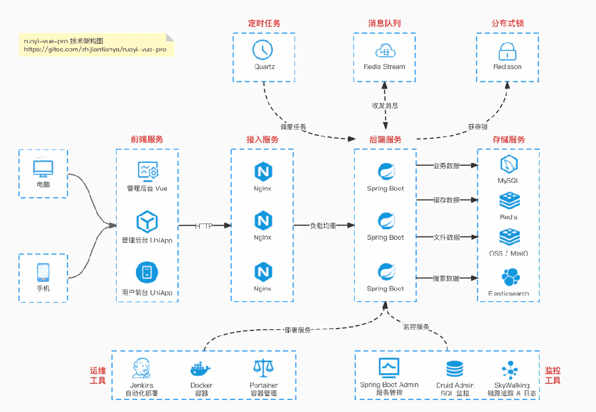
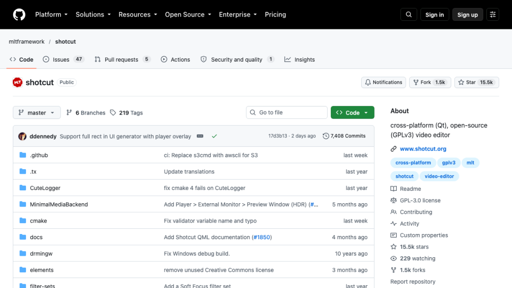
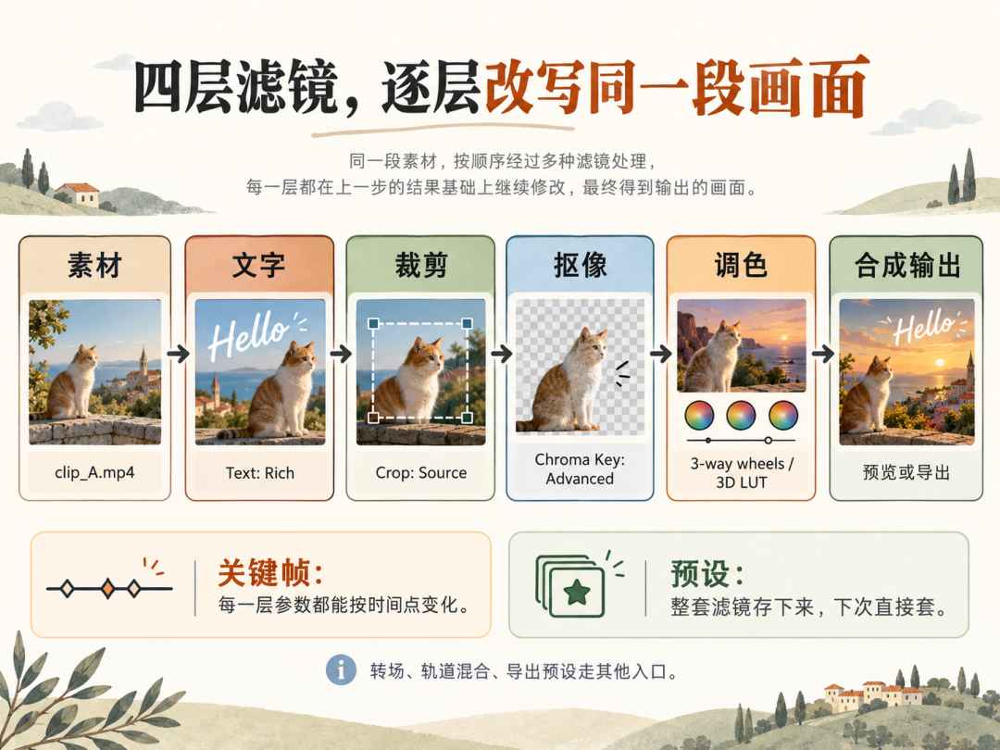
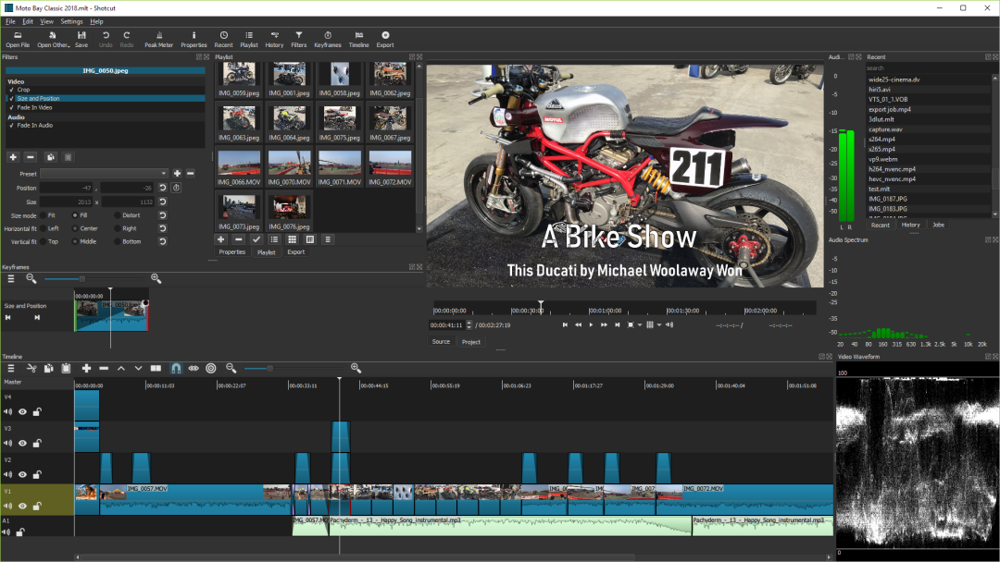
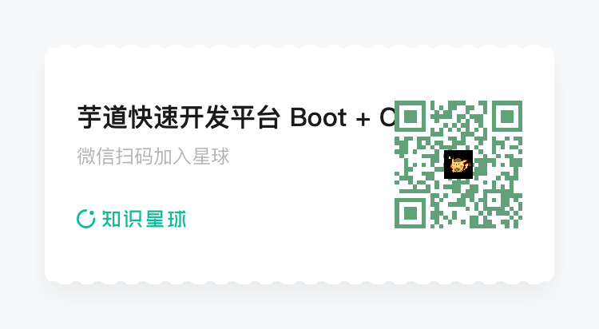
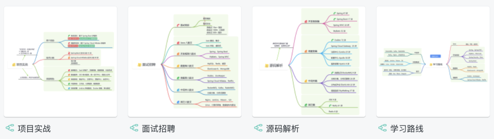
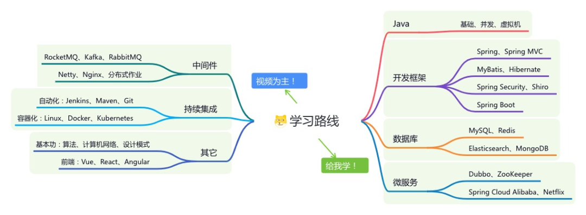
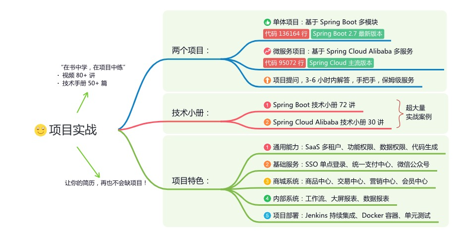
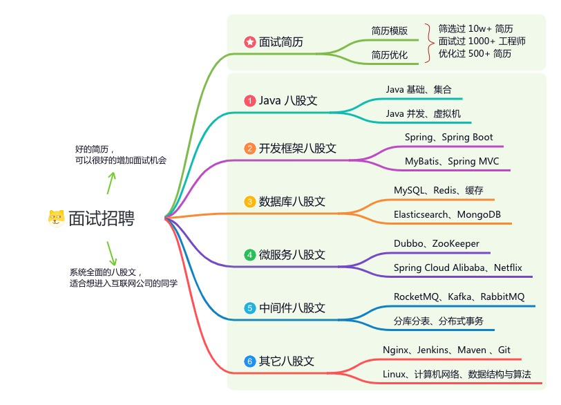
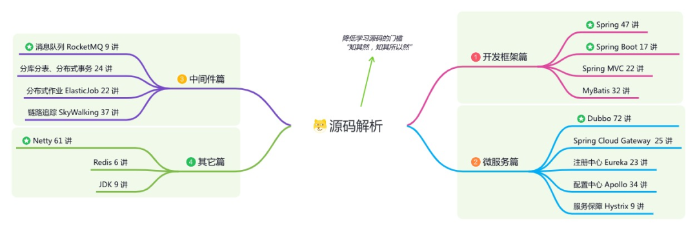

# 剪映开源替代 Star 15.4k

> 来源：Java基基
> 链接（原文）：https://mp.weixin.qq.com/s/myLYRTpqCSinChKJrDZOmQ
> 日期：2026-10-24
> 原始素材：`assets/capcut-open-source-alternative/`（original.html + 10 张图）

👉 这是一个或许对你有用的社群
🐱 一对一交流/面试小册/简历优化/求职解惑，欢迎加入「芋道快速开发平台」知识星球。下面是星球提供的部分资料： 
《项目实战（视频）》：从书中学，往事中“练”

《互联网高频面试题》：面朝简历学习，春暖花开

《架构 x 系统设计》：摧枯拉朽，掌控面试高频场景题

《精进 Java 学习指南》：系统学习，互联网主流技术栈

《必读 Java 源码专栏》：知其然，知其所以然

👉这是一个或许对你有用的开源项目
国产Star破10w的开源项目，前端包括管理后台、微信小程序，后端支持单体、微服务架构
RBAC权限、数据权限、SaaS多租户、商城、支付、审批工作流、大屏报表、ERP、CRM、WMS、MES、HRM、EAM、OA、FMS、PMS、AI大模型、AI工作流、AI Agent、IoT物联网、IM实时聊天等功能：
多模块：https://gitee.com/zhijiantianya/ruoyi-vue-pro

微服务：https://gitee.com/zhijiantianya/yudao-cloud

视频教程：https://doc.iocoder.cn

【国内首批】支持 JDK25 + SpringBoot4、JDK17/21+SpringBoot3、JDK8/11+Spring Boot2三版本 

QUOTE
它替代得了剪映的价格，替代不了剪映的省事。

会员墙弹出来那晚，很多人第一次去搜「剪映替代品」。搜索结果里会跳出一个 2012 年建库的老项目，Star 一万五千多，版本号 26.9.27。

它叫 Shotcut，仓库挂在 https://github.com/mltframework/shotcut 上。先把「开源替代」这四个字拆开，它替代掉的那部分跟你想的不太一样。

— Shotcut 仓库首页，Star 15.5k、Fork 1.5k、默认分支 master、GPL-3.0
本文看点
01
它在剪映出现之前就长成这样了

02
所有效果，最后都是一条滤镜

03
素材不用导入，拖进时间线就能剪

01
HISTORY
它在剪映出现之前就长成这样了

26.9.27 不是语义化版本号，读法是 2026 年 9 月 27 日。仓库 2012 年 4 月建库，比剪映早得多。

2026 年它发了四个版本，从 All the Small Things 一路到 Auto Duck and Adjustment Clip，主题全在编解码、色彩、音频与字幕上，没有一个叫一键成片。那句「功能全面且运行稳定」到今天还站得住。

ruoyi-vue-pro
基于 Spring Boot + MyBatis Plus + Vue & Element & Ant Design 实现的后台管理系统 + 用户小程序，RBAC权限、数据权限、SaaS多租户、商城、支付、审批工作流、大屏报表、ERP、CRM、WMS、MES、HRM、EAM、OA、FMS、PMS、AI大模型、AI工作流、AI Agent、IoT物联网、IM实时聊天等功能
项目地址：https://github.com/YunaiV/ruoyi-vue-pro
视频教程：https://doc.iocoder.cn/video/

02
FILTERS
所有效果，最后都是一条滤镜

属性面板里没有「文字」按钮，也没有「裁剪」工具。文字是 Text: Rich，裁剪是 Crop: Source，抠像是 Chroma Key: Advanced，防抖是 Stabilize，调色是 3-way color wheels 与 3D LUT，全部登记在 Video Filters 下面。

— 滤镜链示意，一段素材依次经过文字、裁剪、抠像、调色四层滤镜后合成输出
好处是统一，共用一套参数逻辑，都能打关键帧、存预设。

边界得说清楚。转场、轨道混合模式、导出预设不在滤镜里，走的是另外的入口。所谓几乎所有效果，就是几乎所有。

yudao-cloud
基于 Spring Cloud Alibaba + Gateway + Nacos + RocketMQ + Vue & Element & Ant Design 实现的后台管理系统 + 用户小程序，RBAC权限、数据权限、SaaS多租户、商城、支付、审批工作流、大屏报表、ERP、CRM、WMS、MES、HRM、EAM、OA、FMS、PMS、AI大模型、AI工作流、AI Agent、IoT物联网、IM聊天等功能
项目地址：https://github.com/YunaiV/yudao-cloud
视频教程：https://doc.iocoder.cn/video/

03
TIMELINE
素材不用导入，拖进时间线就能剪

多数剪辑软件都有「导入媒体」这一步，它把这步删了。素材拖进轨道就在时间线上，工程文件是一份 XML。

一个工程里可以混不同分辨率和帧率，帧精确跳转，4K 到 8K 都收。手机竖屏素材和相机横屏素材，不必先统一项目设置才能放在一起。

— Shotcut 主界面，左侧滤镜与属性面板，中部播放器，下方多轨时间线，右侧 Recent 列表与音频面板

04
PREVIEW
老机器也能跑，前提是别急着看成品

它承认硬件不够，把降级放在预览侧。代理编辑生成低分辨率副本给你剪，预览缩放压住播放窗口，导出才回到原始素材。卡的时候降的是眼前那一层，不是成片。

接 HDR 项目，它给的是 10-bit 端到端、HDR10 与 HLG、HDR 到 SDR 的色调映射，配合 GPU 16 位浮点。

05
INSTALL
三个系统，三种装法

官网 https://www.shotcut.org/ 的下载页把每条系统线的边界都写死了，商业软件很少这么坦白。

Windows 走 exe 或便携 zip，最低 Windows 10 build 1809，Win7 与 8 停在 22.12.21，ARM 有单独的包。macOS 走通用 dmg，主支持 12 到 27，11 停在 24.11.17。2013 年及更早的 Mac 迁到 Apple Metal 后可能预览偏色，建议退回 22.12.21。

Linux 选择最多，便携 tar 解压即用，AppImage 双击就跑，还有 Snap。

···bash
sudo snap install shotcut --classic

别想着自己编译。README 说这只适合 beta 测试者，依赖是 MLT、Qt 6.4 以上、FFmpeg 一整套，凑齐比装软件费事。

06
LIMITS
它缺的东西，正好是剪映最擅长的

模板市场、一键成片、移动端、云端协作，四样都没有。剪映的模板实质是把一串滤镜和素材打包成一个按钮，Shotcut 有叠层和预设，只是没人替你打包成卡点模板。

第一次打开会有点懵。可停靠面板、多套布局、可改快捷键，中文翻译官方注明不全。

还有一条容易忽略，许可证 GPL-3.0。自己用没问题，改一改再分发就得守传染性义务。

07
CHOICE
该换的和不该换的

三类人可以直接换。被会员墙和云端上传挡住的，手上有旧笔记本的，要处理 HDR 或多分辨率混剪的。

在意免费和跨平台的人，本来就是它设计的对象。习惯用滤镜做精细控制的，换过来最顺手。

两类人换了更累。靠模板和卡点过日子的，以及主要在手机上剪的。

它替代得了剪映的价格，替代不了剪映的省事。

END

欢迎加入我的知识星球，全面提升技术能力。
👉 加入方式，“长按”或“扫描”下方二维码噢：

星球的内容包括：项目实战、面试招聘、源码解析、学习路线。

文章有帮助的话，在看，转发吧。
谢谢支持哟 (*^__^*）
