# 从本体论到 Fabric Ontology

> 来源：Deon的学习小站
> 链接（原文）：https://mp.weixin.qq.com/s/Mwfqc1ij1lGF_x42sn_EzQ
> 日期：2026-09-15
> 原始素材：`assets/fabric-ontology-from-ontology/`（original.html + 19 张图）

一个两千年的哲学概念，怎样变成了数据平台里的一个按钮
关于这份文档
读者：有基本 IT 或数据背景，但没接触过本体、知识图谱、语义网。不需要会写 SPARQL，不需要懂描述逻辑。
读完应能
用自己的话解释"本体"是什么，并说清它和数据库 schema、和分类目录、和知识图谱分别差在哪；说出为什么大模型时代本体突然变重要，而不是笼统归因于"AI 火了"；画出 Fabric Ontology 的对象模型并说明每一层解决什么问题；判断一个业务问题该不该用本体解决，如果不该，说得出更合适的替代；在 Fabric 里独立建一个最小本体。
不覆盖：OWL 推理机的算法、描述逻辑的形式语义、SPARQL 语法教学、本体工程方法论的完整流程。这些在附录 D 给入口。
贯穿例子：一家连锁奶茶店的冷链断裂追责。一批奶茶变质，要回答"哪个环节坏的、还有哪些批次受影响、该通知哪些门店"。全文从第 1 章问出这个问题，到第 9 章在真实环境里把它建出来。
文中图片分三类身份，均在图注标明：官方原生图来自 Microsoft Learn 文档插图原件；界面截图是在真实 Fabric 环境中加载页面后截取的；自绘图与状态表为解释本文特定过程制作。
目录
第一篇 本体是什么

 1 一个 SQL 回答不好的问题
 1.1 冷链断裂：七类对象串起来的追问
 1.2 用 SQL 怎么做，代价在哪
 1.3 问题的本质：关系存在于哪里
 1.4 本体不解决什么

 2 本体这个词，从哲学到计算机
 2.1 哲学里的本体论：研究"存在什么"
 2.2 计算机科学借走了什么
 2.3 被误传的那句定义
 2.4 术语表、分类学、本体：逐级加了什么
 2.5 本体与数据库 schema 的根本差别
 2.6 手写一个最小本体

 3 语义网、知识图谱，以及它们留下了什么
 3.1 语义网要解决的问题
 3.2 RDF：把世界拆成三元组
 3.3 RDFS：让机器能推理
 3.4 OWL：更强的表达力，更贵的代价
 3.5 SPARQL：怎样查三元组
 3.6 语义网为什么没按原计划普及
 3.7 知识图谱的实用主义转向
 3.8 RDF 图与属性图：两条路线的分野

 4 为什么大模型让本体重新变重要
 4.1 LLM 面对企业数据的三种失败
 4.2 grounding：只给表结构为什么不够
 4.3 从回答问题到执行动作

第二篇 Fabric 怎样实现这些能力

 5 Fabric IQ：本体在产品里的落点
 6 对象模型：实体类型、属性、关系、实例
 7 数据绑定：语义层怎样接到真实数据
 8 查询：图、自然语言与 agent
 9 动手：把冷链本体建出来

第三篇 选型

 10 横向比较与什么时候不该用

附录 A 术语对照
附录 B 界面与操作速查
附录 C 证据清单与未验证范围
附录 D 进一步阅读
第一篇 本体是什么
1 一个 SQL 回答不好的问题
1.1 冷链断裂：七类对象串起来的追问
一家连锁奶茶店有 6 家门店。原料从中央工厂出发，装冷藏车配送到门店，卸进门店冷柜，最后做成饮品卖给顾客。
某天几家门店同时收到顾客投诉：奶茶有异味。
运营要回答三个问题：
这批货是在哪个环节坏的？ 可能是车上制冷坏了，也可能是门店冷柜超温，还可能是原料出厂就有问题。
还有哪些批次受影响？ 如果是某辆车的问题，那辆车当天送过的所有批次都要查。
该通知哪些门店？ 受影响批次送到了哪些门店，那些门店还有没有库存。
这三个问题牵扯七类对象：批次、运输车、门店、冷柜、温度读数、订单、投诉。
1.2 用 SQL 怎么做，代价在哪
这些数据都在数据库里。第一个问题可以这样查：
-- 找出投诉批次经过的车，以及那辆车当天的制冷状态
SELECT c.complaint_id, b.batch_id, t.truck_id, t.truck_cooling_ok
FROM complaint c
JOIN batch b ON c.complaint_batch_id = b.batch_id
JOIN truck t ON b.batch_truck_id = t.truck_id
WHERE c.complaint_created_at >='2026-09-04';
能查出来。但如果制冷是好的，就要换个方向查冷柜：
-- 换一条路：投诉门店的冷柜有没有超温
SELECT c.complaint_id, s.store_name, f.freezer_id,
MAX(tp.temp_c) AS max_temp
FROM complaint c
JOIN store s ON c.complaint_store_id = s.store_id
JOIN freezer f ON f.freezer_store_id = s.store_id
JOIN temperature tp ON tp.freezer_id = f.freezer_id
WHERE tp.ts BETWEEN'2026-09-01'AND'2026-09-04'
GROUPBY c.complaint_id, s.store_name, f.freezer_id
HAVINGMAX(tp.temp_c) >8;
再换个方向——"那辆车还送过哪些批次、去了哪些店"——又是一条新的 join 链。
每问一个新问题，就要重写一遍连接路径。
代价不在写 SQL 本身（这些语句都不难），而在三件事上：
第一，连接路径存在写查询的人脑子里。complaint.complaint_batch_id 能连到 batch.batch_id，这件事数据库不知道——除非建了外键，而分析库里外键常常是缺的。就算有外键，"为什么要这样连"也不在数据库里。
第二，同一个词在不同表里含义可能不同。batch.batch_store_id 是"这批货送到哪家店"；complaint.complaint_store_id 是"在哪家店被投诉的"。字段名长得像，语义不一样。新人接手时极易连错。
第三，换一个人或换一个工具就要重来。 市场部的分析师、外部顾问、或者一个 AI 助手，都拿不到你脑子里那张连接图。
1.3 问题的本质：关系存在于哪里
把上面三条抽象一下，核心是一句话：
对象之间的关系，存在于写查询的人脑子里，不存在于数据里。
数据库的表结构（schema）描述的是"这张表有哪些列、什么类型"，是存储格式的说明。它不描述"批次和运输车是什么关系、为什么会有这个关系、这个关系在业务上意味着什么"。
这不是数据库的缺陷——关系型模型本来就是为了高效存取设计的，不是为了表达业务语义。
本体要补的就是这一层。 它把"这些概念是什么、它们怎样连接、连接意味着什么"从人脑里搬到一个机器能读、人也能读、所有工具共享的地方。
1.4 本体不解决什么
在往下走之前，先把边界划清楚，避免后面产生不切实际的期待。
本体不修数据质量。 如果 batch_truck_id 里有一半是空的，建了本体它还是空的。本体让"应该有这个关系"变得明确，但不会凭空补出数据。
本体不让慢查询变快。 它是语义层，不是索引。查得慢的还是慢。
本体不替代数据建模。 星型模型、维度设计这些工作照做。本体在它们之上，不在它们之下。
本体有成本。 定义概念、绑数据、维护一致性都要人力。小问题用本体是杀鸡用牛刀——第 10 章会给判断标准。
理解检验：如果这家奶茶店只有 1 家门店、没有配送车、数据全在一张 Excel 里，还需要本体吗？为什么？
2 本体这个词，从哲学到计算机
2.1 哲学里的本体论：研究"存在什么"
"本体论"（ontology）这个词来自哲学，字面是"关于存在的学问"（希腊语 ónto- 存在 + -logía 学问）。
它问的问题听起来很虚，但其实非常具体：世界上到底存在哪些种类的东西？它们之间是什么关系？
举个生活化的例子。一把椅子存在，这没争议。那"椅子"这个类别存在吗？还是说世界上只有一把把具体的椅子，"椅子"只是我们贴的标签？再往下：一支球队存在吗？球队换光了所有队员之后，还是同一支球队吗？
这类追问在哲学里争了两千年。对我们来说，重点不是答案，而是它训练出来的那套提问方式：
•有哪些类别（椅子、球队、订单）
•每个类别有哪些本质属性（椅子有"可坐"，订单有"金额"）
•类别之间是什么关系（椅子 是一种 家具；订单 属于 顾客）
•什么条件下两个东西算同一个（换了所有队员还算同一支球队吗）
这四问，恰好就是后来计算机科学要的。
2.2 计算机科学借走了什么
上世纪八九十年代，人工智能研究者遇到一个麻烦：两个 AI 系统没法交换知识。
系统 A 内部把"父亲"表示成 father(X, Y)，系统 B 表示成 hasParent(Y, X, male)。它们说的是同一件事，但谁也读不懂谁。每做一个新系统，知识都要重新录一遍。
要解决这个问题，得先有一份双方都同意的、明确写下来的概念清单——有哪些概念、每个概念什么含义、彼此什么关系。
这正是哲学本体论在做的事，于是这个词被借了过来。
注意一个容易混的点：哲学里叫本体论（the study of being，一门学科，不可数）；计算机科学里叫一个本体（an ontology，一份具体的工件，可数，可以有很多个）。 中文都译作"本体"，英文靠冠词区分。本文提到 Fabric 的那个，永远是后者——一份可以打开、编辑、保存的东西。
2.3 被误传的那句定义
计算机科学里被引用最多的定义来自 Tom Gruber（斯坦福，1993）：
"An ontology is an explicit specification of a conceptualization."本体是对一个概念化的显式规约。 [8]
这句话很短，拆开看每个词都有分量：
conceptualization（概念化）——你对某个领域的抽象理解。"在冷链这件事里，重要的东西是批次、车、冷柜"，这就是一次概念化。它本来只在你脑子里。
specification（规约）——把它写下来，写成有确定形式的东西。
explicit（显式）——明确写出，不靠默契、不靠命名约定、不靠"大家都知道"。
这里有个流传极广的说法值得澄清。 你会在大量中英文资料里看到这样一句被称作"Gruber 的定义"：
"A formal, explicit specification of a shared conceptualization."
在 Gruber 本人的页面上，这个长版本并不存在。 他那一页引述自己 1993 年的工作时，用的是短版本——"explicit specification of a conceptualization"，并解释为"在某个关注领域中被假定存在的对象、概念和其他实体，以及它们之间成立的关系" [8]。
证据边界：formal 和 shared 这两个词的补充，学界通常归于 Studer 等人 1998 年的论文。但 Gruber 该页没有提及是谁加的，也没有引用 Studer [8]。本文只能确认"长版本不是 Gruber 原话"，不能从这个来源确认补充者是谁。
顺带一提，同一页上 Gruber 还给了另一个更工程化的说法：本体"定义了一组表示性原语，用以对某个知识或话语领域建模" [8]。页面也记录了对这个定义的批评——Smith 与 Welty 认为它过于宽泛 [8]。这个批评不是吹毛求疵：按 Gruber 的定义，一份数据库 schema 也能算本体，这正是 2.5 节要专门区分两者的原因。
回到那两个被补上的词。它们恰恰指向后面所有问题的来源：
•formal（形式化） 意味着要用有严格语义的语言写，机器才能推理。代价是学习成本和表达的僵硬。
•shared（共享） 意味着一份本体要多方认同才有价值。代价是达成一致极其困难——这是语义网后来受挫的主因之一（见 3.6）。
2.4 术语表、分类学、本体：逐级加了什么
这三个词常被混用，但它们的能力是逐级递增的。用图书馆打比方：
术语表（glossary） 相当于书末的名词解释。只告诉你"批次 = 同一次生产出来的一组产品"。只有名字和定义，没有结构。
分类学（taxonomy） 相当于图书馆的分类号体系。它加了一种关系：上下级。"冷藏车 是一种 运输车 是一种 车辆"。有了层级，你就能问"所有车辆"而自动包含冷藏车。
生活化的例子：超市货架。饮料 → 碳酸饮料 → 可乐。这就是分类学。它只有"属于哪一类"这一种关系。
本体（ontology） 加了任意类型的关系，外加约束。
除了"是一种"，还能表达"批次 由 运输车 配送"、"冷柜 位于 门店"、"一个批次只能属于一次生产"。
还用超市打比方：分类学只能说"可乐属于碳酸饮料"；本体还能说"可乐 由 某工厂 生产、陈列在 某货架、保质期 12 个月、一瓶可乐只能属于一个批次"。
一张对照表：

 | 术语表
 | 分类学
 | 本体
 | 
概念有名字和定义
 | ✅
 | ✅
 | ✅
 | 
概念有上下级层次
 | ❌
 | ✅
 | ✅
 | 
任意类型的关系
 | ❌
 | ❌
 | ✅
 | 
属性与数据类型
 | ❌
 | ❌
 | ✅
 | 
约束与规则
 | ❌
 | ❌
 | ✅
 | 
机器可推理
 | ❌
 | 有限
 | ✅
 | 

再往上还有一层：知识图谱。 但它和本体的关系不是"更强"，而是"不同层"——本体是定义，知识图谱是装满了真实数据的实例。3.7 节会展开。
2.5 本体与数据库 schema 的根本差别
这是实践中最该说清的一组对比，因为两者看起来很像：都定义"有哪些类型、每个类型有哪些字段"。
差别有四条：
第一，目的不同。 schema 服务于存储和存取效率——怎么放磁盘上最省、怎么查最快。本体服务于表达含义——这个概念在业务上是什么。所以 schema 会为了性能做反范式、拆表、加冗余列，本体不会。
第二，关系的地位不同。 在关系库里，关系是靠外键隐含的，而且外键只说"这两列的值要对得上"，不说这个连接叫什么、意味着什么。在本体里，关系是一等公民：它有名字（deliveredBy）、有方向、可以带自己的属性。
第三，作用域不同。 一个 schema 属于一个数据库。本体的目标是跨多个系统——一份本体可以同时绑定湖屋里的表、事件仓库里的流、以及 Power BI 里的语义模型。
第四，能不能推理。 schema 不推理。本体可以：如果定义了"冷藏车 是一种 车辆"，问"所有车辆"时，冷藏车自动被包含，不需要你在查询里写 UNION。
一句话记住：
schema 说的是"数据长什么样"，本体说的是"数据是什么意思"。
2.6 手写一个最小本体
不用任何工具，用大白话把冷链的本体写出来，大概是这样：
【实体类型】
 批次 Batch —— 一次生产出来的一组原料
 运输车 Truck —— 负责配送的冷藏车
 门店 Store —— 销售点
 冷柜 Freezer —— 门店里的冷藏设备

【属性】
 批次.生产时间 日期时间
 批次.产品名 文本
 运输车.车牌 文本
 运输车.制冷正常 布尔
 门店.城市 文本
 冷柜.型号 文本
 冷柜.温度 数值，随时间变化 ← 注意这条

【关系】
 批次 --由...配送--> 运输车 deliveredBy
 批次 --送达--> 门店 deliveredTo
 冷柜 --位于--> 门店 locatedIn

【约束】
 一个批次只能由一辆车配送
 一个冷柜只能位于一家门店
 批次的生产时间必须早于送达时间
这份东西比 ER 图多了什么？
多了三样：
1.关系有业务名字。 ER 图上是一条线加外键，这里是 deliveredBy——读的人立刻知道含义。
2.区分了静态属性和时序属性。 "冷柜型号"永远不变，"冷柜温度"每分钟都在变。这个区别在 ER 图里通常被拍平成两张表，在本体里是同一个概念的两类属性。第 7 章会看到 Fabric 就是这么做的。
3.约束是声明出来的。 不是靠应用代码保证，而是写在模型里。
理解检验：上面的本体里，"投诉"应该是一个实体类型，还是门店的一个属性？你的判断依据是什么？
3 语义网、知识图谱，以及它们留下了什么
这一章讲的是本体最完整的一次工业化尝试。它没有按原计划成功，但今天所有本体产品——包括 Fabric 的——都站在它留下的概念上。
3.1 语义网要解决的问题
2001 年，万维网的发明者 Tim Berners-Lee 提出了"语义网"（Semantic Web）。
他要解决的问题用一句话讲：网页是给人看的，机器读不懂。
一个网页上写着"《蒙娜丽莎》由达·芬奇创作"。人一眼就懂。但对浏览器来说，这只是一串字符 
《蒙娜丽莎》由达·芬奇创作
。它不知道"蒙娜丽莎"是一幅画、"达·芬奇"是一个人、"创作"是两者之间的关系。
于是你没法问机器："列出所有 16 世纪意大利画家创作的、现藏于巴黎的画作。"
语义网的构想：在网页的文字之外，再附一层机器能读的结构化事实。这样整个互联网就变成一个巨大的、可查询的数据库。
要做到这一点，需要三样东西：一种表达事实的格式（RDF）、一种定义概念的语言（RDFS/OWL）、一种查询的方式（SPARQL）。
3.2 RDF：把世界拆成三元组
RDF（Resource Description Framework，资源描述框架）的核心想法极其简单：
任何事实都可以拆成"主语—谓语—宾语"三段。
W3C 的原文是："一条 RDF 陈述表达两个资源之间的关系"，其中主语和宾语是相关的两个资源，谓语给这个关系命名；这个关系"以有方向的方式表述（从主语到宾语），在 RDF 中称为属性（property）"。因为陈述由三个元素组成，"它们被称为三元组（triples）" [7]。
写出来就是：
<主语> <谓语> <宾语>
用冷链的例子：
<批次B007> <由...配送> <运输车T02>
<运输车T02> <制冷正常> <否>
<批次B007> <送达> <门店S03>
为什么这么设计？
因为三元组可以无限拼接成网。同一个资源在一条三元组里当宾语，在另一条里当主语，两条就连起来了。W3C 把这一点称为"RDF 威力的重要组成部分" [7]。
画出来就是一张图：节点是主语和宾语，箭头是谓语。
 由...配送 制冷正常
批次B007 ─────────→ 运输车T02 ─────────→ 否
 │
 │ 送达
 ↓
门店S03
看出来了吗——这就是第 1 章那些 join 链的图形版本。 区别在于：SQL 里连接路径写在查询里，这里连接本身就是数据。
RDF 还规定了几个细节，理解它们有助于看懂后面的取舍：
IRI（International Resource Identifier，国际化资源标识符）。每个资源用一个全局唯一的标识符指代，长得像网址。W3C 特别强调 IRI"可以出现在三元组的全部三个位置"，而且是全局的——"任何人都可以复用它来表示同一件事" [7]。
这是语义网最激进的设计：如果全世界都用同一个 IRI 指代达·芬奇，那么任何人发布的关于他的事实都能自动合并。
<http://dbpedia.org/resource/Leonardo_da_Vinci>
字面量（literal）。不是 IRI 的基本值：字符串、日期、数字。带数据类型，字符串还可以带语言标签。关键限制：字面量只能出现在宾语位置 [7]。
<批次B007> <生产时间> "2026-09-01T09:00:00"^^xsd:dateTime
空白节点（blank node）。有时你想说"存在某个东西"，但不想给它起全局名字。W3C 给了个好比方："空白节点就像代数里的简单变量，它们表示某个东西，但不说这个东西的值是什么" [7]。
命名图（named graph）。把一组三元组打包并贴标签。"一个 RDF 文档里的多个图构成一个 RDF 数据集"，"一个数据集可以有多个命名图，以及至多一个未命名的（默认）图" [7]。用途是标记来源——这批事实来自供应商，那批来自自己的系统。
3.3 RDFS：让机器能推理
光有三元组还不够。你可以写下一万条事实，但机器仍然不知道"运输车"是一个类别、"制冷正常"这个属性只能用在车上。
RDFS（RDF Schema）补的就是这一层。按 W3C 的说法，"这个语言允许人们定义 RDF 数据的语义特征" [7]。
它引入七个核心构件 [7]：
构件
 | 作用
 | 冷链例子
 | 
rdfs:Class | 声明一个类别
 | 运输车是一个类
 | 
rdf:Property | 声明一个属性
 | "由…配送"是一个属性
 | 
rdf:type | 某实例属于某类
 | T02 是 运输车
 | 
rdfs:subClassOf | 类的上下级
 | 冷藏车 是 运输车 的子类
 | 
rdfs:subPropertyOf | 属性的上下级
 | "冷链配送" 是 "配送" 的子属性
 | 
rdfs:domain | 属性的主语必须属于哪个类
 | "由…配送" 的主语必须是 批次
 | 
rdfs:range | 属性的宾语必须属于哪个类
 | "由…配送" 的宾语必须是 运输车
 | 

最关键的收益是推理。 W3C 给的例子是：已知 Bob 认识 Alice，且 foaf:knows 这个属性的 domain 是 foaf:Person，推理机就能推出 Bob 是一个 Person [7]——这条事实没人写过，是算出来的。
换成冷链：
已知： <批次B007> <由...配送> <T02>
已知： "由...配送" 的 rdfs:range 是 运输车
推出： <T02> rdf:type <运输车> ← 没人写过这条
再加上子类关系：
已知： <冷藏车> rdfs:subClassOf <运输车>
已知： <T02> rdf:type <冷藏车>
推出： <T02> rdf:type <运输车>
于是查"所有运输车"时，T02 自动被包含——不需要在查询里写 UNION，也不需要提前把数据展平。 这就是 2.5 节说的"本体能推理，schema 不能"的具体含义。
这里有个值得知道的怪癖：RDFS 对建模非常宽松。W3C 明确写道，"'类'的世界和'实例'的世界之间没有严格分界" [7]——所以 ex:Elephant 可以既是一个动物类别，同时又是 ex:Species（物种）这个类的一个实例。
这种灵活性在哲学上很漂亮，在工程上是麻烦的根源：你很难判断一个东西到底该建成类还是实例。后来的工业产品（包括 Fabric）几乎都放弃了这种灵活性，强制区分"类型"和"实例"。
3.4 OWL：更强的表达力，更贵的代价
RDFS 能表达的约束还是太弱。它说不了"一个批次只能由一辆车配送"、"两个 IRI 指的是同一个东西"、"这两个类互不相交"。
OWL（Web Ontology Language）补这些。W3C 的定位是给那些"希望对 RDF 数据做更全面语义建模"的用户；并且"OWL 是一个 RDF 词汇表，所以它可以和 RDF Schema 结合使用" [7]——两者是叠加关系，不是竞争关系。
最常用的一个构件是 owl:sameAs，它声明两个不同的 IRI 指向同一个资源 [7]：
<http://dbpedia.org/resource/Leonardo_da_Vinci>
 owl:sameAs <http://viaf.org/viaf/24604287/> .
为什么需要它？因为现实是各家机构各自造标识符。DBpedia 有自己的达·芬奇 IRI，图书馆联合目录有另一个。owl:sameAs 把它们粘起来，软件就能合并两边的数据。
换到企业里，这个问题一模一样：CRM 里的客户 ID、ERP 里的客户编码、客服系统里的会员号，指的是同一个人。主数据管理（MDM）折腾几十年的事，本质上就是 owl:sameAs。
OWL 还能表达基数（"恰好一个"）、互斥类、传递性关系（"A 是 B 的一部分、B 是 C 的一部分，则 A 是 C 的一部分"）等等。
代价是复杂度。 OWL 有多个方言（OWL Lite / DL / Full），表达力越强，推理越慢，甚至可能不可判定。写一份正确的 OWL 本体需要专门训练——这是它难以普及的直接原因之一。
3.5 SPARQL：怎样查三元组
有了数据和模式，还需要查询语言。SPARQL 的核心想法同样简单：
写一个带"空位"的三元组模式，让引擎去数据里找能填满空位的组合。
空位用 ?变量 表示。查"哪些批次由制冷故障的车配送"：
SELECT ?batch ?truck
WHERE {
 ?batch :deliveredBy ?truck .
 ?truck :coolingOk false .
}
读作："找出所有满足这两条的 ?batch 和 ?truck——批次由某辆车配送，且那辆车制冷不正常。"
和 SQL 的根本差别在这里：SQL 里你要写 FROM batch JOIN truck ON ...，明确指出从哪张表连到哪张表；SPARQL 里你只写事实的形状，引擎自己去图上找路径。
多跳查询的差别更明显。"投诉 → 批次 → 车 → 制冷状态"这条链，SQL 要写三个 JOIN；SPARQL 只是多写两行三元组模式：
SELECT ?complaint ?truck
WHERE {
 ?complaint :aboutBatch ?batch .
 ?batch :deliveredBy ?truck .
 ?truck :coolingOk false .
}
这就是 1.2 节那个痛点的正面解答。 连接路径不再写在查询里，而是本来就在数据里。
3.6 语义网为什么没按原计划普及
二十多年过去，互联网并没有变成一个巨大的 RDF 数据库。原因值得认真看，因为同样的坑今天仍在。
第一，"shared"（共享）太难了。 回到 2.3 节那个补充的词——一份本体要多方认同才有价值。可是让全世界对"什么是一个客户"达成一致？各家的业务定义本来就不同，而且不同是有商业理由的。
第二，标注成本没有回报。 给网页加 RDF 标注要花人力，好处却归于"整个生态"，而不是标注者自己。经济学上这叫正外部性，典型结果就是没人做。
第三，数据质量与恶意标注。 开放网络上，标注可以是错的，也可以是故意误导的（为 SEO 骗流量）。推理机遇到脏数据会把错误放大。
第四，学习门槛高。 RDF/OWL/SPARQL 是一整套新概念，对已经会 SQL 的工程师来说投入产出比不划算。
但有相当一部分活了下来，而且活得很好：
活下来的
 | 在哪里用
 | 
schema.org 标注 | 几乎所有网站都在用。搜索结果里的星级评分、菜谱时长、活动时间，都来自它
 | 
受控词表与本体 | 医学（SNOMED CT）、生命科学（Gene Ontology）、金融（FIBO）、图书馆（MARC）
 | 
三元组的思想 | 被知识图谱完整继承
 | 
推理的思想 | 被今天所有本体产品继承
 | 
sameAs 式的实体对齐 | 成了主数据管理的理论基础
 | 

规律很清楚：语义网在边界清晰、有权威机构、协作有强激励的领域成功了（医学术语必须统一，否则要出人命）；在开放、无权威、激励错配的领域失败了。
这条规律直接适用于企业本体。 一个公司内部有权威（管理层可以拍板"客户就这么定义"）、边界清晰（就这一家公司）、激励一致（大家都想把数据用好）。所以本体在企业里比在开放互联网上更容易成功——这也是 Palantir、Fabric IQ 这类产品的立足点。
3.7 知识图谱的实用主义转向
2012 年，Google 发布"知识图谱"（Knowledge Graph），搜索结果右侧开始出现人物、地点、电影的信息卡片。
技术上它和语义网同源，但做了几个实用主义的妥协：

 | 语义网的理想
 | 知识图谱的做法
 | 
范围
 | 整个互联网
 | 自己控制的一个图
 | 
谁来标注
 | 网站作者
 | 自己抽取 + 自己校验
 | 
正确性
 | 靠推理保证
 | 靠数据质量流程保证
 | 
标准
 | 严格 RDF/OWL
 | 够用就行，内部格式也可以
 | 
推理
 | 完整的逻辑推理
 | 有限的、可控的规则
 | 

核心转变：从"让全世界协作"退回到"我自己建一个高质量的图"。 放弃了理想主义的开放性，换来了可控性和可用性。
这一步之后，"知识图谱"成了工业界的主流说法，"语义网"退回学术圈。
本体和知识图谱的关系，到这里可以说清了：
本体是定义（schema 层）：有哪些类型、哪些关系、哪些约束。知识图谱是实例（data 层）：装满了真实数据的那张图。
用面向对象打比方：本体是类定义，知识图谱是对象实例。用数据库打比方：本体是表结构，知识图谱是表里的行。
一张没有本体的图会怎样？技术上能跑，但边的含义没人说得清——A --rel--> B 里 rel 到底是什么、能不能传递、能不能有多条，全靠猜。图能存关系，但只有本体能定义关系的含义。
记住这一句，第 5 章会看到 Fabric 恰好就是这样分工的。
3.8 RDF 图与属性图：两条路线的分野
工业界在"怎么存这张图"上分成了两派，这个分歧至今存在，而且直接决定了 Fabric 的技术选择。
RDF 图（三元组图）：一切都是三元组。要给关系加属性？得再造一个节点。
比如想表达"这次配送是 9 月 1 日完成的"——配送 是关系，9月1日 是这个关系的属性。RDF 里没法直接挂，只能把关系具体化（reification）成一个节点：
<配送事件E1> <涉及批次> <B007>
<配送事件E1> <涉及车辆> <T02>
<配送事件E1> <完成时间> "2026-09-01"
一条直观的边，变成了三条三元组加一个人造节点。
属性图（labeled property graph，LPG）：节点和边都可以直接带属性。
(批次B007) -[配送 {完成时间: "2026-09-01"}]-> (运输车T02)
一条边搞定。
对照表：

 | RDF 图
 | 属性图
 | 
边能否直接带属性
 | 不能，要具体化
 | 能 | 
全局标识符
 | IRI，天然支持跨库合并
 | 通常是局部 ID
 | 
标准化程度
 | W3C 标准，很完整
 | 长期各家方言不同
 | 
推理能力
 | 强（RDFS/OWL）
 | 弱，通常靠应用层
 | 
上手难度
 | 高
 | 低
 | 
典型代表
 | 学术、医疗、政府开放数据
 | Neo4j 等图数据库，多数商业产品
 | 

工业界大体选了属性图，因为它更贴近开发者的直觉（就像带属性的对象和链接），而跨组织合并数据的需求在企业内部并不强烈。
而标准化后来以另一种方式回来了。 2024 年，GQL（Graph Query Language）成为 ISO/IEC 39075 国际标准——这是继 SQL 之后，ISO 批准的第二个数据库查询语言标准，服务的正是属性图。
记住这个分叉点。 第 5 章你会看到：Fabric 选的是属性图 + GQL，不是 RDF + SPARQL。这不是随意的选择，而是站在上面这段历史的哪一边。
理解检验：如果奶茶店要和上游供应商、下游外卖平台交换冷链数据，三家的系统各自独立。RDF 路线和属性图路线，哪个更合适？为什么？
4 为什么大模型让本体重新变重要
本体这个概念冷了十几年，2023 年之后突然又热起来。原因不是"AI 火了所以什么都热"，而是 LLM 暴露了一个具体的、老办法解决不了的问题。
4.1 LLM 面对企业数据的三种失败
设想你把奶茶店的数据库接给一个 AI 助手，然后问它："上周哪些门店受冷链问题影响？"
失败一：术语歧义。
数据库里有 batch_store_id 和 complaint_store_id。模型看到两个都带 store_id，很可能随手选一个，或者把两个连起来。
它不知道前者是"送到哪家店"，后者是"在哪家店被投诉"。字段名相似，语义相反。
人类新人也会犯这个错——区别是人会去问老同事，模型不会问，它会直接给你一个看起来很像样的答案。
失败二：关系臆测。
模型不知道 batch 和 truck 该怎么连。它会猜：也许 batch.truck_id = truck.id？也许要经过一张中间表？
猜对了皆大欢喜，猜错了你拿到一个语法正确、结果错误的查询。而且它不会告诉你它在猜。
失败三：无法解释。
就算答对了，你问"你怎么得出这个结论的"，它只能复述 SQL。它说不出"因为投诉指向批次，批次由 T02 配送，T02 当天制冷故障"这条业务推理链——因为这条链从来没写在任何地方。
这三种失败的共同根源：模型拿到的是表结构，不是业务含义。表结构里没有"送到"和"被投诉"的区别，没有连接路径，没有推理链。
4.2 grounding：只给表结构为什么不够
"grounding"（接地/锚定）指把模型的输出约束在可验证的事实上。
常见做法是把表结构塞进提示词：
你可以访问这些表：
batch(batch_id, batch_product, batch_produced_at, batch_truck_id, batch_store_id)
truck(truck_id, truck_plate, truck_driver, truck_cooling_ok)
complaint(complaint_id, complaint_store_id, complaint_batch_id, complaint_created_at)
...
这确实有用，但它提供的信息有明确的上限。 对照来看：
模型需要知道的
 | 表结构提供了吗
 | 本体提供了吗
 | 
有哪些表/列
 | ✅
 | ✅
 | 
列的数据类型
 | ✅
 | ✅
 | 
batch_store_id 在业务上是什么意思
 | ❌
 | ✅ 属性描述
 | 
batch 和 truck 怎样连接
 | ❌（除非有外键）
 | ✅ 关系是一等公民
 | 
这个连接在业务上叫什么
 | ❌
 | ✅ deliveredBy
 | 
"运输车"和"冷藏车"是什么关系
 | ❌
 | ✅ 类型层级
 | 
一个批次能不能有两辆车
 | ❌
 | ✅ 约束
 | 
同义词（"车"="运输车"="配送车"）
 | ❌
 | ✅ 同义词字段
 | 

多出来的这些，正好就是 4.1 里三种失败对应的东西。
还有一点容易被忽略：本体是人审过的。表结构是数据库自己长出来的，没人保证它反映业务；本体是有人坐下来定义、评审、维护的。模型基于它推理，等于站在人类已经达成的共识上。
一个直白的类比：给新来的分析师一份数据字典（表结构），和给他一份带业务解释和关系图的领域说明书（本体），产出质量的差距是数量级的。对模型也一样。
4.3 从回答问题到执行动作
还有一层，比查询更进一步。
企业真正想要的不止"告诉我哪些门店受影响"，而是"通知那些门店下架相关批次"。这要求 agent 能执行动作。
要安全地执行动作，agent 需要知道三件事：
有哪些动作可用。 不能让它自由发挥去改数据库，得有一份明确的动作清单——"下架批次"、"通知门店"、"创建召回单"。
动作的前提条件。 "下架批次"需要哪些参数，什么情况下允许执行。
执行的后果。 动作会改变哪些对象的状态。
这三件事本质上仍然是本体的一部分——只不过从"静态的概念和关系"扩展到了"可执行的行为"。
这正是 Palantir 给自家本体的定位：它包含语义元素（objects、properties、links）和动力学元素（actions、functions、dynamic security），整体被称为"组织的数字孪生" [9]。第 10 章会展开比较。
一句话收束这一章：
过去本体是为了让不同系统互相理解；现在本体是为了让 AI 理解你的业务。需求从"系统间互操作"变成了"人机之间的共识"，但需要的东西是同一样。
理解检验：如果不建本体，只是把每张表、每个字段都写上详细的中文注释，能不能达到同样效果？哪些能达到，哪些不能？
第二篇 Fabric 怎样实现这些能力
5 Fabric IQ：本体在产品里的落点
5.1 先定位：它在整个产品里的哪一层
Fabric Ontology 不是一个孤立功能，它属于一个叫 Fabric IQ 的工作负载。
而 Fabric IQ 又属于微软更大的 Microsoft IQ 框架——按官方描述，这是"一个上下文引擎，把你组织的知识、数据和工作流统一起来" [1]。它分四块：

 | 提供什么上下文
 | 
Work IQ | 工作中的上下文：邮件、会议、文档、协作
 | 
Foundry IQ | 构建 AI 应用时的上下文
 | 
Web IQ | 公开网络的上下文
 | 
Fabric IQ | 企业数据与业务语义的上下文 | 

Fabric IQ 要解决的问题，官方说得很直白：
"组织在表和 schema 的层面处理数据，这些结构是为机器而建的，不是为含义而建的。然而组织运转依靠的是业务概念——客户、货运、资产。" [1]
这句话就是第 1 章那个痛点的官方版本。
5.2 三层结构
Fabric IQ 自身分三层 [1]：
┌─────────────────────────────────────────────┐
│ 运营智能层 本体 Ontology │ ← 业务概念、关系、规则、动作
│ 面向跨域推理与 agent │
├─────────────────────────────────────────────┤
│ 商业智能层 Power BI 语义模型 │ ← 指标、度量、口径
│ 面向分析与报表 │
├─────────────────────────────────────────────┤
│ 统一数据层 OneLake │ ← 数据本身
│ 面向存储 │
└─────────────────────────────────────────────┘
这三层的分工值得琢磨。
统一数据层解决"数据在哪"。商业智能层解决"指标怎么算"——它已经是一层语义了，但它的语义是面向分析的：销售额怎么定义、同比怎么算。
运营智能层解决的是另一类问题：这些东西在现实世界里是什么、怎样连接、能对它们做什么。它面向的不是报表，而是跨域追问和 agent。
回到冷链例子：语义模型能回答"上周各门店销售额"；本体要回答"这批货在哪坏的、还影响谁"。后者不是一个聚合问题，是一个遍历问题。
5.3 六个 Item 的分工
Fabric IQ 工作负载下有六类 Item [1]：
Item
 | 职责
 | 
本体 Ontology | 定义业务概念、关系、规则
 | 
Power BI 语义模型 | 定义指标口径（同时属于 Power BI 工作负载）
 | 
图 Graph | 存储和遍历实例之间的连接
 | 
计划 Planning | 基于语义模型和本体做带写回的规划
 | 
数据代理 Data agent | 用自然语言问数据
 | 
操作代理 Operations agent | 监控运行状况并触发动作
 | 

其中本体和图的关系，官方有一句概括得极准的话：
"Ontology declares what connects and why. Graph stores and traverses those connections."本体声明什么相连、为什么相连；图存储并遍历这些连接。 [1]
这正是 3.7 节讲的"本体是定义、知识图谱是实例"在产品里的落地。 概念上的分工，在 Fabric 里变成了两个不同的 Item。
5.4 一个实测发现：建本体会生出三个 Item
上面那句话不只是概念描述，它在物理结构上是真的。
在真实环境里用 REST API 创建一个名为 ont_lengliang 的本体后，工作区里出现的不是一个 Item，而是三个：
Lakehouse ont_lengliang_lh_<guid> ← 存实体实例数据
SQLEndpoint ont_lengliang_lh_<guid> ← 湖屋自带
GraphModel ont_lengliang_graph_<guid> ← 存图
而本体自身不出现在通用 Item 列表里（预览类型尚未在该 API 中上架）。
这个结构说明了几件事：
本体不是独立的存储。 它是一层声明，实例数据落在自动生成的湖屋里，连接关系落在 GraphModel 里。
你的数据不会被搬走。 绑定源表仍在原处（见第 7 章），本体只是引用。
那个自动生成的湖屋是可见的。 在 OneLake 目录里能看到它，甚至能在选表器里选中它——这解释了为什么后面绑定数据时列表里会多出一个奇怪的湖屋名。
5.5 技术路线：属性图 + GQL，不是 RDF
第 3.8 节留了个伏笔，这里揭晓。
Fabric 的图采用带标签的属性图（labeled property graph）模型，查询语言是 GQL——即 2024 年成为 ISO/IEC 39075 国际标准的那个图查询语言 [6]。
不是 RDF，不是 SPARQL。
把第 3.8 节的对照表拿来对号入座：

 | Fabric 的选择
 | 意味着
 | 
图模型
 | 属性图
 | 边可以直接带属性，不用具体化
 | 
查询语言
 | GQL（ISO 标准）
 | 标准化，但不是 W3C 那一套
 | 
全局标识符
 | 局部 ID
 | 跨组织合并数据不是设计目标
 | 
推理
 | 有限，靠规则
 | 不做 OWL 式的完整逻辑推理
 | 
类型/实例分界
 | 严格区分 | 不允许 RDFS 那种"类同时是实例"
 | 

这些选择整体指向一个判断：Fabric 的本体是为"一个组织内部"设计的，不是为"跨组织开放协作"设计的。
对照 3.6 节那条规律——本体在有权威、边界清晰、激励一致的场景里成功。微软选的正是那个成功的场景。 这是一个清醒的产品决策，不是技术上的偷懒。
理解检验：如果你的需求是和三家外部供应商交换冷链数据，各家系统独立。基于 5.5，Fabric Ontology 适合吗？如果不适合，第 3 章提到的哪条路线更合适？
6 对象模型：实体类型、属性、关系、实例
这一章讲 Fabric Ontology 的四个核心概念。它们和第 2、3 章的通用概念一一对应，但有 Fabric 自己的约束。
6.1 实体类型：概念的模板
实体类型（entity type）是现实世界某个概念的可复用逻辑模型——比如"货运"、"产品"、"传感器" [2]。
官方对它的定位说得很清楚：它"标准化了该事物的名称、描述、标识符、属性和约束，使得业务里每个团队用'货运'这个词时指的是同一件事"；并且"通过把概念提升到任何单张表之上，实体类型消除了跨数据源互相冲突的列级定义" [2]。
"提升到任何单张表之上"是关键。 实体类型不等于表：
•一个实体类型可以绑定多张表（静态一张 + 时序多张，见第 7 章）
•一张表也不一定对应一个实体类型
•实体类型有表没有的东西：同义词、描述、约束
用第 2 章的话说：实体类型是"类定义"，表是"存储"。
在编辑器里，实体类型显示为画布上的一个节点：
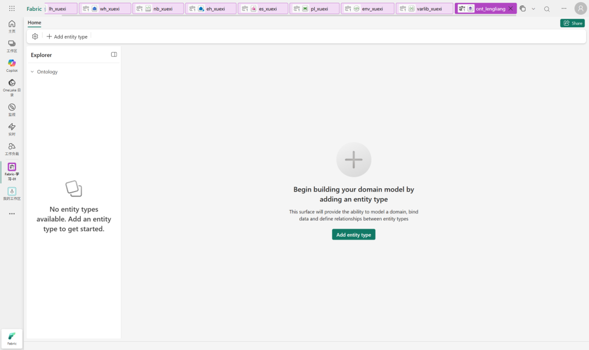图 6-1　界面截图。空本体的初始状态，提示"No entity types available"。
读图提示：先看左侧 Explorer 面板——这是本体的目录树，根节点是 Ontology，下面挂实体类型。再看功能区只有 Add entity type 一个可用按钮：本体的第一步必然是定义概念，这个 UI 设计本身就在表达方法论。
创建实体类型的对话框极简：
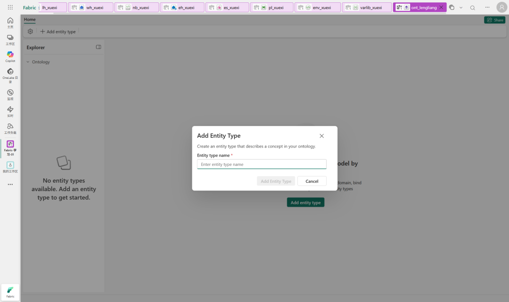图 6-2　界面截图。只需一个名称。
注意它只要一个名字。 属性不在这里填——因为 Fabric 的默认路径是从数据反推属性（第 7 章），而不是先手写一堆属性再去找数据。这个顺序反映了产品的立场：本体要接地，不要悬空。
6.2 实体类型键：唯一性从哪来
每个实体类型必须有一个实体类型键（entity type key）——一个或一组属性，其值能唯一标识每个实例。
官方对它的解释是："键是一个唯一标识属性或属性序列，我们用它来可靠地把你的下游数据连接到这个实体类型。你选择属性的顺序就是它被读取的顺序。"
这一条是硬性的，而且是最容易踩的坑。 第 9 章会看到：没有定义键时，绑定根本保存不了，而且失败提示很容易被忽略。
键的类型受限：只能是 string 或 integer [4]。所以如果你的业务主键是 GUID 或复合日期，需要先在 ETL 阶段转成受支持的类型。
6.3 属性：静态与时序
属性（property）是关于实体的一个具名事实，带声明的数据类型 [2]。
Fabric 把属性分成两类，这个区分很重要：

 | 静态属性
 | 时序属性
 | 
例子
 | 冷柜型号、门店城市
 | 冷柜温度、传感器读数
 | 
变化频率
 | 基本不变
 | 持续变化
 | 
数据来源
 | OneLake（湖屋表）
 | OneLake 或事件仓库
 | 
每个实体类型能绑几个
 | 只能一个 | 可以多个 | 

"静态绑定只能有一个"是个硬限制 [5]——你不能把一个实体类型的静态属性拆到两张表里再合并。需要合并就先在 ETL 里做好。
时序数据还有格式要求：必须是列式的，即"一张表，每个带时间戳的观测占一行，列里放时间戳和属性值（如温度或压力）" [4]。
这个区分回应了第 2.6 节手写本体时那个观察：ER 图会把"冷柜型号"和"冷柜温度"拍平成两张表，本体把它们当作同一个概念的两类属性。Fabric 是少数在产品层面显式区分这两者的实现。
属性命名有严格约束 [4]：
•长度 1–26 个字符
•只能是字母数字、连字符、下划线
•必须以字母数字开头和结尾
•名称在所有实体类型之间必须唯一
最后一条尤其反直觉：你不能让 Store 和 Truck 都有一个叫 name 的属性。必须叫 store_name 和 truck_name。
这条约束其实暴露了 Fabric 本体的一个设计取舍：属性名是全局命名空间，不是挂在类型下的局部名。这简化了下游引用（一个名字全局唯一），代价是建模时要自己做前缀管理。RDF 用 IRI 解决同名问题，Fabric 用"你自己起不同的名"解决。
6.4 关系：有名字、有方向
关系（relationship）是实体类型或实例之间带类型、带方向的链接 [2]。
按官方描述，关系"可以带属性（如距离、置信度、生效时间）和基数规则（例如一个客户有多个订单）"；它们"让上下文变得显式且可复用，支持遍历、依赖分析、基于规则的推断，从而在不写自定义 join 逻辑的情况下更清楚地回答业务问题" [2]。
"不写自定义 join 逻辑"——这就是第 1.2 节痛点的正面回答。
创建关系需要三样：名称、起点实体类型、终点实体类型。
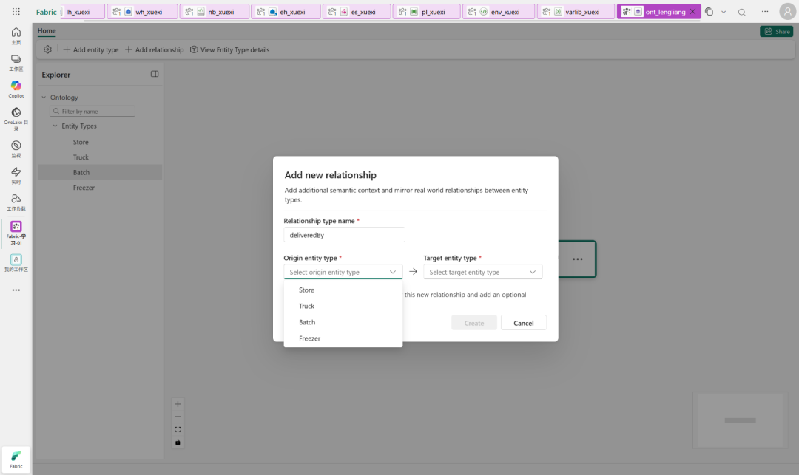图 6-3　界面截图。展开的实体类型下拉，可选 Store / Truck / Batch / Freezer。
读图提示：注意对话框底部那行小字——Next: You'll refine the data definition for this new relationship and add an optional mapping table.关系的定义分两步：先声明"谁连谁"（语义），再定义"怎么连"（数据）。第二步可以挂一张映射表，用于多对多关系。
一个重要的对比。 在关系数据库里，关系是靠外键隐含的，且只有"值要对得上"这一层含义。在这里，关系有名字（deliveredBy）、有方向（从 Batch 指向 Truck）、可以带自己的属性。
这就是 2.5 节说的"关系是一等公民"的具体样子。
6.5 实例与本体图
实体实例（entity instance）是实体类型的一个具体出现，由数据绑定填充 [2]。
实例"会记录是哪个来源创建了它们、在什么时间为真，并且可以参与关系"。官方对它的作用有一句好总结："实体实例把你的原始数据变成标准化的业务对象，让所有工具和 AI agent 以同样的方式理解它们" [2]。
所有实例和它们的连接构成本体图（ontology graph）——一个"由数据绑定和关系定义构建出来的可查询实例图"，由 Fabric 的 Graph 提供 [2]。图中"节点是实体实例，边是链接（断言的或推导的），带元数据属性" [2]。
这里必须记住一条限制：
上游数据源的更新（比如新增的行）需要手动刷新，才会在本体里可见。 [2][4]
这不是实时同步。本体图是物化的，不是视图。做方案时这一条会直接影响时效性设计。
完整的本体长这样：
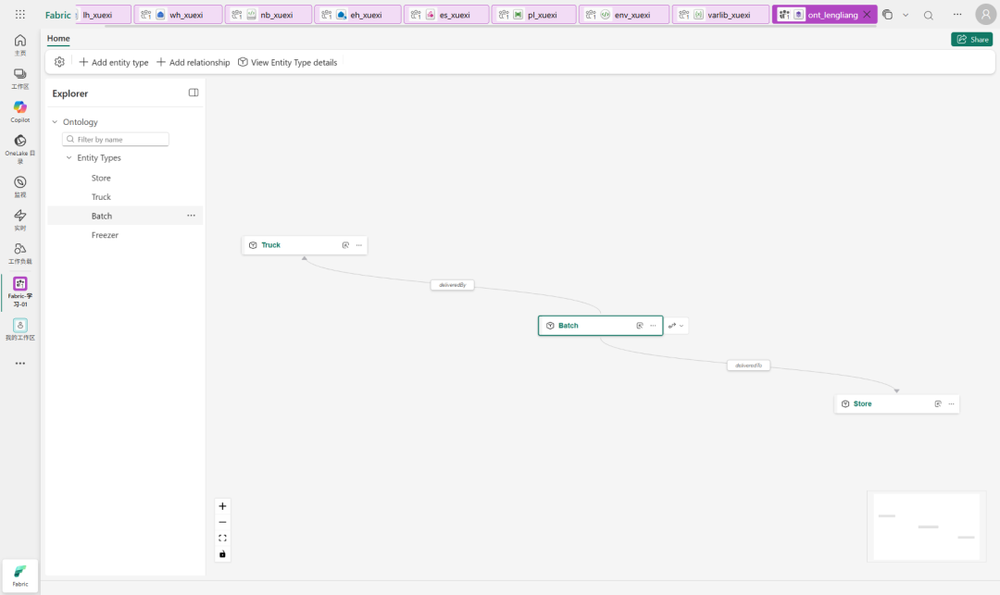图 6-4　界面截图。画布上 Truck ←deliveredBy— Batch —deliveredTo→ Store。
读图提示：先看中间的 Batch 节点（绿色高亮为当前选中），两条曲线分别指向左上的 Truck 和右下的 Store，边上的标签就是关系名。再看左侧 Explorer 树——四个实体类型平铺，关系不在树里，它们只在画布上表现为边。最后看左下角的 zoom / fit view / 锁定控件，图大了之后要靠它们导航。
把这张图和第 1.2 节的 SQL 对照看：那三段 join 里隐含的连接路径，现在变成了画布上两条有名字的线。这就是本体做的全部事情——把关系从查询里搬到数据里。
理解检验：如果要表达"某次配送的完成时间"，这个信息应该放在哪？Batch 的属性、Truck 的属性，还是 deliveredBy 关系的属性？为什么？
7 数据绑定：语义层怎样接到真实数据
第 6 章定义的都是"概念"。这一章讲怎么让概念长出真实数据。
7.1 绑定要解决的问题
数据绑定（data binding）把实体类型、关系、属性的 schema 连接到驱动业务运转的具体数据源 [4]。
官方列了三条收益 [4]：
•把数据集成进语义层，而不复制源数据
•用来自批处理和实时源的最新上下文信息丰富实体类型
•为 AI agent 和自动化提供语义骨架，支撑跨企业的推理、决策和动作
第一条是最关键的。 绑定不是 ETL——它不把数据搬到别处，而是建立引用。
对照一下三种做法：

 | 做了什么
 | 数据在哪
 | 变更传播
 | 
ETL | 抽取、转换、装载
 | 新拷贝一份
 | 下次跑批
 | 
视图 | 定义一个查询
 | 仍在原处
 | 实时
 | 
本体绑定 | 建立概念到列的映射
 | 仍在原处
 | 需手动刷新 | 

绑定更像视图，但它映射的不是"另一张表的形状"，而是"一个业务概念"。
7.2 静态绑定：先立住实体
必须先做静态绑定。 官方明确要求：绑时序数据之前，静态绑定必须完成，因为"实体类型必须至少有一个绑定了静态数据的属性，用作给时序数据做上下文的键" [4]。
入口有两个：画布上实体类型旁的 ... 菜单里的 Bind data，或者配置页里的 Manage property bindings > Add binding and properties；实体类型还没有属性时，配置页会直接给一个 Add properties from data 按钮 [4]。
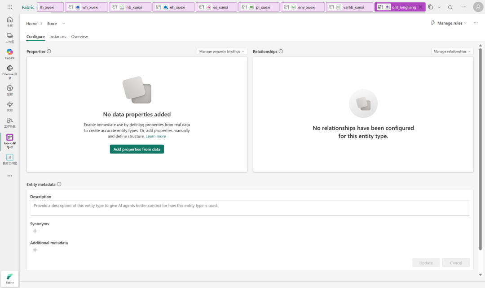图 7-1　界面截图。Configure / Instances / Overview 三个标签，左侧是属性区，右侧是关系区。
读图提示：三个标签的分工——Configure 定义结构，Instances 看真实数据，Overview 看汇总。右上角 Manage property bindings 和 Manage relationships 分别对应第 6 章的属性和关系。此时两边都是空的，提示 No data properties added。
点进绑定页后的结构：
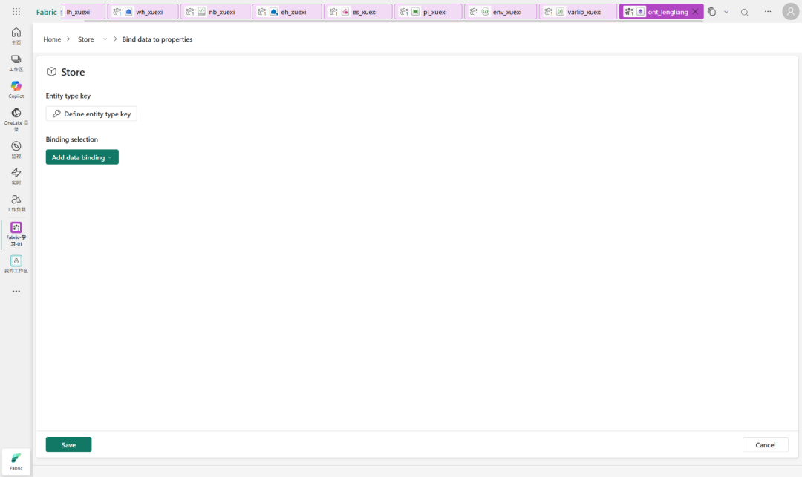图 7-2　界面截图。Entity type key 与 Binding selection 两个区块。
读图提示：注意这一页的两个区块——Entity type key（实体类型键）在上面，Binding selection（绑定选择）在下面。这个顺序不是随意的：键是先决条件，7.5 节会看到没有它连保存都不允许。
数据源类型只有两种：
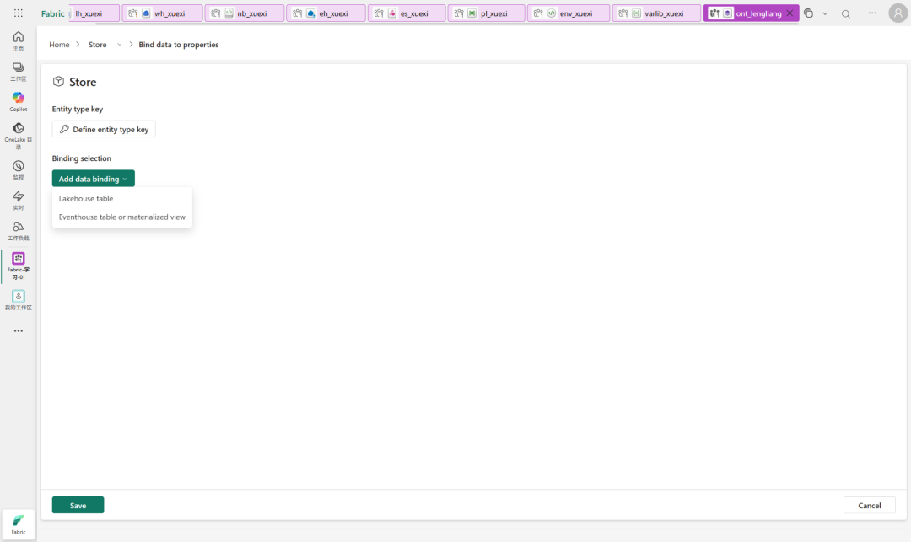图 7-3　界面截图。Lakehouse table 与 Eventhouse table or materialized view。
选定类型后，从 OneLake 目录里挑表：
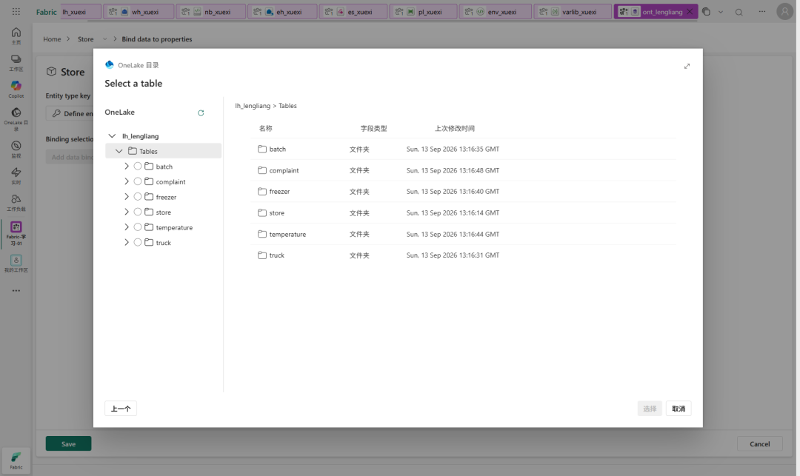图 7-4　界面截图。左侧是湖屋/Tables 的树，右侧是表列表，底部是"选择"按钮。
读图提示：左侧树里每个表名前有一个圆圈——那才是选择控件，点表名只会展开成文件夹。这个细节在第 9 章会再提一次，因为它是实操中最容易卡住的地方。注意列表里除了 lh_lengliang，还有一个 ont_lengliang_lh_<guid>——那就是 5.4 节说的本体自动生成的内部湖屋。
选完表，属性会自动从列反推出来：
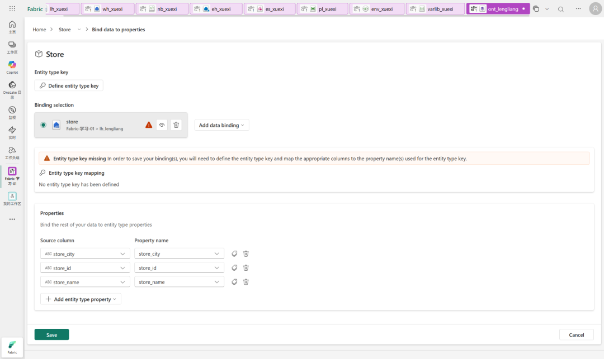图 7-5　界面截图。Source column 与 Property name 两列对照，底部提示"3 property bindings added from source columns"。
读图提示：左边 Source column 是源表的列，右边 Property name 是本体里的属性名，默认同名但可以改。这一步就是 6.1 节说的"从数据反推属性"。注意顶部那条橙色提示 Entity type key missing——它会一直挡着保存，直到你定义键。
7.3 时序绑定
静态绑定完成后，可以在同一页继续加时序绑定。
差别只有一处：多出一个 Timeseries data 区块，要你选时间戳列 [4]。
时序绑定有两个前提 [4]：
源数据必须是列式的——一行一个带时间戳的观测，列里放时间戳和值。如果你的数据是"一行一台设备、几十列是不同时刻"的宽表，要先转置。
必须有一个静态属性能当键，且"这个静态数据必须与时序数据里的某一列精确匹配"。冷链例子里就是 freezer_id：静态表 freezer 里有它，时序表 temperature 里也有它，两者靠它对上。
时序绑定可以有多个，来源可以同时包括事件仓库和湖屋 [5]。
7.4 类型映射
绑定时源列类型会映射到本体属性类型。完整对照 [4]：
本体属性类型
 | 湖屋支持的类型
 | 事件仓库支持的类型
 | 
integer
 | tinyint, smallint, bigint, integer, long, short
 | int, long
 | 
boolean
 | boolean
 | bool
 | 
datetime
 | datetime, date, timestamp
 | datetime
 | 
double
 | double, decimal, float
 | decimal, real
 | 
string
 | char, decimal(p,s), string, array, binary, byte, map, object, struct, timestamp_ntz
 | dynamic, string, guid, timespan
 | 

时间戳列只接受 datetime / date / timestamp；实体类型键只接受 string / integer [4]。
注意 string 那一行：array、map、struct、binary 这些复杂类型会被映射成 string。也就是说本体不理解嵌套结构——嵌套 JSON 要先在 ETL 里展平。
官方的建议很直接："如果你的数据包含其他数据类型，在把数据带进本体之前先做 ETL 转换成受支持的类型" [4]。
7.5 限制清单：做方案前必看
这一节是本章最实用的部分。这些限制会直接否掉某些方案。
源表的三条硬要求 [4][5]：
必须是托管表（managed）。 官方："本体只支持托管湖屋表（与湖屋位于同一 OneLake 目录），不支持在湖屋里显示但实际位于别处的外部表。" 也就是说快捷方式指向的表不能直接绑。
不能启用 OneLake 安全。 "你不能把启用了 OneLake 安全的湖屋用作绑定的数据源。" 这条影响很大——如果你的治理方案依赖 OneLake 细粒度安全，就和本体冲突。
不能启用列映射（column mapping）。 "本体图不支持启用了列映射的 delta 表。"
第三条有个隐蔽的触发条件，值得单独标出来：
列映射可以手动启用，也会在列名包含某些特殊字符时自动启用，这些字符包括 ,;{}()\n\t= 以及空格。此外，为 import 模式语义模型表存储数据的 delta 表也会自动启用。 [5]
列名里有一个空格，这张表就绑不了本体，而且原因完全不显眼。 造数据时最好统一用 ASCII 蛇形命名。
其他限制 [5]：
•绑定建立后改湖屋表名可能导致访问不到数据
•每个实体类型只支持一个静态绑定，不能把多个源合并到一个实体类型（时序绑定不受此限）
•静态数据必须用 OneLake 支持的源
最后是那条最容易漏的：
上游数据源的更新（比如新增行）需要手动刷新，才会在本体里可见。 [4]
7.6 实体类型键：一个静默的拦路虎
第 6.2 节说过键是硬性的。这里说清它在绑定流程里的实际表现。
属性映射完成后，页面会显示：
Entity type key missing — In order to save your binding(s), you will need to define the entity type key and map the appropriate columns to the property name(s) used for the entity type key.
在定义键之前，Save 不会生效。 而且——这是实测中最坑的一点——保存失败没有明显的错误弹窗，页面看起来像是保存了，退出再进来才发现属性是空的。
定义键的面板长这样：
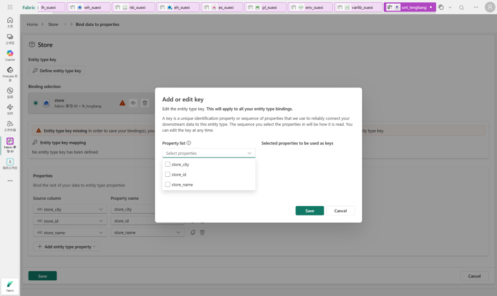图 7-6　界面截图。Property list 下拉展开，可勾选一个或多个属性组成键。
读图提示：面板文字说明了两件事——"选择一个或多个属性构成实体键，它们的值合起来唯一标识每个实体实例"，以及"你选择属性的顺序就是它被读取的顺序"。支持复合键，但顺序有意义。
定义之后，Entity type key missing 提示消失，保存才会真正生效：
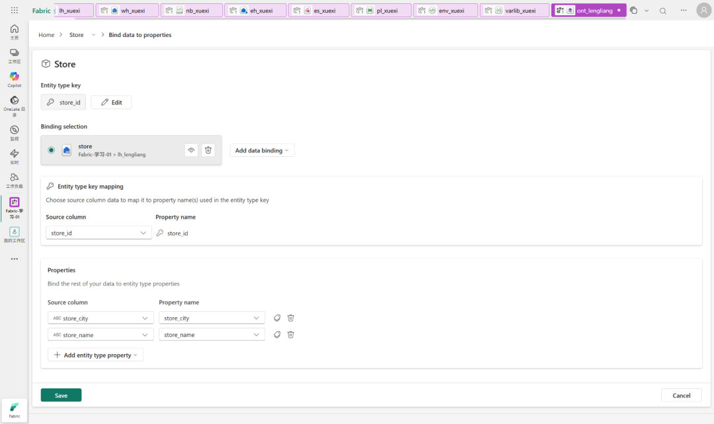图 7-7　界面截图。橙色提示消失，Entity type key 区块显示已选的键属性。
绑定成功后的配置页：
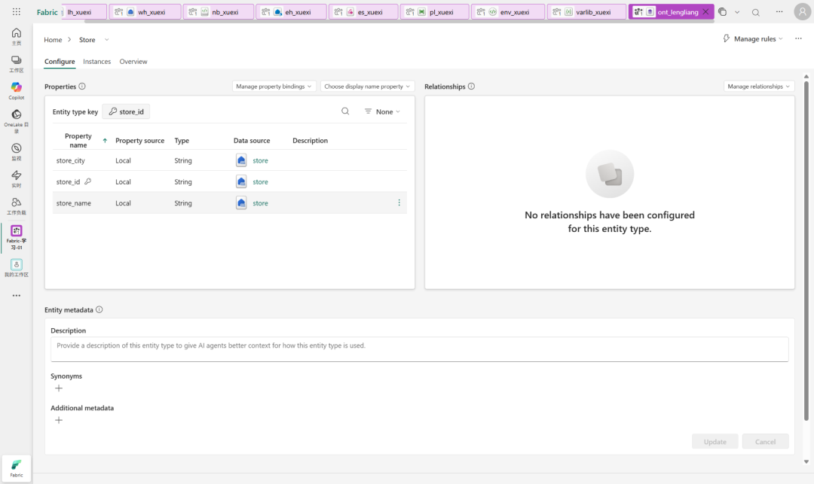图 7-8　界面截图。属性表格列出 Property name / Property source / Type / Data source。
读图提示：注意 Property source 这一列全是 Local，Data source 这一列全是源表名 store。这两列合起来告诉你：属性定义在本体本地，数据来自那张表——这正是 7.1 节"不复制源数据"的具体呈现。
理解检验：冷链的温度表 temperature 有 freezer_id, ts, temp_c 三列。它应该绑到哪个实体类型？是静态绑定还是时序绑定？绑定之前 freezer 表必须先做什么？
8 查询：图、自然语言与 agent
定义完、绑完数据，接下来是消费。
8.1 本体查询是什么
官方对它的定位：
"本体查询让你通过本体术语，对绑定的数据源提出业务层面的问题。查询从实体类型出发，允许按属性过滤、遍历关系、按时间聚合以及其他约束。" [2]
"从实体类型出发"和"遍历关系"这两个词组，正好对应第 3.5 节讲的 SPARQL 思路——你描述事实的形状，不写 join 路径。
8.2 查询怎样被路由
这里有一个设计值得单独讲。官方说：
"本体层自动把你的查询发送到最高效的系统去拿结果（比如给 Graph 用 GQL、给 Eventhouse 用 KQL）。" [2]
也就是说本体层本身不是一个执行引擎，而是一个路由器。
回到冷链：
问题：投诉批次由哪辆车配送，那辆车当天制冷是否正常？
 ↓ 本体层解析
 遍历部分（批次→车） → 交给 Graph，用 GQL
 时序部分（温度随时间） → 交给 Eventhouse，用 KQL
 ↓
 结果合并返回
这个架构的好处是各引擎干各自擅长的事（第 5.2 节那三层的延续）；代价是你要理解数据落在哪一层，否则性能问题不好排查。
8.3 NL2Ontology：自然语言查询
本体还包含一个自然语言到本体（NL2Ontology）的查询层，"把你的自然语言问题转成结构化查询并返回相关结果" [2]。
它的价值官方讲得很具体：
"这让你可以用业务术语提问，而不需要知道数据在不同系统里究竟是怎么存的。NL2Ontology 查询确保过滤条件、连接、单位和有效期窗口与你本体中发布的定义保持一致。" [2]
把这段话和第 4 章对照：4.1 节讲的三种失败——术语歧义、关系臆测、无法解释——正好被这里的三个保证覆盖（定义一致、连接来自本体、单位和有效期明确）。
这就是第 4 章那个论证在产品里的兑现。
8.4 给 agent 用
本体的另一个出口是 Fabric 的数据代理（Data agent）和操作代理（Operations agent）。
按 5.3 节的分工，数据代理负责回答问题，操作代理负责监控并触发动作。本体为它们提供"一个共享的上下文层，供 Fabric agent 和实时智能组件使用，以实现一致的推理和动作" [2]。
要用数据代理，租户设置里还要额外开三个开关（第 9.1 节列出），其中两个涉及跨地理区处理数据，属于合规评审必看项。
8.5 刷新：本体图是物化的
第 6.5 和 7.5 节都提过，这里再强调一次，因为它是方案设计的硬约束：
上游数据的更新需要手动刷新才会在本体里可见。 [2][4]
这意味着：
•本体不适合做秒级实时的场景——那是事件流和 Activator 的活
•本体适合的是跨域追溯、上下文推理、agent grounding，这些场景对分钟级到小时级的延迟不敏感
•做方案时必须明确刷新策略，并把它写进 SLA
理解检验：冷柜超温要在 1 分钟内告警。这个需求该用本体做吗？如果不该，Fabric 里哪个组件负责？本体在这个场景里还有什么用？
9 动手：把冷链本体建出来
这一章把前面八章的概念变成一个能跑的东西。全部步骤在真实环境中执行过，截图都是实拍。
9.1 前置条件
租户设置是第一道门，而且它不开的话，"新建项"面板里根本看不到本体这个选项——不是报错，是压根不出现。
必须由 Fabric 管理员在管理门户 → 租户设置里开启 [3]：
开关（英文原名）
 | 中文界面措辞
 | 必需性
 | 
Enable Ontology item (preview) | 用户可以创建本体 (预览版) 项目
 | 必需 | 
Users can use Copilot and other features powered by Azure OpenAI | 用户可以使用 Copilot、AI 智能体和其他由 Azure OpenAI 提供支持的 AI 体验
 | 用数据代理时必需
 | 
Data sent to Azure OpenAI can be **processed** outside your capacity's geographic region... | 可以在容量的地理区域…之外处理发送到 Azure OpenAI 的数据
 | 用数据代理时必需
 | 
Data sent to Azure OpenAI can be **stored** outside your capacity's geographic region... | 可以在容量的地理区域…之外存储发送到 Azure OpenAI 的数据
 | 用数据代理时必需
 | 

官方原话："如果不启用这个设置，创建新本体项时会报错。" [3]
两个提醒。一，中文界面下搜英文关键词搜不到这些设置，必须用上表的中文措辞。 二，后两个跨区开关是数据驻留决策，涉及数据出境。在客户环境里这必须走合规评审，不能默认打开。
其他前置 [4]：一个绑定了 Fabric 容量的工作区；数据已经完成必要的 ETL；静态数据在 OneLake，时序数据在 OneLake 或事件仓库。
9.2 准备数据
冷链例子需要四张表（先不做时序部分）：
store store_id, store_name, store_city
truck truck_id, truck_plate, truck_driver, truck_cooling_ok
batch batch_id, batch_product, batch_produced_at, batch_truck_id, batch_store_id
freezer freezer_id, freezer_model, freezer_store_id
列名设计要遵守两条规则，否则后面会卡：
全部用 ASCII 蛇形命名，不要有空格。 原因见 7.5 节——空格会触发列映射，而启用列映射的表绑不了本体。
属性名全局唯一。 所以是 store_name 而不是 name，truck_plate 而不是 plate。原因见 6.3 节。
数据本身设计成有故事：T02 这辆车制冷故障（truck_cooling_ok = false），它送过的批次去了特定几家门店——这样后面查出来的结果才有意义。
写入湖屋时确保是托管 Delta 表：
spark.createDataFrame(rows).write.format("delta") \
 .mode("overwrite").option("overwriteSchema", "true") \
 .saveAsTable("store")
用 saveAsTable 而不是 save(path)——前者是托管表，后者可能是外部表，而外部表绑不了（7.5 节）。
9.3 建本体与实体类型
在工作区里新建 Ontology (preview) 项（它在「新建项」面板的分析和训练数据分区）。
打开后是空画布（图 6-1）。首次进入会有一个 Welcome to Ontology 弹窗，关掉即可。
点 Add entity type，填名称（图 6-2），重复四次建出 Store / Truck / Batch / Freezer：
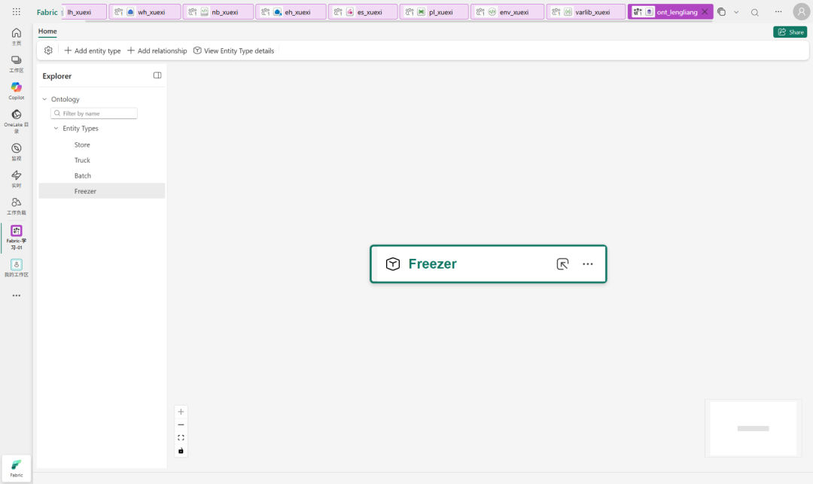图 9-1　界面截图。左侧 Explorer 树列出四个实体类型，画布上是对应节点。
读图提示：功能区此时多出了 Add relationship 和 View Entity Type details 两个按钮——它们只在选中某个实体类型后才可用。画布右下角是缩略图，左下角是缩放控件。
9.4 绑定数据
对每个实体类型重复以下步骤。以 Store 为例：
第一步：选中实体类型 → 点节点上的 Configure entity type for Store → 进入配置页（图 7-1）。
⚠️ 这里有个坑。 首次进入配置页会弹出一个六步导览浮层 Entity type configuration — 1 of 6，它是模态的，会挡住 Add properties from data 按钮。先把它关掉或点完，否则后续点击都会落空。
第二步：点 Add properties from data → Add data binding → 下拉选 Lakehouse table（图 7-3）。
第三步：在 OneLake 目录里选湖屋 → 下一步 → 展开 Tables → 勾选表名左边的圆圈 → 选择（图 7-4）。
⚠️ 第二个坑。 点表名只会把它当文件夹展开，右侧会显示"未能加载文件夹内容"。必须点表名左边那个圆圈才算选中，底部的「选择」按钮才会变亮。
第四步：属性自动从列反推出来（图 7-5）。可以改名、删除、增加。
第五步：点 Define entity type key → 展开 Property list → 勾选 store_id → 保存（图 7-6）。
⚠️ 第三个坑，也是最隐蔽的。 不定义键，Save 不生效，而且没有明显报错。页面看起来保存成功，退出再进来会发现属性是空的。判断标准：橙色的 Entity type key missing 提示消失了才算数（图 7-7）。
第六步：点左下角 Save 保存绑定。
四个实体类型的对应关系：
实体类型
 | 源表
 | 实体类型键
 | 
Store
 | store | store_id | 
Truck
 | truck | truck_id | 
Batch
 | batch | batch_id | 
Freezer
 | freezer | freezer_id | 

绑定完成后，配置页会列出所有属性及其来源（图 7-8）。
9.5 定义关系
选中 Batch → 点 Add relationship → 填三项：
关系名
 | Origin
 | Target
 | 业务含义
 | 
deliveredBy | Batch
 | Truck
 | 这批货由哪辆车配送
 | 
deliveredTo | Batch
 | Store
 | 这批货送到哪家店
 | 
locatedIn | Freezer
 | Store
 | 这台冷柜在哪家店
 | 

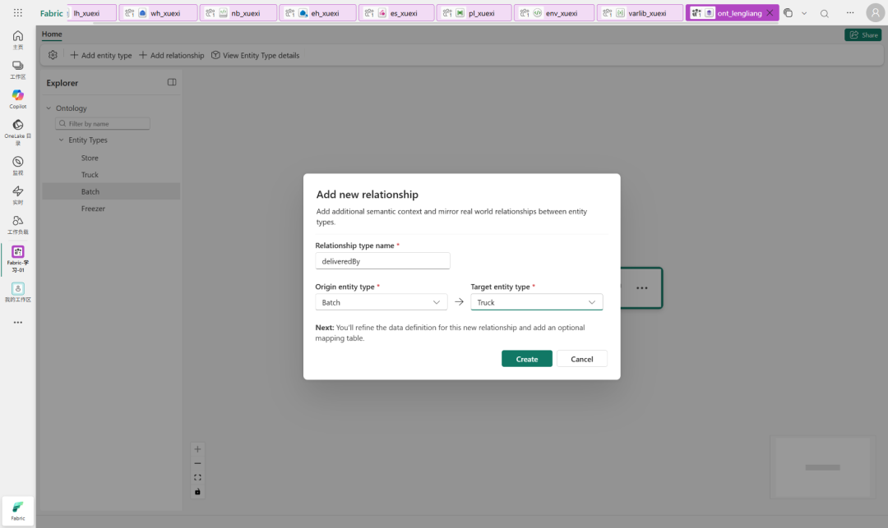图 9-2　界面截图。名称、Origin、Target 三项填完后 Create 按钮变为可用。
三条关系建完，画布变成一张图（图 6-4）。
9.6 看实例：数据真的流进来了
回到任一实体类型的配置页，切到 Instances 标签：
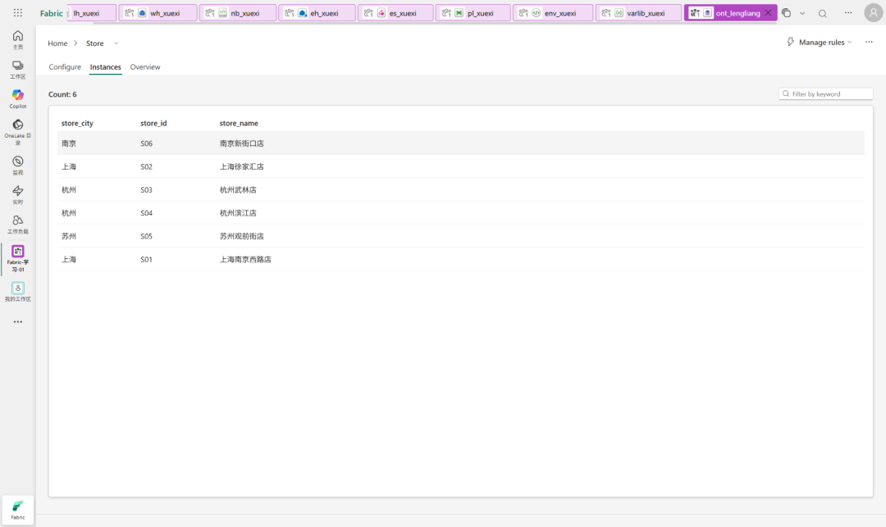图 9-3　界面截图。Count: 6，表格列出六家门店的真实数据。
读图提示：顶部 Count: 6 是实例数量，下面三列 store_city / store_id / store_name 就是 9.4 节绑定的属性。这些不是源表的直接展示，是本体把源数据转成的"实体实例"——6.5 节说的"把原始数据变成标准化业务对象"，就是这一屏。
再看 Batch 的详情页，属性和关系同时呈现：
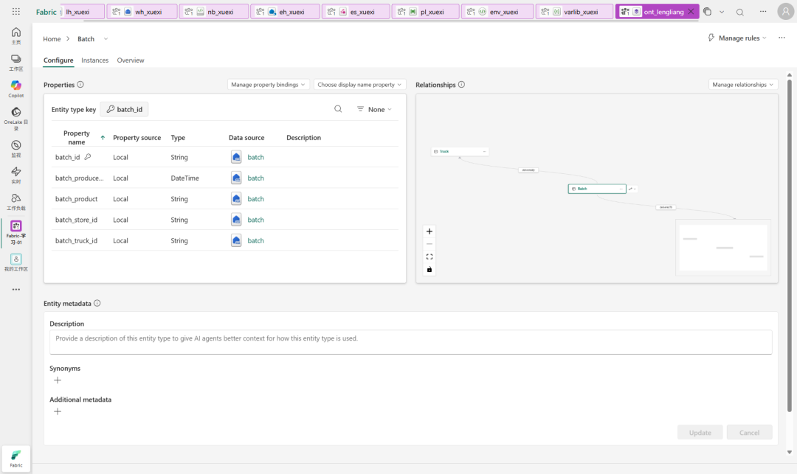图 9-4　界面截图。左侧 Properties 表格，右侧 Relationships 列出 deliveredTo 与 deliveredBy。
读图提示：Entity type key 显示为 batch_id。属性表里 batch_produced_at 的类型被正确识别为 DateTime——这是 7.4 节类型映射的结果。右侧关系区显示 Batch 同时连向 Store 和 Truck，这就是第 1 章那条 join 链，现在它是模型的一部分而不是查询的一部分。
9.7 这一章证明了什么
证明了：本体可以定义业务概念并绑定到 OneLake 里的真实表；绑定不复制数据，属性来源清晰标注为源表；实体实例能正确物化出来（Store 六条）；关系可以声明并在图上呈现。
没有证明：时序绑定（本次只做了静态）；跨域查询的实际性能；NL2Ontology 的回答质量；数据代理的集成效果；大规模数据下的刷新耗时。
9.8 踩坑清单
按遇到的顺序：
#
 | 坑
 | 表现
 | 解法
 | 
1
 | 租户设置没开
 | 「新建项」里根本没有本体
 | 见 9.1，需 Fabric 管理员
 | 
2
 | 六步导览浮层
 | 点按钮没反应
 | 先关掉浮层
 | 
3
 | 点表名不是点圆圈
 | 提示"未能加载文件夹内容"
 | 点表名左侧的圆圈
 | 
4
 | 实体类型键未定义 | 保存静默失败，属性丢失 | 确认橙色提示消失再保存
 | 
5
 | 列名有空格
 | 表绑不上，原因不显眼
 | 列名用 ASCII 蛇形
 | 
6
 | 属性重名
 | 报错或拒绝创建
 | 属性名全局唯一，加前缀
 | 
7
 | 外部表 / 快捷方式表
 | 选不到或绑不上
 | 必须是托管表
 | 
8
 | 上游加了新行看不到
 | 实例数不变
 | 手动刷新图
 | 

第 4 条是最值得警惕的——它不报错，只是悄悄不保存。做的时候一定要退出再进去验证一次。
理解检验：如果你要把冷柜温度（时序）也加进来，需要在上面哪一步之后做？还需要保证 temperature 表和 freezer 表之间有什么？
第三篇 选型
10 横向比较与什么时候不该用
10.1 比较口径
共同任务
用第 1 章的冷链追责作为统一命题：
已有：四类主数据（批次、车、门店、冷柜）在关系库或数据湖里；一条温度遥测流。
要做到：给定一条投诉，能沿"投诉 → 批次 → 车 → 制冷状态"和"投诉 → 门店 → 冷柜 → 温度历史"两条路径追溯；能反向查"这辆车还送过哪些批次、去了哪些店"；业务人员能用自然语言问；AI agent 能基于结果建议动作。
约束：一家公司内部，不跨组织；数据量在 TB 以内；团队有 2 名分析师 + 1 名 IT。
比较轴
从这个任务推出真正要比的维度，而不是罗列功能：
1.本体层从哪来——概念、关系、约束的定义是产品给的，还是自己搭
2.图存储与遍历——谁来存实例图、怎么查
3.数据要不要搬——源数据是否必须复制到另一个系统
4.推理能力——能否自动推出未显式写下的事实
5.动作与写回——能否从"知道"走到"做"
6.AI 集成——自然语言查询、agent grounding 是否内置
7.跨组织协作——多方共享同一份本体的可行性
8.上手门槛与运维——需要什么技能、谁来运维
候选
类型
 | 候选
 | 
直接对标产品
 | Palantir Foundry Ontology | 
标准派路线
 | RDF/OWL 三元组库 + SPARQL | 
图派路线
 | 属性图数据库（以 Neo4j 为例） | 
基线：不用本体
 | 直接给 LLM 喂表结构 | 

证据边界（先说清）
本章不含任何性能或成本的测量数据。 没有在同等数据量、同等配置下做过对照测试，因此不给性能排名，也不给 TCO 数字。
判断依据是各候选的官方一手文档，引用见附录 C。特别说明：Microsoft 的 Graph 文档里有一张"graph vs 独立图数据库"的对照表 [6]，那是微软对竞品的评价，本章不把它当作中立证据，Neo4j 一列的判断来自 Neo4j 自己的文档 [10]。
10.2 与 Palantir Foundry Ontology
这是最直接的对标，也是客户现场最常被问的一个。
Palantir 自己怎么说
Foundry 把 Ontology 定位为"组织的一个运营层"，坐落在已经进入平台的数字资产之上，把它们连回现实世界中代表的东西——工厂设备这类实体资产，或客户订单、金融交易这类抽象。它被称为"组织的数字孪生"，同时包含"语义元素（objects、properties、links）"和"动力学元素（actions、functions、dynamic security）" [9]。
拆开看：
语义部分：把源数据映射成"objects、properties、links"。官方强调这"远超数据编目或 schema 设计"，提供"所有字段的丰富元数据"以及对变更的细粒度安全与治理 [9]。
动力学部分：action types 让你"从操作员那里采集数据"或协调伸进已有系统的决策流程；functions 是用来"编写和演进任意复杂度业务逻辑"的机制 [9]。
interfaces：一种"描述对象类型的形状及其能力"的本体类型，提供"对象类型多态性" [9]。
实质差异
轴
 | Palantir Foundry
 | Fabric Ontology
 | 
语义层（对象/属性/链接）
 | ✅ 原生
 | ✅ 原生
 | 
动作与写回 | ✅ action types 原生，可采集操作员输入、回写已有系统
 | 有限：本体本身不写回；动作要靠 Activator / 操作代理 / 用户数据函数拼
 | 
业务逻辑
 | ✅ functions，任意复杂度
 | 需借助笔记本、UDF 等外部件
 | 
类型多态
 | ✅ interfaces
 | ❌ 未见对应机制
 | 
应用构建
 | ✅ Workshop 等配套
 | 需用 Power BI / Fabric Apps 另建
 | 
与数据湖的关系
 | 建在 Foundry 已集成的数据之上
 | 直接绑 OneLake，不复制
 | 
与 BI 的关系
 | 自有分析工具（Quiver 等）
 | 原生接 Power BI 语义模型（第 5.2 节三层）
 | 

最锋利的那条差异是"动力学元素"。
Palantir 从一开始就把"执行动作"设计进本体本身。Fabric Ontology 当前（预览期）的重心在语义与 agent grounding；要走到"下架批次、通知门店"，需要把 Activator、操作代理、用户数据函数这些拼起来。
这不等于 Fabric 做不到——第 5.3 节那六个 Item 合起来覆盖了类似能力，但它们是几个 Item 的组合，不是一个本体对象的内建属性。对客户讲的时候，这个差别要说清楚，不能含糊过去。
反过来 Fabric 有一处结构性优势：它的本体和 Power BI 语义模型在同一个平台里、同一个三层结构中（5.2 节）。对已经重度使用 Power BI 的组织，这条路径的摩擦明显更小。
什么时候 Palantir 更合适
•核心诉求是运营闭环（不只是查询，还要改变系统状态）
•需要围绕本体构建应用给一线操作员用
•场景是高度复杂的运营调度（供应链、国防、制造），且预算与实施能力到位
10.3 与 RDF/OWL 标准栈
第 3 章讲的那条路线：三元组库 + RDFS/OWL + SPARQL。
轴
 | RDF/OWL 栈
 | Fabric Ontology
 | 
图模型
 | RDF 三元组
 | 属性图（LPG）[6]
 | 
边能否直接带属性
 | ❌ 要具体化
 | ✅ 能
 | 
查询语言
 | SPARQL（W3C）
 | GQL（ISO/IEC 39075）[6]
 | 
推理能力 | ✅ 强，RDFS 推导 + OWL 完整逻辑
 | 有限，靠规则
 | 
跨组织合并 | ✅ IRI 全局唯一，天然支持
 | ❌ 局部 ID，非设计目标
 | 
标准成熟度
 | 二十余年，生态完整
 | GQL 2024 年成标准，生态年轻
 | 
上手门槛
 | 高，要学一整套新概念
 | 低，图形化建模
 | 
与企业数据平台集成
 | 需自建
 | 原生
 | 
运维
 | 自己部署三元组库
 | 平台托管
 | 

最该注意的两条：
推理。 如果你的领域有丰富的分类层级和逻辑约束（医学术语、法规合规、产品分类体系），OWL 的推理能力是 Fabric 给不了的。"冷藏车是运输车的子类，所以查运输车自动包含冷藏车"这种，Fabric 要靠你自己在关系里表达。
跨组织。 3.6 节那条规律在这里直接生效——如果需求是和外部方共享同一份本体（行业标准、供应链联盟、政府开放数据），RDF 的 IRI 机制是为此设计的，Fabric 不是。
什么时候 RDF/OWL 更合适
•领域已有成熟的标准本体可复用（SNOMED CT、FIBO、Gene Ontology）
•需要跨组织、跨机构共享语义
•推理是核心需求，不是附加项
•团队有本体工程能力，或愿意投入培养
10.4 与属性图数据库（Neo4j）
Neo4j 和 Fabric Graph 用的是同一种图模型——属性图。所以比较的焦点不在图本身，而在本体层在哪。
Neo4j 自己怎么说
Neo4j 的模型由 nodes（描述领域中的实体）、relationships（连接源节点和目标节点，"总是有方向"且"必须有一个类型"）、labels（给节点分类，"可以在运行时增删"）、properties（节点和关系上的键值对）构成 [10]。
关键在于它对 schema 的定义：
"A schema in Neo4j refers to indexes and constraints."Neo4j 里的 schema 指的是索引和约束。 [10]
而且它是 "schema optional"（官方用词，不是 schema-free）——"意思是不必创建索引和约束"，数据可以"在不预先定义 schema 的情况下创建" [10]。
最值得注意的一点：Neo4j 这份讲图数据库核心概念的文档通篇不谈本体。
这不是批评——它是一个图数据库，职责就是高效存储和遍历图。但这意味着本体层要你自己建：概念定义、同义词、约束语义、业务含义，Neo4j 不提供承载它们的一等结构（社区有 neosemantics 这类插件做 RDF 互操作，但那是插件，不是核心）。
对照
轴
 | Neo4j
 | Fabric Graph + Ontology
 | 
图模型
 | 属性图
 | 属性图 [6]
 | 
查询语言
 | Cypher（GQL 的主要来源）
 | GQL（ISO 标准）[6]
 | 
本体层 | ❌ 自建；schema 仅指索引和约束 [10]
 | ✅ 本体是一等 Item
 | 
建模约束
 | schema optional，可以先放数据
 | 必须先定义实体类型和键
 | 
数据要不要搬
 | ✅ 要，导入图数据库
 | ❌ 直接绑 OneLake [6]
 | 
图算法
 | ✅ 成熟（GDS 库）
 | 内建算法 [6]
 | 
自然语言查询
 | 需自建或用生态工具
 | NL2GQL 内置 [6]
 | 
运维
 | 独立集群，自己扩缩容监控
 | 用现有 Fabric 容量，闲时自动降配 [6]
 | 
多云/本地部署
 | ✅ 灵活
 | ❌ 仅 Fabric
 | 
成熟度
 | 十余年生产验证
 | 预览 / 早期
 | 

两条最实质的差别：
数据引力。 Neo4j 要把数据导进去，意味着一条 ETL 管道加一份副本，源变了要同步。Fabric Graph 直接在 OneLake 上建图 [6]。但别忘了 8.5 节——Fabric 的图是物化的，需要手动刷新，它不是实时视图。 两边都有同步问题，只是形态不同。
schema 哲学相反。 Neo4j 是 schema optional，先放数据后加约束；Fabric 强制先定义实体类型和键（7.6 节那个拦路虎就是这个哲学的体现）。前者适合探索性建模，后者适合治理优先的场景。
什么时候 Neo4j 更合适
•图本身是核心（社交网络、推荐、路径优化、欺诈检测），需要成熟的图算法库
•需要多云或本地部署
•团队已有 Cypher 能力
•需要生产级成熟度，不接受预览版风险
10.5 基线：直接给 LLM 喂表结构
这是最常见的"不用本体"做法，也是真正的比较基准——不比这个，整章横评站不住脚。
做法：把表结构（可能加上字段注释）塞进提示词，让模型生成 SQL。
它确实能工作，而且成本极低、上手极快。第 4.2 节那张表已经给过对照，这里补充判断标准：
情况
 | 喂表结构够用吗
 | 
表少（十几张以内）、命名规范、有外键
 | ✅ 基本够用
 | 
问题集中在单表或两表 join
 | ✅ 够用
 | 
一次性分析，不需要复用
 | ✅ 够用
 | 
表多、命名混乱、无外键
 | ❌ 模型会猜错
 | 
需要三跳以上遍历
 | ❌ 容易错且难验证
 | 
同名字段语义不同（batch_store_id vs complaint_store_id）
 | ❌ 典型翻车点
 | 
需要解释推理链给业务方看
 | ❌ 做不到
 | 
多个团队/工具要共享同一套定义
 | ❌ 提示词不是共享资产
 | 

一个诚实的提醒：很多号称需要本体的场景，其实只要把字段注释写好、把外键建上、把命名规范化就解决了。这三件事成本远低于建本体。
先做这三件事，做完还不够，再考虑本体。
10.6 能力矩阵
格子含义：原生＝开箱即用；需配置＝平台内可配；需自建＝要自己开发；不适用＝不是该方案的目标。
比较轴
 | Fabric Ontology
 | Palantir Foundry
 | RDF/OWL 栈
 | Neo4j
 | LLM+表结构
 | 
概念/属性/关系定义
 | 原生
 | 原生
 | 原生
 | 需自建 | 不适用
 | 
图存储与遍历
 | 原生
 | 原生
 | 原生
 | 原生
 | 不适用
 | 
数据不搬
 | 原生
 | 原生
 | 需配置
 | 需搬运 | 原生
 | 
强逻辑推理
 | 有限
 | 有限
 | 原生 | 需自建
 | 不适用
 | 
动作与写回
 | 需组合多 Item
 | 原生 | 不适用
 | 需自建
 | 不适用
 | 
自然语言查询
 | 原生（NL2GQL / NL2Ontology）
 | 原生
 | 需自建
 | 需自建
 | 原生
 | 
agent grounding
 | 原生
 | 原生
 | 需自建
 | 需自建
 | 有限
 | 
与 Power BI 集成
 | 原生（同平台三层） | 需对接
 | 需对接
 | 需对接
 | 不适用
 | 
跨组织共享本体
 | 不适用
 | 有限
 | 原生（IRI） | 有限
 | 不适用
 | 
多云/本地
 | ❌
 | 有限
 | ✅
 | ✅
 | ✅
 | 
上手门槛
 | 低
 | 中
 | 高 | 中
 | 最低 | 
成熟度
 | 预览 | 生产
 | 二十余年
 | 生产
 | —
 | 

再次强调：本表不含性能与成本判断。要得到那部分结论，必须在相同数据、相同配置下自行测量。
10.7 什么时候不该用本体
这一节可能比前面所有比较都重要。
成本在哪
定义成本。 有人要坐下来决定"客户到底是什么"。这通常不是技术问题，是组织问题——需要跨部门达成一致，可能要几周。
绑定成本。 7.5 节那串限制意味着源数据往往要先改造：改列名、把外部表转托管表、拆分或合并表。
维护成本。 源表加了列、业务概念变了、新增了一类对象——本体要跟着改，而且改错了下游 agent 会给出错误答案。
刷新成本。 8.5 节的手动刷新意味着要有调度和监控。
三类不适合的场景
第一类：问题是单表或两表的。
"上月各门店销售额排名"——这是聚合，不是遍历。语义模型加报表就够了，本体帮不上忙还增加一层。
判断标准：如果你的典型问题用一两个 join 就能写出来，不需要本体。
第二类：数据质量还没解决。
如果 batch_truck_id 有一半是空的、门店编码三个系统三套、时间戳时区混乱——建本体只会把混乱系统化。本体让"应该有这个关系"变明确，但不补数据。
判断标准：先算一下关键外键的填充率。低于 90% 就先去修数据。
第三类：组织还没准备好达成一致。
3.6 节讲过语义网败在"shared"上。企业内部虽有权威，但如果销售、财务、运营对"一个成交客户"的定义各执一词且没人能拍板，本体项目会卡在定义阶段，永远上不了线。
判断标准：能不能在两周内让相关部门对前五个核心概念签字。
该用的信号
反过来，出现下面这些情况，本体的价值开始显现：
•典型问题需要三跳以上的遍历，且遍历路径经常变
•同一个业务概念在多个系统里有不同表示，且这个差异反复造成误解
•要给 AI agent 用，且要求答案可解释
•有多个团队/工具需要共享同一套定义
•组织有能力也有意愿维护这套定义
10.8 回到奶茶店
用 10.7 的标准检查第 1 章那个问题：
信号
 | 冷链追责符合吗
 | 
三跳以上遍历
 | ✅ 投诉→批次→车→制冷状态，三跳；换个方向还是三跳
 | 
遍历路径经常变
 | ✅ 每换一个追问方向就是一条新路径
 | 
同概念多系统表示
 | ⚠️ 本例数据都在一个湖屋里，这条不强
 | 
给 AI agent 用
 | ✅ 目标就是让业务人员自然语言追问
 | 
多团队共享定义
 | ⚠️ 小公司，这条不强
 | 
有能力维护
 | ⚠️ 1 名 IT，是个现实约束
 | 

诚实的结论：这个规模的奶茶店，本体是划算但不是必需的。六张表、三条关系，一个熟练的分析师用 SQL 也能应付。
真正让它划算的临界点在于：门店从 6 家变成 600 家、数据源从 1 个湖屋变成 ERP+WMS+IoT 平台三套、追问的人从 1 个分析师变成 20 个区域经理。那时"连接路径存在于人脑里"的成本会变得不可接受——而这正是第 1.3 节那句话的含义。
用这个例子讲课很好，用它论证客户必须买本体则是夸大。 给客户做判断时，用 10.7 那三个标准，不要用例子的观感。
理解检验：某客户有 200 张表、外键基本没建、三个部门对"活跃用户"定义不同。基于 10.7，你的第一步建议是什么？本体应该排在第几步？
附录 A 术语对照
A.1 概念层
中文
 | 英文
 | 含义
 | 首次出现
 | 
本体论
 | ontology（不可数）
 | 哲学分支，研究"存在什么"
 | 2.1
 | 
本体
 | an ontology（可数）
 | 一份具体的概念规约工件
 | 2.2
 | 
概念化
 | conceptualization
 | 你对某领域的抽象理解
 | 2.3
 | 
术语表
 | glossary
 | 只有名字和定义
 | 2.4
 | 
分类学
 | taxonomy
 | 加了上下级层次
 | 2.4
 | 
知识图谱
 | knowledge graph
 | 装满真实数据的实例图
 | 3.7
 | 
三元组
 | triple
 | 主语-谓语-宾语
 | 3.2
 | 
具体化
 | reification
 | 把关系变成节点以便挂属性
 | 3.8
 | 
接地 / 锚定
 | grounding
 | 把模型输出约束在可验证事实上
 | 4.2
 | 

A.2 标准与技术
缩写
 | 全称
 | 是什么
 | 
RDF
 | Resource Description Framework
 | 用三元组表达事实的数据模型
 | 
RDFS
 | RDF Schema
 | 在 RDF 上定义类和属性
 | 
OWL
 | Web Ontology Language
 | 更强表达力的本体语言
 | 
SPARQL
 | SPARQL Protocol and RDF Query Language
 | RDF 的查询语言
 | 
IRI
 | International Resource Identifier
 | 全局唯一标识符
 | 
LPG
 | Labeled Property Graph
 | 带标签的属性图
 | 
GQL
 | Graph Query Language
 | 属性图查询语言，ISO/IEC 39075
 | 
NL2GQL / NL2Ontology
 | —
 | 自然语言转图查询 / 转本体查询
 | 

A.3 Fabric 专有
中文
 | 英文
 | 含义
 | 
实体类型
 | entity type
 | 概念的可复用模板
 | 
实体实例
 | entity instance
 | 实体类型的具体出现
 | 
实体类型键
 | entity type key
 | 唯一标识实例的属性（组）
 | 
属性
 | property
 | 关于实体的具名事实
 | 
关系
 | relationship
 | 实体类型/实例之间的有向链接
 | 
数据绑定
 | data binding
 | 把概念映射到具体数据源
 | 
静态绑定 / 时序绑定
 | static / time series binding
 | 不变属性 / 随时间变化的属性
 | 
本体图
 | ontology graph
 | 由绑定和关系构建的实例图
 | 

A.4 容易混淆的几组
别搞混
 | 区别
 | 
本体 vs 知识图谱
 | 定义 vs 实例；类 vs 对象
 | 
本体 vs 数据库 schema
 | 表达含义 vs 描述存储
 | 
分类学 vs 本体
 | 只有上下级 vs 任意关系
 | 
RDF 图 vs 属性图
 | 三元组、边不能带属性 vs 边可带属性
 | 
静态属性 vs 时序属性
 | 冷柜型号 vs 冷柜温度
 | 
语义模型 vs 本体
 | 指标口径 vs 业务概念与关系
 | 

附录 B 界面与操作速查
B.1 URL 路由
本体编辑器 /groups/{工作区ID}/ontologies/{本体ID}
可附加 ?experience=fabric-developer。
B.2 编辑器结构
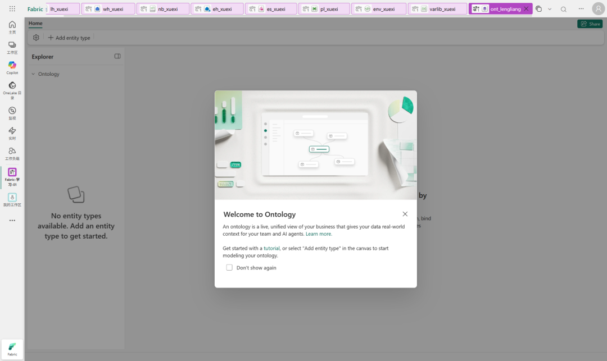图 B-1　界面截图。功能区、Explorer 面板、画布三部分。
功能区按钮（部分按钮需选中实体类型后才出现）：
按钮
 | 作用
 | 
Open artifact settings | 本体项设置
 | 
Add entity type | 新建实体类型
 | 
Add relationship | 新建关系（需先选中实体类型）
 | 
View Entity Type details | 进入实体类型详情页
 | 
View Relationship Type details | 进入关系详情页（有关系后出现）
 | 
Share | 共享
 | 

Explorer 面板：根节点 Ontology → Entity Types → 各实体类型。带按名筛选框。关系不在树里，只在画布上表现为边。
画布控件（左下角）：zoom in / zoom out / fit view / toggle interactivity。右下角是缩略图。
B.3 实体类型配置页
三个标签：
标签
 | 内容
 | 
Configure | 属性、关系、实体元数据（描述、同义词）、资源链接
 | 
Instances | 真实实例数据，带 Count
 | 
Overview | 汇总视图，可加磁贴（Add tile）
 | 

右上角还有 Manage rules 和 More actions。
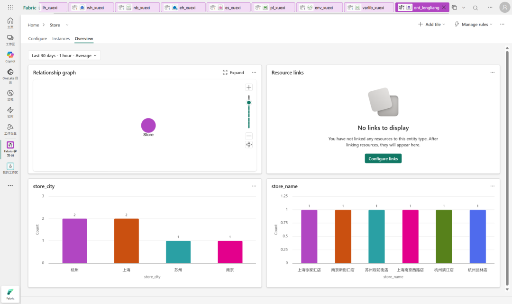图 B-2　界面截图。Overview 标签，可添加磁贴。
B.4 绑定流程速查
选中实体类型
 → Configure entity type for X
 → 【先关掉六步导览浮层】
 → Add properties from data （已有属性时走 Manage property bindings > Add binding and properties）
 → Add data binding
 → 选 Lakehouse table / Eventhouse table or materialized view
 → 在 OneLake 目录选湖屋 → 下一步
 → 展开 Tables → 【点表名左边的圆圈】→ 选择
 → 属性自动映射（可改名/增删）
 → Define entity type key → Open Property list → 勾选键属性 → Save
 → 【确认 Entity type key missing 提示消失】
 → 左下角 Save
B.5 硬性约束速查
项
 | 约束
 | 
源表类型
 | 必须是托管表，不能是外部表
 | 
OneLake 安全
 | 启用了就不能作为绑定源
 | 
列映射
 | 启用了就不能绑；列名含空格等特殊字符会自动启用
 | 
静态绑定数量
 | 每个实体类型只能一个
 | 
时序绑定数量
 | 可以多个，湖屋和事件仓库都行
 | 
属性名
 | 1–26 字符，字母数字/连字符/下划线，首尾为字母数字，全局唯一
 | 
实体类型键类型
 | 只能 string 或 integer
 | 
时间戳列类型
 | 只能 datetime / date / timestamp
 | 
数据刷新
 | 手动，不是实时
 | 

B.6 完整本体的样子
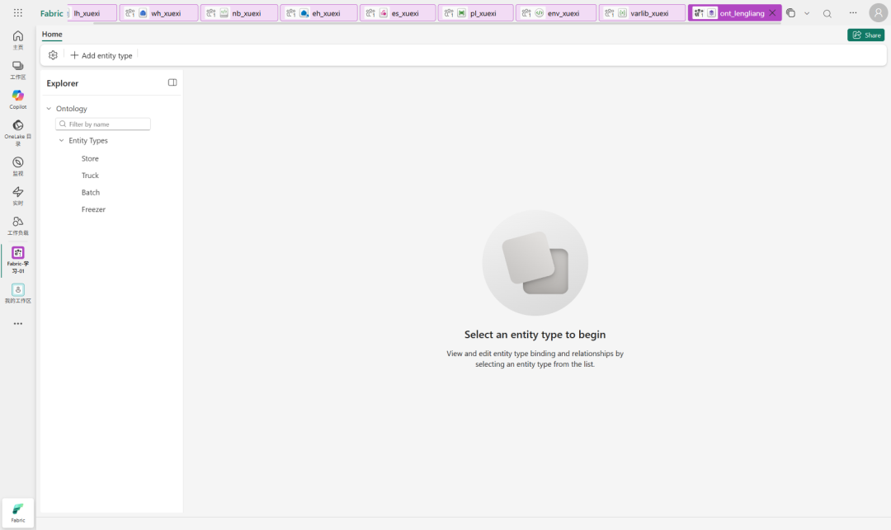图 B-3　界面截图。四个实体类型与它们之间的关系。
附录 C 证据清单与未验证范围
C.1 参考来源
正文中的 [n] 对应下表。URL 用行内代码给出。
编号
 | 来源
 | URL
 | 
[1]
 | Fabric IQ 概述
 | https://learn.microsoft.com/en-us/fabric/iq/overview | 
[2]
 | 本体（预览）概述
 | https://learn.microsoft.com/en-us/fabric/iq/ontology/overview | 
[3]
 | 本体所需租户设置
 | https://learn.microsoft.com/en-us/fabric/iq/ontology/overview-tenant-settings | 
[4]
 | 绑定数据
 | https://learn.microsoft.com/en-us/fabric/iq/ontology/how-to-bind-data | 
[5]
 | 本体常见问题
 | https://learn.microsoft.com/en-us/fabric/iq/ontology/resources-frequently-asked-questions | 
[6]
 | Fabric 中的图
 | https://learn.microsoft.com/en-us/fabric/graph/overview | 
[7]
 | W3C RDF 1.1 Primer
 | https://www.w3.org/TR/rdf11-primer/ | 
[8]
 | Tom Gruber, What is an Ontology
 | https://tomgruber.org/writing/definition-of-ontology | 
[9]
 | Palantir Foundry Ontology 概述
 | https://www.palantir.com/docs/foundry/ontology/overview | 
[10]
 | Neo4j 图数据库概念
 | https://neo4j.com/docs/getting-started/appendix/graphdb-concepts/ | 

资料访问日期：2026 年 9 月。Fabric Ontology 处于预览状态，行为和限制可能已变化。
C.2 证据身份
类型
 | 处理方式
 | 
官方文档陈述
 | 附 [n]；关键处给出原文表述
 | 
界面截图
 | 图注标为"界面截图"，来自真实 Fabric 环境的实际操作
 | 
实测发现
 | 明确标注，如 5.4 节的三个自动生成 Item
 | 
推演
 | 标明推导过程
 | 

特别说明：第 10 章中，Fabric 一列的判断来自官方文档 + 本次实操；Palantir、RDF/OWL、Neo4j 三列全部来自各自的官方文档，本文未在这三个平台上做过操作。Microsoft 文档中"graph vs 独立图数据库"的对照表 [6] 被视为厂商对竞品的评价，未用作中立证据。
C.3 未验证范围
本次实操完成的：创建本体项；创建 4 个实体类型；完成 4 个静态数据绑定并定义实体类型键；创建 3 条关系；查看实体实例（Store 6 条）。
本次实操未完成的：
•时序绑定——只做了静态绑定，温度表未接入
•NL2Ontology 自然语言查询——未测试回答质量
•数据代理集成——未接入
•GQL 查询——未直接执行过图查询
•手动刷新的实际耗时——未测量
•规则（Manage rules）——未使用
全文不含性能与成本测量数据。 第 10 章不给性能或 TCO 排名。
关于 2.3 节的定义考据：已确认 Gruber 本人页面使用短版本，长版本在该页不存在 [8]。但该页未说明 formal 和 shared 由谁补充，Studer 等人的归属未从一手来源确认，正文已标注证据边界。
C.4 环境边界
实操环境为中文语言设置的 Fabric 门户，但本体编辑器本身是英文界面，OneLake 目录选表器是中文界面——同一个流程中英混排。租户设置的搜索按当前界面语言匹配，中文界面下搜英文关键词无结果。
附录 D 进一步阅读
D.1 概念与历史
RDF / 语义网：从 W3C 的 RDF 1.1 Primer [7] 入手，它有完整的例子。想深入 OWL，看 W3C 的 OWL 2 Primer。
Gruber 的原始定义：他本人的页面 [8] 篇幅不长，值得读原文，包括对定义"过于宽泛"的批评。
知识图谱：本文未展开的一大块是知识图谱的构建方法（实体抽取、实体对齐、质量评估）。这是一个独立领域。
D.2 标准
GQL（ISO/IEC 39075）：Fabric Graph 支持的图查询语言标准 [6]。它与 Neo4j 的 Cypher 同源，学 Cypher 的资料大部分可迁移。
SPARQL：如果要走 RDF 路线，W3C 的 SPARQL 1.1 规范是必读。
D.3 Fabric 本体的深入方向
本文覆盖了定义、绑定和基本查询。以下方向留给后续：
方向
 | 入口
 | 
时序绑定与事件仓库集成
 | [4] 的 "Add time series data" 章节
 | 
从语义模型生成本体
 | 官方教程的 "Generate from semantic model" 路径
 | 
规则（Manage rules）
 | 配置页右上角
 | 
数据代理接入
 | [1] 中 Data agent 部分
 | 
GQL 查询
 | [6] 的 GQL language guide
 | 
操作代理与动作
 | [1] 中 Operations agent 部分
 | 

D.4 选型相关
Palantir Foundry Ontology [9]：特别关注 action types 与 functions，这是与 Fabric 差异最大的部分。
Neo4j [10]：如果考虑图数据库路线，从它的 graph data modeling 文档入手；注意本体层需要自建。
行业标准本体：医学 SNOMED CT、金融 FIBO、生命科学 Gene Ontology。如果你的领域已有成熟标准本体，优先复用而不是自建——这是 3.6 节那条规律的实践含义。
