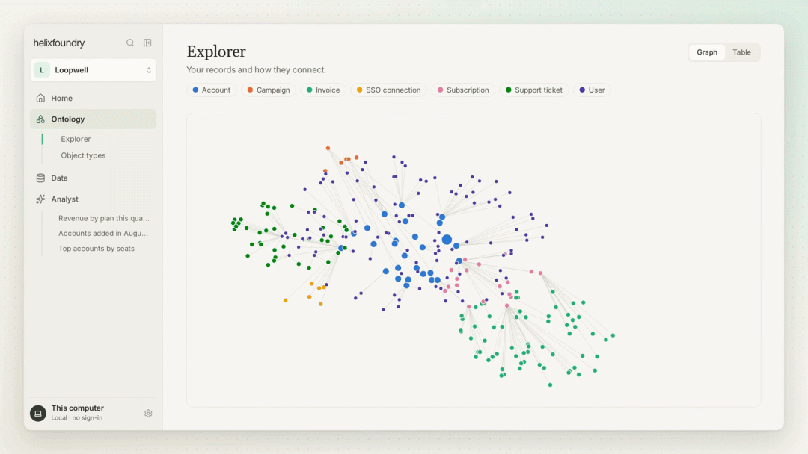
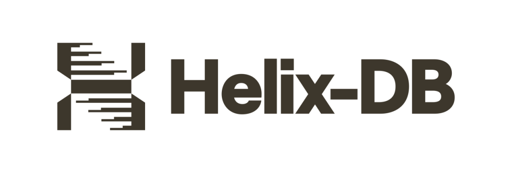
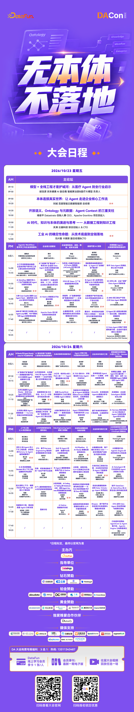

# Helix Foundry开源：图与SQL联手，自动构建跨源企业本体

> 来源：DataFunTalk
> 链接（原文）：https://mp.weixin.qq.com/s/gmn3baN1x23P5inIE_WlDA
> 日期：2026-10-18
> 原始素材：`assets/helix-foundry-graph-sql-ontology/`（original.html + 6 张图）

导读 一家 SaaS 企业想知道，哪些付费客户最近使用量下降，未来一个月又可能面临续费风险。这个问题看起来只需要查询几张表，真正做起来却可能涉及四五套系统：Stripe 记录订阅和付款，PostHog 保存产品使用行为，WorkOS 管理用户身份，业务数据库中还有客户、组织及产品配置。
麻烦在于，这些系统未必使用同一套客户标识。支付账户中的邮箱可能与登录邮箱不同，一个客户组织可能对应多个用户，产品事件也不一定直接关联订阅记录。即便 Data Agent 能写出 SQL，也必须先知道这些记录应该如何对应。
主要内容包括以下几个部分：
1. 11个数据集，为什么还需要构建一层企业本体？
2. Ontology如何自动构建？AI没有直接决定实体关系
3. HelixDB + DuckDB：图数据库与OLAP如何协作？
4. 32个客户、240个订单，Data Agent实际完成了什么？
5. 与传统Semantic Layer相比，它还差什么？

HelixDB 开源的 Helix Foundry，正在尝试把这部分工作纳入数据分析系统。项目采用 Apache 2.0 许可证，将 HelixDB、DuckDB 和 Parquet 组合起来：连接多个数据源，根据数据中的键和关联信息生成 Ontology 建议，经用户确认后创建真实的业务对象和关系，再通过 SQL 完成分析。
有意思的是，初始 Ontology 的发现并不依赖大模型自由推断。Helix Foundry 使用确定性程序识别候选实体和关系，AI 参与描述优化和后续分析建模。这种分工，让它与单纯依靠大模型生成 SQL 的 Data Agent 有了明显区别。
01

11个数据集，为什么还需要构建一层企业本体？
Helix Foundry 的官方示例模拟了一家名为 Loopwell 的 B2B SaaS 企业。它将 PlanetScale、WorkOS、PostHog、Stripe 及 S3 中的数据组织成 11 个相互关联的数据集，覆盖账户、用户、组织、身份连接、产品事件、订阅、账单、支持工单及营销活动等信息。项目还刻意保留了部分真实企业中常见的数据问题，例如支付邮箱与登录邮箱不一致、支持工单缺少账户关联、营销代码录入错误。

图1｜Helix Foundry 的 Ontology Explorer：Loopwell 工作空间里 Account、Subscription、Support ticket 等对象与关联关系的可视化
假设要分析某家企业客户近期的业务状况，数据工程师可能需要从 PlanetScale 获取账户信息，用 WorkOS 确定组织与用户的归属，在 PostHog 中计算产品使用情况，再到 Stripe 中查找对应订阅。如果客户在不同系统中使用不同 ID，SQL JOIN 的难度就从语法编写变成了实体身份识别。即使 SQL 成功执行，关联错误也可能让收入重复计算，或把某个用户的行为归到错误的客户名下。
传统数据仓库通常通过 ETL、主数据管理、维度建模和语义层来处理这些问题。它们已经有相当成熟的方法，只是跨系统映射仍然需要工程师持续维护。新接入一个系统，可能就要重新检查业务主键、外键、粒度和指标口径。对于频繁引入 SaaS 工具的企业，这部分工作很难一次完成。
Helix Foundry 使用 Ontology 来组织这些关系。在它的实现中，Ontology 包含业务对象类型、具体对象记录以及对象之间的关联。例如，Customer 与 Subscription 可以形成关联，Organization 与 User 之间可以存在成员关系。系统最终保存的也不只是一份关系定义文件，而是可以在 HelixDB 中查询和浏览的对象及关联边。不过，这一层能否反映真实业务，仍取决于源数据是否提供了可靠的标识与映射依据。
02

Ontology如何自动构建？AI没有直接决定实体关系
打开 Helix Foundry 后，初始化流程分为 AI、Data 和 Ontology 三个步骤。用户可以选择本地模型，也可以配置托管模型；随后连接数据库、SaaS 工具或文件，并指定需要导入的表与数据集。PostgreSQL、MySQL 和 Neo4j 支持结构发现及快照导入，Stripe、WorkOS、PostHog 等连接器则针对各自的数据对象进行适配。系统并不会自动导入全部可访问数据，每项输入都需要明确选择。
数据导入后，Helix Foundry 会生成一个 Ontology 草案。这里的核心是确定性关系发现：根据数据结构、候选键以及可匹配的关联字段，识别可能属于同一业务实体的记录和实体间关系。部分连接器还会主动整理字段形式。例如，Stripe 连接器会把客户、订阅等对象的标识转换为相应的 _id 字段，WorkOS 也保留能够关联组织与用户的标识；PostHog 中的 distinct ID 则可用于连接产品行为与应用用户。这些处理让跨源匹配拥有相对明确的基础。
但键匹配有天然边界。两个系统都有 customer_id，并不能直接证明它们采用相同的编码体系；邮箱相同，也未必代表同一法律实体或业务账户。Loopwell 示例中的邮箱差异、缺失关联和错误代码，正说明真实数据很难仅凭字段名称完成可靠合并。Helix Foundry 可以提供初始关系建议，无法保证所有身份冲突都被自动解决。遇到复杂关联，仍然需要引入明确的业务映射规则。
AI 在这个阶段承担的工作，比项目名称容易让人联想到的范围更窄。
官方文档明确说明，初始 Ontology 建议由确定性逻辑计算产生。模型准备就绪后，可以在后台改写摘要、实体描述和关系名称，但不会直接决定初始结构。用户能够重命名或排除不合适的实体，再确认构建。这样可以避免将未经核实的大模型推断直接写入业务对象网络。
确认后的流程也有具体实现。构建任务会将通过验证的对象与关联关系物化为 HelixDB 中的记录和边，按阶段发布工作空间。这里已经超出了普通数据字典或关系建议的范畴。对于后续由 AI 生成的 SQL Pipeline、对象类型和关系定义，系统还设置了 Schema 检查、查询执行验证、失败修复和审核机制。正式发布时会检查输入快照版本、提案哈希及当前发布版本，防止把基于旧数据验证的定义直接覆盖新版本。
这套流程的工程价值，是将原本散落在数据接入、关系发现、模型定义和发布环节中的操作连接起来。用户依然负责确认业务语义，但系统能够完成一部分可重复的结构发现、对象生成和发布工作。
03

HelixDB + DuckDB：图数据库与OLAP如何协作？
Ontology 构建完成后，Helix Foundry 还需要解决另一件事：业务关系如何参与真正的数据分析。如果只有图数据库，系统可以展示客户、组织、订阅之间的关联，却仍然需要处理事件聚合、收入统计、时间窗口计算等分析任务。Helix Foundry 选择让 HelixDB 和 DuckDB 分别承担这两类工作。

从官方架构看，HelixDB 保存工作空间元数据、业务对象、关联边、任务及发布状态；DuckDB 负责对声明的数据输入执行 SQL 和关系型转换；Parquet 则保存数据导入后形成的不可变快照。
系统由 App、后台 Worker、独立 Executor、HelixDB 和 Ollama 等组件组成。数据进入本地工作空间后，被整理为带有版本信息的快照，供后续的 SQL Pipeline、对象构建和分析查询使用。
可以继续看 Loopwell 的客户分析场景。假设系统已经识别客户与组织、订阅记录之间的关系，分析人员需要计算客户所在区域的收入、订阅情况和产品活跃度。对象关系用于明确哪些记录可以关联，DuckDB 则读取对应快照，完成筛选、JOIN、分组和聚合。用户得到的分析答案会关联实际执行的 SQL 及输入快照版本。需要特别说明，这里是 HelixDB 与 DuckDB 在同一工作流程中协作，并不代表项目已经实现了一个可以任意混合图遍历与 SQL 的统一查询引擎。
Parquet 快照在这套架构中十分重要。传统自然语言数据分析容易出现一个问题：Agent 昨天与今天回答同一个问题，数字发生变化，却无法解释差异来自模型、SQL，还是底层数据更新。Helix Foundry 将分析依赖的数据版本记录下来，使用户能够追溯执行查询时使用了哪一版输入。数据刷新也有明确机制：PostgreSQL 和 MySQL 在具备权限与条件时可以通过原生变更捕获触发同步，否则按照计划刷新快照。不过当前实现仍会将已提交的变更合并为新的完整快照，并没有把每一条 CDC 事件直接实时写入 Ontology。
图与 SQL 的组合还涉及执行安全。Helix Foundry 不让模型生成的 SQL 直接接触所有本地文件或数据库凭据。独立 Executor 只加载获准的数据快照，禁用外部访问及扩展安装，并将生成的查询限制为单条 SELECT。默认最多同时执行两个 DuckDB 任务，每个任务设置 512 MB 的内存额度，超出后可按配置使用磁盘溢写。连接器凭据与 SQL 执行环境隔离，从而降低错误查询接触敏感资源的风险。
官方在 2026 年 10 月 10 日补充了更大工作空间的本地测试。在 M1 Pro、Docker 分配 8 CPU 和 8 GB 内存的条件下，测试数据包含 3 万条客户记录、7 万条订单记录和约 6.77 万条关系。HelixDB v0.0.12 完成这批对象及关系发布用了约 64 秒。该测试证明了项目在这一数据规模上的实际发布路径，但它并不包含所有企业数据接入、模型推理和持续运行成本，也不能直接推导生产环境的吞吐上限。
04

32个客户、240个订单，Data Agent实际完成了什么？
如果说前三部分解决数据如何组织，那么 Data Agent 的价值就要看它能否在这些数据上完成可靠的分析任务。Helix Foundry 的官方验证报告提供了一组较完整的参考案例，使用本地 qwen3:4b 模型，围绕客户收入和延迟订单建立分析工作空间。
在这项验证中，系统根据示例数据和分析目标，生成了 3 个数据目录条目、1 条 SQL Pipeline、Customer 与 Order 两种 Ontology 对象类型、1 类关联关系及包含两个组件的仪表板。初始生成结果并非一次通过，自动验证机制对 Ontology 和仪表板草案进行了修复。经过最终 10 项检查后，结果通过 API 审核发布。模型共调用 6 次，报告使用 14,516 个 Token，从第一阶段到形成可审核提案约耗时 153 秒，另需计算发布耗时。
发布结果包含 32 个 Customer 对象、240 个 Order 对象，以及连接两者的 240 条关系，覆盖全部 32 个客户。系统还计算了按区域汇总的收入，并识别出 35 个延迟订单。更关键的是，发布后的查询都绑定了明确声明的数据快照版本。另一项本地验证显示，从某条订单记录发起查询时，Agent 能够选择回答任务、执行 SQL，并返回 35 个延迟订单及来源引用。
这些数字的价值，不在于 240 个订单有多大的计算量，而在于它验证了一条完整路径：从原始数据建立目录和对象定义，再生成 SQL、校验关联关系、执行分析并发布结果。用户可以沿着对象关系查看数据，也可以直接提出业务问题。相较于只负责 Text-to-SQL 的系统，Helix Foundry 多出了可复用的实体关系以及围绕数据版本建立的验证流程。
当然，这项结果属于项目方在本地开发环境完成的参考验证，并非外部企业生产案例。它使用的数据规模有限，模型生成的定义也经过自动修复。即便全部程序检查通过，依然不能证明“收入”“延迟订单”或“高价值客户”等指标已经符合某家企业的业务规则。官方也承认，语法和执行验证无法替代业务语义审核。对 Data Agent 来说，这恰好是关键的能力分界：执行成功可以交给程序验证，业务解释仍需要明确的责任主体。
05

与传统Semantic Layer相比，它还差什么？
Helix Foundry 很容易被理解成一个能够自动生成语义层的工具，但与 dbt MetricFlow 等成熟方案相比，两者的侧重点存在差异。以 dbt Semantic Layer 为例，数据团队可以通过 Entity、Dimension 和 Metric 定义可复用的指标及关联路径，由 MetricFlow 根据语义模型组织 JOIN，避免部分重复计算和错误连接。它并非只负责展示指标，同样能够处理实体之间的语义关系。
Helix Foundry 当前更突出的能力，是围绕多个外部来源构建实际的业务对象网络。连接器先获取数据，确定性程序提出实体与关联建议，HelixDB 保存物化对象，DuckDB 执行分析。它尤其适合讨论那些尚未完成统一数仓建模、但希望快速探索跨源对象关系的场景。不过，建立客户与订阅的关联之后，仍然需要定义“有效客户”如何计算、退款是否冲减收入、订阅变更如何归属统计周期。这些问题属于指标治理，无法仅靠图关系自动解决。
实际部署也有清晰限制。官方将 Helix Foundry 定位为可执行的单服务器 MVP，本地优先，并采用面向单机用户的访问方式。它没有直接提供完整的企业多租户协作体系，默认也不应暴露到公共网络。当前版本不支持向源系统写回数据、跨外部系统的分布式事务或分布式计算。复杂 SQL JOIN 仍然需要业务人员审核，大规模 Ontology 的分页与浏览能力也有待完善。官方公布的备份、恢复与升级脚本在 10 月 10 日改写后，尚未完成真实 Compose 环境下的完整验证。
还有一个容易被忽视的问题：Ontology 本身需要持续维护。新数据源加入、字段发生漂移、客户身份映射规则改变，都可能影响已有实体关系。Helix Foundry 提供 Schema Drift 审核、版本检查、人工编辑保留、重新物化与定义回滚等能力。它可以重新验证旧定义并基于当前快照物化，但无法把回滚理解为恢复所有源系统的历史状态。对于业务对象长期演化、权限隔离和跨部门口径治理，这些机制仍需要接受更复杂的实际检验。
Helix Foundry 展示的技术路线因此值得关注：它将数据接入、实体关系发现、Ontology 物化、SQL 计算和 AI 分析放入同一套本地工作流程，并用确定性程序、快照版本和人工审核约束模型行为。对于企业 Data Agent，这提供了一个可以进一步验证的工程方向。真正决定它能否进入生产环境的，仍是跨源身份匹配的准确性、复杂业务规则的维护成本，以及数据规模扩大后整套系统的稳定性。
参考来源
Helix Foundry 官方 GitHub（Apache 2.0）
https://github.com/HelixDB/helix-foundry
HelixFoundry Technical Guide：数据源连接、Ontology、AI、架构与安全机制
https://github.com/HelixDB/helix-foundry/blob/main/docs/GUIDE.md
Guided Setup：Ontology 建议、审核及构建发布流程
https://github.com/HelixDB/helix-foundry/blob/main/docs/onboarding.md
Implementation and Validation：本地模型验证、对象关系数量、性能及项目边界
https://github.com/HelixDB/helix-foundry/blob/main/docs/VALIDATION.md
dbt MetricFlow 官方文档：语义模型、指标、实体与 JOIN 机制
https://docs.getdbt.com/docs/build/about-metricflow

往期推荐

30万奖金+海量Credit，这场Agent大赛凭什么值得去？

问数、归因、写报告，AI不再靠猜！腾讯数据智能体工作平台DataBuddy来了！

阿里开源Data Agent：语义层之外补上分析方法

从知识加工到知识治理：网易智企如何把知识变成 Agent 可调用的底座

如何基于语义层 + Skill + 知识库让 Agent 更懂业务？

瓶颈不在模型，在企业身份：邓白氏把 Agent 放进了监管流程

Harness Engineering 的语义底座：本体驱动的 Agent 可控执行

办 800 人 Agent 峰会选址，我把 6 家酒店丢给了豆包工作

破局Agent落地：基于Harness+记忆+Skill的Data Agent架构演进！

Harness Agent 在实际业务中的落地现状和未来发展

点个在看你最好看

SPRING HAS ARRIVED

