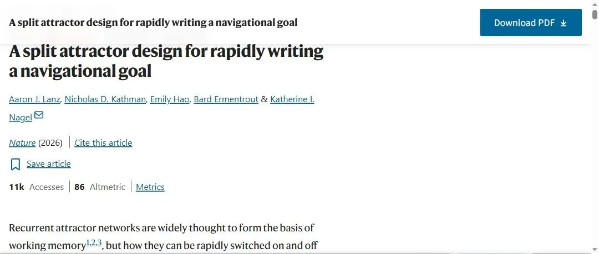
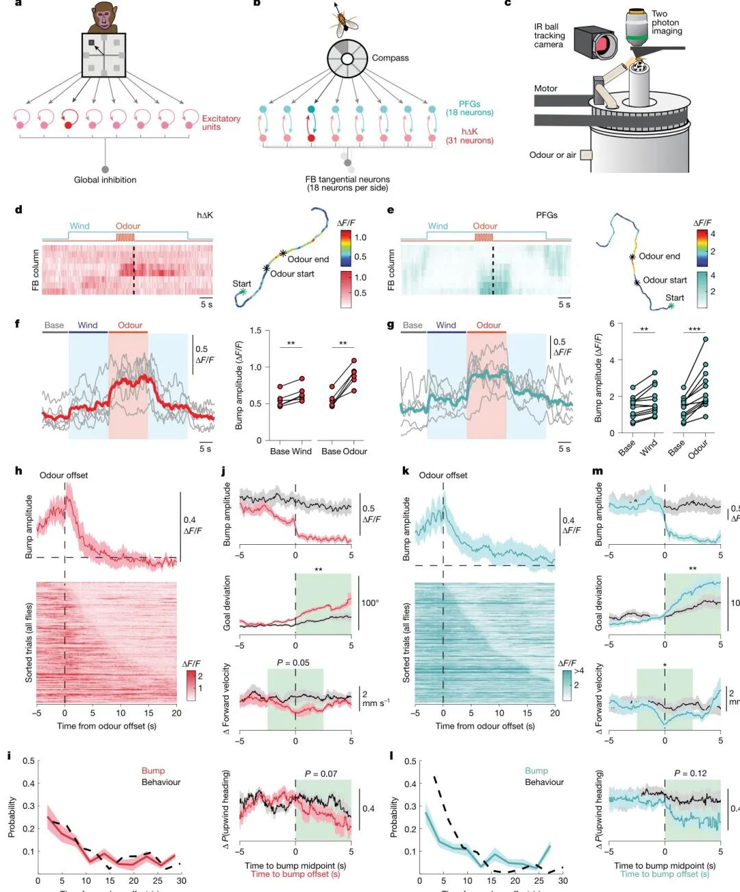
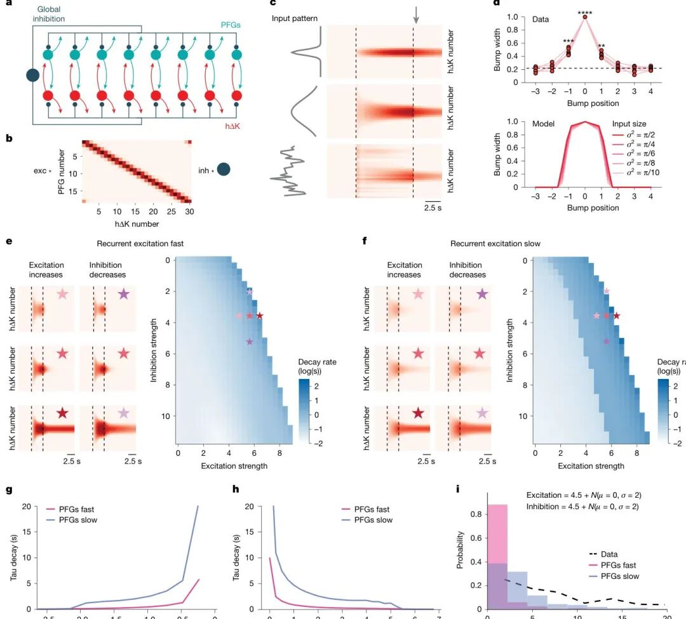
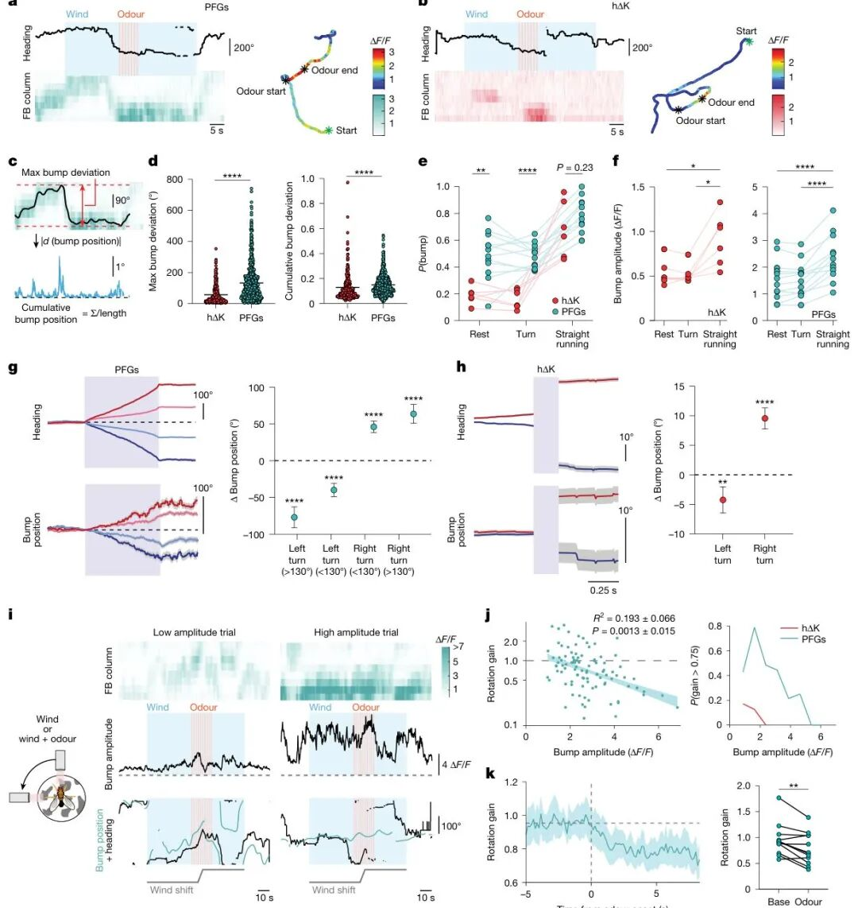
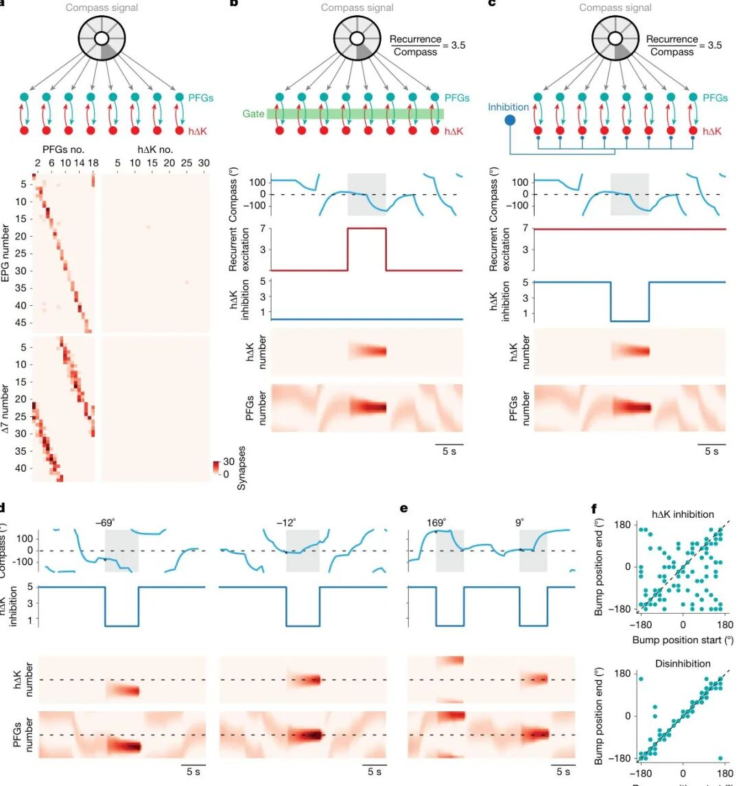
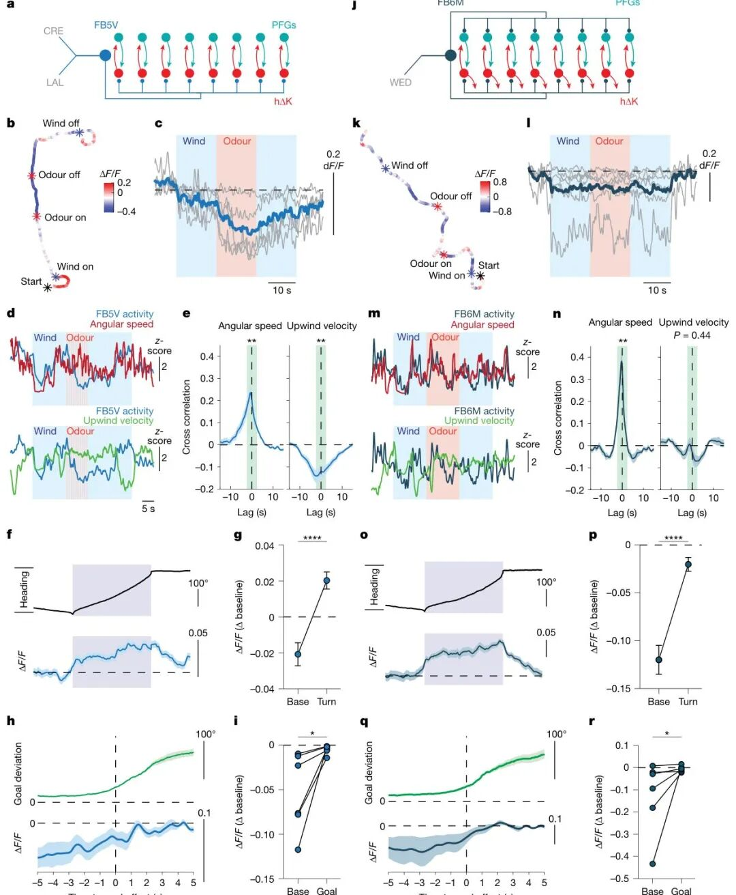

# Nature丨记忆的神经机制研究：工作记忆的新增与保持

> 来源：Brain博览记2026
> 链接（原文）：https://mp.weixin.qq.com/s/0g3EVSn-Lmk-ktShPIa-WQ
> 日期：2026-10-18
> 原始素材：`assets/nature-working-memory-neural-mechanism/`（original.html + 8 张图）

Nature丨记忆的神经机制研究：工作记忆的新增与保持
基本信息
• Title： A split attractor design for rapidly writing a navigational goal
• 发表时间： 2026-10-07（在线发表）
• 发表期刊： Nature
• 影响因子： 56.1（2025 年度，JCR Q1）
• 研究方法： 在体双光子钙成像 + 离体全细胞电生理 + 连接组计算建模
• 参与被试： 雌性果蝇（1–14 日龄，多种转基因品系）
工作记忆有个经典难题：负责“记住”的神经网络必须足够稳定，否则记忆几毫秒就散了；可它又必须能随时开关——新信息来了要写入，任务结束了要清空。稳定和灵活，在模型里天然打架。这项研究在果蝇脑子里找到了一个两全的电路设计：把网络拆成两半，一半管“记什么”，一半管“什么时候记”。
研究背景
复馈（recurrent）神经网络被广泛认为是工作记忆的基础：神经元靠彼此激励把活动“兜住”，形成持续发放，持续时间远超单个神经元的膜时间常数——这说明持续性来自网络互动。经典模型用“局部复馈兴奋 + 全局抑制”就能重现实验里的持续活动，但代价是：配置成稳定吸引子的网络一旦激活就很难关掉。模型作者们通常干脆加一个“门”来控制开关时机——可是，生物学里的门长什么样、装在回路的哪里？没人说得清。
果蝇是回答这个问题的理想对象：连接组把每个突触都数清楚了，遗传工具又能精确操控同一批神经元。果蝇导航中心（中央复合体）的扇形体（FB）里，h∆K 与 PFG 两类局部神经元在柱状结构中结成环状复馈连接——PFG 接收罗盘系统的航向输入，两者还共同接收全局输入。这个架构像极了经典工作记忆模型。
实验方法
三线并进：
在体成像： 果蝇在气垫球上行走，球的转动闭环控制风向；双光子记录 FB 神经元。气味用 0.5% 苹果醋（15 秒阶梯或 1 Hz 短脉冲），分析三类行为状态：休息、转弯、直线奔跑；
离体电生理： 全细胞记录 h∆K 神经元，光遗传逐一激活各类突触伙伴，配合药理阻断剂与破伤风毒素（TNTe）操控；
计算建模： 按 hemibrain 连接组的真实连接结构建 30 个 h∆K + 18 个 PFG + 1 个抑制性切向神经元的速率模型，兴奋/抑制强度可调，突触时间常数由电生理数据拟合。
核心发现
一、两群神经元共享持续活动，且持续性靠复馈
气味出现时，h∆K 与 PFG 都在 FB 上产生一个局部化的活动“凸包”（bump），并在果蝇保持目标航向期间持续。关键对应关系：bump 消失的时刻，正是果蝇偏离目标方向的时刻。电生理进一步追责：h∆K 对电流注入只有即时反应、没有内在持续性；但阻断 h∆K 自身的突触输出（TNTe）后，持续的兴奋反应消失了——持续性来自网络，不来自单细胞。
二、慢兴奋 + 快抑制：稳定性的配方
突触层面有个耐人寻味的分工：兴奋是慢的——激活胆碱能输入（FB6A/D）、PFG 或 5-羟色胺能的 ExR3，都在 h∆K 上引起缓慢而持续的兴奋（可被烟碱或 5-HT 拮抗剂削弱）；抑制是快的——两个抑制性切向类型 FB5V 和 FB6M 一激活就立刻压制，且能被 GABAA 拮抗剂 picrotoxin 翻转成兴奋。
这个“慢兴奋+快抑制”的组合在模型里展现了价值：如果复馈兴奋也是快的，只有非常窄的一组兴奋/抑制强度能让网络产生缓慢衰减的持续活动，稍一扰动就跳到“瞬间衰减”或“永不衰减”；换上慢兴奋，稳定持续活动的参数域大幅扩张，而且小幅调节强度就能平滑调节记忆维持多久——加入试次间噪声后，模型再现了实验观察到的持续时长分布。一个只有两个节点的极简模型复现了同样的规律，说明这是复馈回路的通用设计原则，不挑网络构型。
三、转弯时，两半网络说散就散
成像里藏着开关的线索：直线奔跑时，h∆K 和 PFG 都有高幅 bump；但转弯和休息时，PFG 仍保持一个低幅 bump，而且它的位置随转弯在柱间平移——和罗盘神经元一样在跟踪航向；h∆K 却几乎沉默，转弯结束后才在新位置重新出现。一个巧妙的“风移”实验量化了这种切换：突然把风向转 90°，PFG 的 bump 幅度低时位置跟着航向走（旋转增益接近 1），幅度高时位置纹丝不动（增益接近 0）——同一群神经元在“跟随模式”和“锁定模式”之间切换，气味出现会把它们推向锁定模式。
四、模型：抑制一半，就是开关
连接组提供了最后一块拼图：只有 PFG 直接接收罗盘输入，而且这个前馈输入比 h∆K–PFG 复馈连接弱得多（模型中复馈：罗盘 = 3.5:1）。仿真显示：强抑制 h∆K 时，PFG 低幅跟随罗盘；解除抑制（去抑制）时，复馈立刻把当前罗盘位置“锁”成一个高幅稳定 bump——就像数字电路里的锁存器。连续两次去抑制，能把两个不同的航向先后写入网络。记忆的“内容”由 PFG 携带，“写入时机”由对 h∆K 的抑制控制——把输入和开关分到网络的两半，就是稳定与灵活兼得的设计。
五、在体验证：刹车踏板找到了
模型能不能对上真实的脑？研究者对 FB5V（每侧 9 个、专门抑制 h∆K，树突分布在气味区 CRE 和前运动区 LAL）做了在体成像：它们紧张性放电，气味时被强烈抑制，抑制还持续到气味结束后的逆风行走期；活动与角速度正相关、与逆风速度负相关；大转弯（>130°）时活动飙升，偏离目标方向时也升高——每一次该“松刹车”的时刻（气味、目标行走）它都在松，每一次该“踩刹车”的时刻（转弯、偏离）它都在踩，与去抑制模型的预测完全吻合。FB6M 的角色略有不同：它同时支配两群神经元，更像是许可性的共同调节器，而不是解耦开关。
总结
这项研究给出了一个完整的电路设计原则：分裂吸引子 + 去抑制门控。慢兴奋让吸引子稳定且可调，快抑制配合行为状态做快速开关；网络拆成两半后，一半携带记忆内容、一半受门控控制写入时机。作者认为这可能是复馈回路兼顾稳定与灵活的通用解——从果蝇的导航记忆到哺乳动物前额叶的工作记忆，用的可能是同一套思路。
作者自认的局限：部分持续性可能来自回路上游（FB5V 的抑制在气味后仍持续，其上游蘑菇体输出神经元可能参与）；模型的严格检验还需要额外的因果实验（如直接激活或沉默 FB5V，预测两群神经元活动的可检验变化）；光遗传整类激活可能带来非生理的去极化，单细胞反应存在异质性。
关于我们
👋 你好，这里是「Brain博览记」，专注脑科学的科研团队。
每天看文献、做研究、处理数据，分享我们的所见所学。
🧠 聚焦脑科学、心理学、神经科学、脑机接口，追踪大脑、认知与行为研究的重要进展。
📚「文献解读」——精选“脑科学”前沿文章，从研究背景、实验设计到结果与启示，带你真正读懂一篇好文章
⚡「每日速览」——捕捉最新24小时前沿文献，提炼核心发现与研究亮点，每日更新。
🔬「脑科学知识库」——持续更新最新文献，直接加入你的“AI知识库”。
🔬 持续关注认知、情绪、记忆、注意、决策、脑影像、计算建模及神经精神疾病等研究方向
愿我们一起连接脑科学，洞见认知未来。

