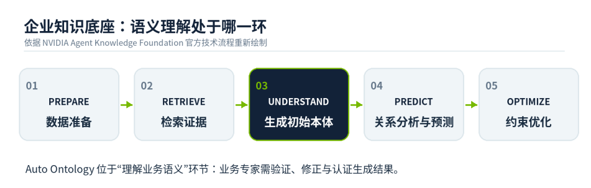
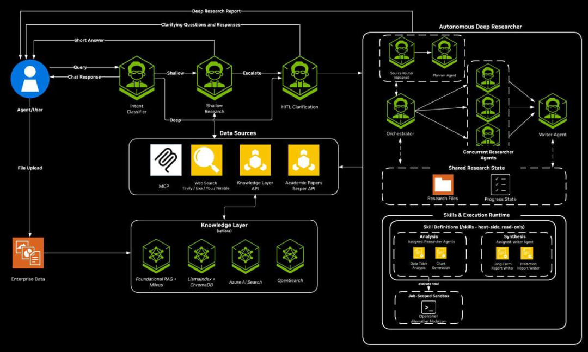
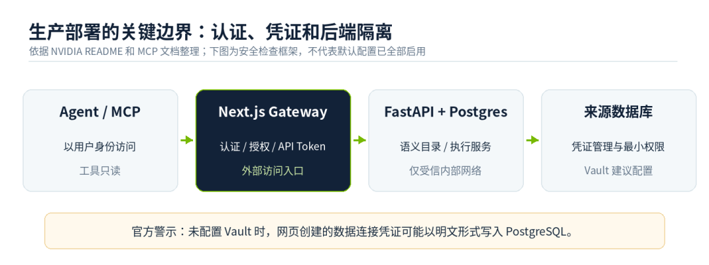

# NVIDIA  开源Auto Ontology，本体创建时间缩短90%

> 来源：DataFunTalk
> 链接（原文）：https://mp.weixin.qq.com/s/DXdqHAA-5enaRKvY5bkt-g
> 日期：2026-10-24
> 原始素材：`assets/nvidia-auto-ontology/`（original.html + 8 张图）

导读 让 Data Agent 回答“上季度收入增长了多少”，困难往往不在 SQL 语法，而在“收入”究竟指向哪个业务口径。销售系统记录签约额，订单系统保存实付金额，财务系统确认可入账收入；三份结果都可能合法，却不能直接替换。Agent 如果只依靠字段名称选择数据，返回的数字越流畅，业务风险反而越不容易察觉。
10 月 21 日，NVIDIA 公布扩展后的 Agent Toolkit，将开源项目 Auto Ontology 纳入新的 Agent Knowledge Foundation。它从企业元数据、文档及已有语义模型出发，组织业务实体、关系与指标，并通过 MCP、CLI 和 API 向 Agent 提供可复用的上下文。NVIDIA 在官方页面披露：其测试中的本体创建时间缩短了 90%。这是一项关于初始建设效率的厂商测试结果，并非企业端到端部署周期或准确率的通用承诺。
主要内容包括以下几个部分：
1. 本体建设的成本，为什么一直卡在数据打通之后
2. 从 Schema 到业务实体：Auto Ontology 实际组织了什么
3. Agent 不再直接猜 SQL：九项 MCP 工具怎样协同
4. 一套本体能否长期可信，取决于审核与生产配置
5. NVIDIA、Palantir、Snowflake、Databricks：同谈 Ontology，落点并不相同

原本由数据工程师反复编写的字段说明、指标映射和查询提示，开始被整理为独立的语义目录；Agent 不再必须从原始 Schema 猜测业务含义，而可以先查经过审核的定义，再执行数据查询。

01

本体建设的成本，为什么一直卡在数据打通之后
一套企业数据平台通常已经积累了表结构、字段描述、数据血缘、BI 报表和指标文档，但这不等于形成了一套可供 Agent 使用的业务知识。数据库知道 customer_id 是字符串，却未必知道它是“消费者账号”还是“企业客户”；一张订单表能够关联发票，并不意味着一张发票只对应一笔订单。业务实体、指标粒度与例外规则，仍需人来确认。
传统 Ontology 建设因此很重：数据工程师梳理来源表和主外键，架构师定义对象及关联，财务、销售等团队审核指标口径。即便首期建模完成，新系统接入、组织调整、业务指标改版仍会带来持续维护工作。问题不只是缺少自动化工具，而是“原始结构”和“权威业务含义”没有现成的一一对应关系。
NVIDIA 将 Auto Ontology 定位为一个生成起始本体的开放组件。官方概括了五个动词：Discover 从元数据发现对象与关系；Ground 对齐指标、实体和定义；Validate 用认证规则及血缘检查查询；Expose 通过接口提供上下文；Learn 将被认证的纠正纳入语义资产。其价值在于减少候选模型的手工整理，而业务判断并未消失。
90% 的效率数字需要放在这一边界下阅读。NVIDIA 说明该结果来自自身测试，但没有随页面公开完整的测试规模、人工审核投入与评价方法。因此，它证明了厂商在特定条件下观察到的建模加速，不足以证明企业无需治理团队，也不能据此估算跨系统上线时间。
02

从 Schema 到业务实体：Auto Ontology 实际组织了什么
在工程实现上，Auto Ontology 不只是向模型输入一份数据库 DDL。当前开源仓库包含基于 FastAPI 的后端、Next.js 前端、数据摄取服务，以及保存语义目录和向量索引的 PostgreSQL/pgvector。它调用 NVIDIA NIM 提供的推理、Embedding 和 Reranking 能力，支持连接 Databricks、Snowflake、PostgreSQL 与 DuckDB，并提供 Docker Compose、Kubernetes 两种部署路径。

一个零售企业可以用来说明它解决的是什么问题。假设 CRM 持有客户信息，交易库保存订单，财务系统维护发票。系统可根据已有元数据提出 Customer、Order、Invoice 等实体候选，并尝试找出客户—订单、订单—发票的关联。但这些只是建模线索：一个客户可能在多个系统中有不同 ID，一张发票也可能汇总多笔订单；如果直接以同名字段连接，很容易产生重复计算。
真正关键的是指标语义。销售部门说的 Revenue 可能是支付金额，财务定义的 Revenue 则可能依照确认规则计算。系统可以发现二者都与订单有关，却不能凭字段相似度决定谁覆盖谁。可复用的语义层应当保留指标定义、适用范围、粒度、关联路径和物理字段映射，并标记哪些定义已经认证。这样，Agent 找到的就不只是“看起来相关的列”，而是一个可以核查的业务概念。
Auto Ontology 的 README 明确写到，它用企业元数据建立语义与图式推理层，并能补充企业已有的 Ontology、Semantic Model。这是对现有资产的组织与复用，并不要求把所有数据复制到另一个图数据库。业务人员对生成结果进行测试、修正和认证，才是从候选结构走向可信业务语义的分水岭。
03

Agent 不再直接猜 SQL：九项 MCP 工具怎样协同
对于 Data Agent 开发者，Auto Ontology 最具体的工程入口是 MCP。官方文档中的服务只是公共 API 的 HTTP 客户端：Agent 通过 MCP 调用，再经带认证的 Next.js API 网关进入后端，而不是由 MCP 服务自身持有数据库凭证或绕过平台权限。这种分层把“Agent 会使用哪些工具”与“当前用户有权访问什么”分开处理。
公开文档列出了九项默认工具。search_terms、get_term 用于查找业务术语和解释；get_term_columns、get_term_sql_attributes、get_sql_attribute、describe_table 用于查看术语与实际字段、SQL 属性及表的语义关联。check_answerable 判断语义层是否覆盖用户问题，check_readiness 检查语义层是否已编译且数据库连接是否可执行；ask_question 才启动完整的自然语言问答与 SQL 查询链路。
例如有人询问“上季度活跃客户数”。Agent 可以先检索“活跃客户”的定义和映射字段，再执行可回答性与连接就绪性检查，最后调用 ask_question。该工具返回答案、实际执行的 SQL 和结果行，供上层系统复核。文档还标明结果最多返回 100 行，并通过 row_count、truncated 告知是否截断；因此“拿到了查询结果”不能被误解为“返回了完整明细”。
默认 MCP 工具全部是只读接口，并未暴露任意浏览原始数据库、Schema 或原始列的工具。官方说明这是有意设计：希望 Agent 借助语义层理解数据，而不是绕过约束直接猜表。需要区分的是，ask_question 仍可经平台执行查询 SQL；“只读”不等于没有访问生产数据的风险，数据库账户、行级权限和审计仍需企业自行配置。
这也解释了 Validate 的意义：生成 SQL 与执行成功只完成了技术检查，指标口径、连接粒度、数据来源与可解释性仍需验证。Auto Ontology 提供了让验证更可操作的语义映射和查询记录，但官方没有承诺所有生成查询都能自动通过业务正确性审计。
04

一套本体能否长期可信，取决于审核与生产配置
初次生成本体只是开始。业务增长可能改变“活跃用户”的统计窗口，财务关账会改变收入确认时点，新业务线可能引入新的客户标识。如果缺少变更审批、回归测试与版本记录，本体就会从可信上下文慢慢变成另一份过时文档。Auto Ontology 将 Learn 列为能力方向，强调吸收已认证的纠正，但不宜据此写成“所有用户反馈都会自动变成正式业务规则”。
更稳妥的落地路径是将定义划分为候选、待审核和已认证三种状态。系统负责发现新增字段和关联、提出指标候选，业务所有者负责裁定口径，数据团队通过固定测试问题和 SQL 结果检查变更。上线后，再观察口径冲突率、错误 SQL 比例、查询可回答率和人工复核投入。比单次建模速度更重要的，是它在规则变化时是否仍然可控。
部署文档还给出了一个不应忽略的安全细节：通过 Web UI 添加数据源时，如果未配置 HashiCorp Vault，连接对象（包括密码）可能以未加密 JSON 形式存储在 PostgreSQL；Vault 默认并不启用。企业部署前应优先确认密钥存储策略、最小权限数据库账号与网络隔离，而不能只因为系统支持认证与 RBAC，就认为敏感凭证自动受到保护。
另一个信任边界在服务网络。官方 README 提醒，FastAPI 使用的内部用户身份头由 Next.js 网关转发，后端端口不应对公网直接暴露。MCP 使用平台用户身份与权限，默认工具面又经过显式白名单限制。这些设计让系统更容易进入现有治理体系，但真正的生产可靠性仍取决于实际部署、审计与权限配置。

05

NVIDIA、Palantir、Snowflake、Databricks：同谈 Ontology，落点并不相同
把 Auto Ontology 放进企业数据生态里看，会发现它并没有替代所有既有本体平台的意图。NVIDIA 官方称其可以补充现有语义模型；它选择从元数据发现、语义组织、查询验证以及 MCP 接入切入，为不同 Agent 框架供应可复用的知识上下文。它更像一个开放的语义支撑组件，而不是覆盖数据治理、业务应用和写回动作的完整企业操作平台。
Palantir Ontology 的覆盖面更广。它通过对象、属性和链接表达企业的业务状态，并以 Action、Function 将对象修改和业务流程连接起来。对于需要把分析结果变成采购、派单、审批等系统动作的场景，业务执行与控制是核心组成部分。Auto Ontology 当前披露的 MCP 默认工具主要面向查询与解释，不能与这种可执行的业务本体混为一谈。
Snowflake Horizon Context 则强调在数据目录、语义视图、血缘和访问控制之间建立统一上下文：Semantic Views 让指标、维度和关系可由 Cortex Analyst 等能力复用，Autopilot 可以帮助生成语义视图。Databricks Genie Ontology 同时结合自动推断的知识与 Unity Catalog 中由人明确管理的 Metric Views、Pages 等语义资产。两者也都在做语义自动化，因此“NVIDIA 首次让机器自动构建 Ontology”并不成立。
三类路线的选择取决于企业的现状：如果重点是已有仓库中的指标治理，原生语义层往往最容易沿用权限体系；如果强调业务对象及动作闭环，执行型 Ontology 的价值更直接；如果已有多个平台、想给不同 Agent 共享一个语义入口，可以评估开放组件的集成能力，但也要测算跨源建模质量与长期维护成本。NVIDIA 10 月 21 日的合作公告提及 Palantir、Databricks、Snowflake，涉及的是更广泛的 Agent Knowledge Foundation，不能推断这些企业都已生产部署 Auto Ontology。
对于企业 Data Agent，值得跟踪的指标将从“能写多少条 SQL”转向“有多少问题使用了已认证定义、多少错误可追溯、多少变更可以稳定复核”。当业务知识开始从散落的文档和提示词进入可检索、可审核的共享语义目录，Agent 才更有条件从演示走向长期运行。Auto Ontology 的意义，是把这条工程路径做成了一个可以研究和试验的开源项目；距离真正免维护的企业本体，仍有相当长的路。
本文截至 2026 年 10 月 23 日依据公开技术资料校对。插图均为编辑依据官方文档重新绘制的技术示意图，并非 NVIDIA 官方原始截图；“90%”仅为 NVIDIA 自述测试结果。
参考来源
01 NVIDIA 2026-10-21 官方公告
https://blogs.nvidia.com/blog/enterprise-platforms-agent-toolkit/
02 NVIDIA Agent Knowledge Foundation 技术页面
https://developer.nvidia.com/topics/ai/agent-knowledge-foundation
03 NVIDIA Auto Ontology 项目 README
https://github.com/NVIDIA/auto-ontology
04 NVIDIA Auto Ontology MCP 工具文档
https://github.com/NVIDIA/auto-ontology/blob/main/docs/mcp.md
05 Palantir Ontology / Action Types
https://www.palantir.com/docs/foundry/action-types/overview
06 Snowflake Horizon Context
https://docs.snowflake.com/en/user-guide/snowflake-horizon/horizon-context
07 Databricks Unity Catalog Pages
https://www.databricks.com/blog/unity-catalog-pages-governed-home-your-business-knowledge-genie-ontology

往期推荐

Agent落地别只盯模型：组织、引擎、数据，三层能力才是分水岭

DeepSeek开源生产级推理引擎，552B模型背后的架构曝光

帮红娘公司老板梳理业务，我把"怎么提效"也丢给了豆包工作

别再往 RAG 里塞碎片了：AI 问数的瓶颈不在模型

本体+语义层：腾讯最新数据智能体落地实践！

2.96万星开源iFixAi：Agent完成任务也可能越权

聚焦真实Agent落地样本：Agentic Growth中国峰会来了！

小米 Data Agent：真正拉开差距的不是模型，而是 Harness

准确率全球 Top6:个推 AIBI 如何构建 OntoOS 实现可信问数

GitHub开源Graphify爆红：仓库变图谱，不靠向量

点个在看你最好看

SPRING HAS ARRIVED

