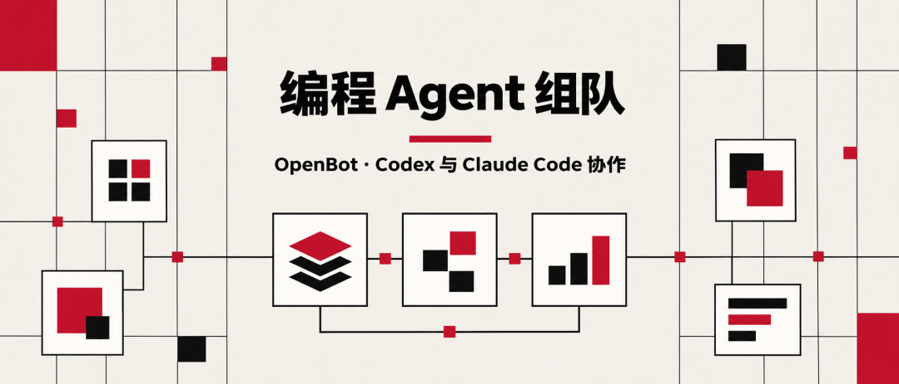
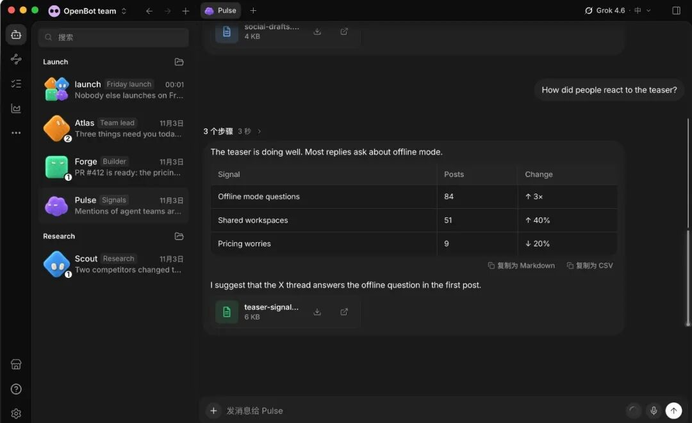

# 已付费的编程 agent 组队上班了：OpenBot 把 Codex 和 Claude Code 变成协作团队

> 来源：AG雷达
> 链接（原文）：https://mp.weixin.qq.com/s/5az1SylUXNFHIm4JGv7hLw
> 日期：2026-11-04
> 原始素材：`assets/openbot-agent-team/`（original.html + 2 张图）

AG 雷达 · SWISS EDITORIAL
额度用完自动换备用模型，数据留在本机，个人非商业免费
OpenBot 是一个本地优先的桌面应用，把 Codex、Claude Code、Gemini、Grok 这些你已在付费的编程 agent 组成能互发消息、交接任务、互相审查的常驻团队；装好后连上已有订阅，一句话建 agent，派活即排队执行。个人非商业免费，商用需买许可。

FACT FIRST · 事实优先

▲ OpenBot 编程 Agent 协作示意封面
01FACT
一句话结论

Codex、Claude Code、Grok 这些编程 agent 各自挂在独立终端里，互不知道对方的存在。OpenBot 在它们下面加了一层本地工作台：各家的 CLI 和登录原样保留，OpenBot 给每个 agent 配名字、指令、独立工作区和消息队列，让它们可以互发消息、交接任务、互相审查。个人非商业使用免费，源码在 GitHub 公开。
02SECTION
先看要点

■ 用现有订阅就能跑：Codex 登 ChatGPT 账号，Claude Code 登 Claude 账号，Gemini 需 Google AI Pro 或 Ultra；OpenCode 有免账号的免费模型；还支持 Grok、Cursor、Cline，以及 Ollama、LM Studio 本地模型和任何说 ACP 协议的 agent（官方举例 Goose、Qwen Code）。

■ 协作有明确机制：每个 agent 有自己的名字、指令和工作区，互发消息、交接任务、互相审查、传文件；agent 忙时可继续派活，消息进队列，可暂停、恢复、取消。

■ 换模型不换人：把 agent 从 Claude 换到 Codex，工作区和对话都还在；额度用完或服务商过载、宕机时，可自动切到另一家的备用模型，聊天里留下切换记录。

■ 数据分工清晰：工作区、对话、文件、浏览器数据都存在你的电脑上；发给模型的请求仍会送到你选的服务商。

■ 许可是关键边界：PolyForm Noncommercial 1.0.0——源码公开、个人非商业免费，商用需向版权方单独购买许可。

快速阅读到这里已经可以做出判断：想在现有订阅上把多个编程 agent 组成协作团队的，值得装来试；需要商用授权或逐步审批的，先看文末限制。

03SECTION
上手四步：从安装到派出第一个任务

第一步，安装。 到 openbot.run 或 GitHub Releases 下载：macOS 13 及以上（Apple 芯片或 Intel）、Windows 10 及以上（x64）、Linux 提供 AppImage。Windows 新版安装包由 SYNTHETIFY LABS 签名。
第二步，连接服务商。 在应用里登录你已有的账号，比如 ChatGPT 或 Claude。各家 CLI 运行时可以由 OpenBot 托管下载并自动更新，也可以用你自己装的 CLI；OpenCode 的免费模型不用登录任何账号。
第三步，一句话建 agent。 用一句自然语言描述你想要的 agent，例如「一个负责每天整理 AI 新闻的研究员」，应用会生成它的指令，你检查、修改后保存。每个 agent 自带头像、指令和独立工作区。
第四步，派活。 直接发消息，可以连发多条——消息排队等 agent 空下来处理，随时暂停、恢复或取消。agent 在自己的工作区里给出回复和产出文件，就是跑通的信号；中途切换备用模型时，聊天里会出现一条切换说明。不在电脑旁时，iPhone、Android 应用和网页端可以连回正在运行的 OpenBot。
下面是原帖附带的应用界面演示截图：左侧是各司其职的 agent 列表（launch、Atlas、Forge、Pulse），右侧是正在汇报社媒信号分析的 Pulse，答复里直接给出结构化表格和文件附件。

▲ OpenBot 桌面应用界面演示：多个 agent 列表与协作对话（来自原帖附图）
04SECTION
用之前要知道的三个限制

■ 开发预览阶段，权限很大：官方 README 明确警告，agent 以完全访问权限运行，读写文件、执行命令、联网、控制内置浏览器都不逐步确认。只派你信得过的任务，做好备份。

■ 不是离线产品：本机存的是工作区和对话，但发给模型的请求一定会送到对应服务商，agent 打开的网页也走网络。

■ 迭代非常快：GitHub Releases 显示 11 月 1 日到 3 日连发 v0.58 到 v0.60 三个版本，截至 2026 年 11 月 4 日约 5,300 Star。功能和界面可能每周都在变，遇到问题先看最新版 changelog。

05SECTION
边界与行动

OpenBot 适合已经在为 Codex 或 Claude 付费、想让多个 agent 分工协作的个人用户；不适合想拿它商用又不想买许可的团队，也不适合要求每个操作都要人工审批的环境。行动路径：装一个 → 连一家 → 建一个最简单的 agent → 派一件小事验证队列和文件产出，跑通再扩团队。
官方 GitHub 仓库
https://github.com/nightly-labs/openbot
官方网站与下载
https://openbot.run/

AG雷达 AG-Radar
从发现 Agent，到用好 Agent。
关注 AI Agent 资讯、科普、真实案例与实验复盘。
进入公众号主页 →
