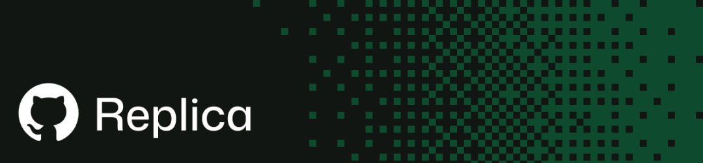
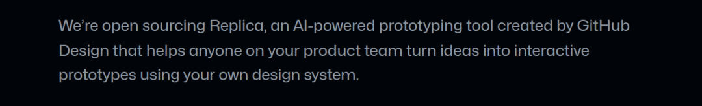
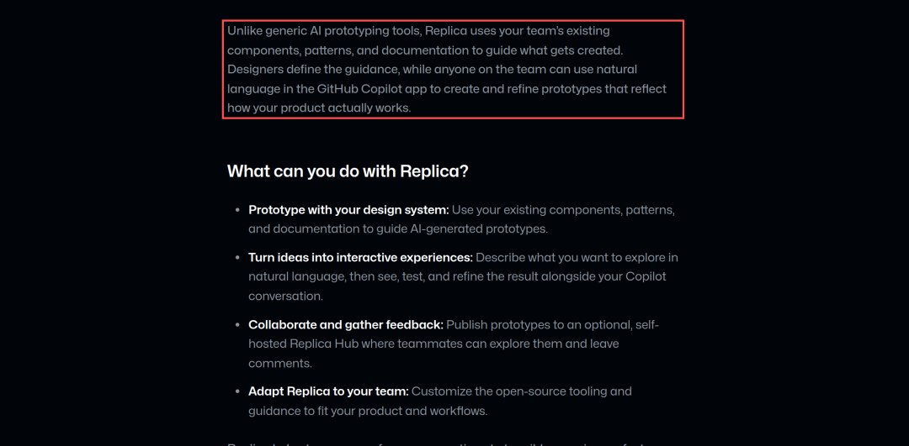

# Replica开源了：给AI套上设计规范，生成对齐产品体系的界面原型

> 来源：梁記士多
> 链接（原文）：https://mp.weixin.qq.com/s/dLiDa322Uy2oQWoXnBnXaQ
> 日期：2026-10-29
> 原始素材：`assets/replica-design-system-prototype/`（original.html + 3 张图）

AI 生成界面这件事，过去两年一直卡在同一个地方：出来的东西能看，但不像你们家的产品。
原因不复杂。模型没有被喂过你们的设计系统——按钮圆角多少、间距是 4 还是 8、空状态怎么画、文案什么调性，它一概不知道，只能按训练数据里的平均值来生成。于是每张原型都长得很"AI"。
GitHub 10 月 28 日开源了 Replica，正面回答的就是这个问题：先把你团队的组件、模式和文档交给模型，再让它生成。
图 1｜Replica 官方仓库头图

官方公告的原话是这样定位它的：
We're open sourcing Replica, an AI-powered prototyping tool created by GitHub Design that helps anyone on your product team turn ideas into interactive prototypes using your own design system.

翻成中文只有一句半：我们把 Replica 开源了。这是 GitHub Design 做的 AI 原型工具，产品团队里的任何人都能用它把想法变成可交互的原型——前提是用你们自己的设计系统。
图 2｜GitHub Changelog 首段原文

这句话里有三个信息点值得拆开看：AI-powered（生成能力来自模型）、anyone on your product team（目标用户不只是设计师）、using your own design system（约束来自你的规范，不是模型的默认审美）。
为什么“设计系统”是这类工具的下限
通用生成工具从零画界面，评判标准是“好不好看”。但产品原型要回答的是另一个问题：这东西能不能按我们的方式实现？
一个按钮在通用工具里长什么样都行；在真实产品里，它有既定尺寸、状态、禁用样式、加载态、无障碍属性。模型如果没被约束，生成的是一张“看起来像按钮”的图，工程师要把它翻成代码时，等于从零重写。
Replica 的做法是把约束前置：设计师先把组件、模式、文档写成指导，之后任何人都能用自然语言调用它。 生成质量的下限，从此由团队自己的规范决定，而不是由模型的训练数据决定。
它到底做什么
按仓库说明，四件事：
用你的设计系统做原型：现有组件、模式、已批准的规范，作为生成时的约束

自然语言出可交互的东西：描述想探索的交互，结果直接显示在 Copilot 对话旁边的画布上

收反馈：把原型发布到组织自托管的 Replica Hub，同事可以试用并留言

可改造：MIT 开源，工具链和规范都能按团队习惯改

注意第一条的措辞：官方说的是"使用团队组件、模式和文档指导生成"，不是"逐项精确复用"。这个区别后面会讲。
官方公告里还专门对比了一句：跟通用的 AI 原型工具不同，Replica 用的是你团队现有的组件、模式和文档来指导生成什么——设计者定义指导，团队里任何人都能用自然语言在 Copilot app 里创建和迭代。
图 3｜Changelog 原文：Unlike generic AI prototyping tools…

四件套：能拆开用
组成
 | 作用
 | 是否必需
 | 
Starters
 | 现成的起始应用，带共享的 Copilot skills
 | 新建仓库时选一个
 | 
Replica 插件
 | 给 Copilot 加一块画布，原型跑在对话旁边
 | 用画布就需要
 | 
Replica Hub
 | 可选，自托管，托管已发布的原型和评论
 | 只有团队协作才需要
 | 
GitHub build action
 | 发布到 Hub 时构建原型
 | 本地开发不需要
 | 

对新仓库，官方给了两个 starter：Minimal（一个小例子，用来适配你自己的设计系统）和 CoreAI Sandbox（已经带导航布局和按钮菜单，用的是微软 CoreAI 的设计系统）。
拆开用的意义在于：你不用先搭服务器就能开始。 本地原型不需要 Hub、不需要 Docker、不需要域名，甚至不需要一个 GitHub 仓库。
本地跑起来要什么
环境要求不轻，但都是常规件：
GitHub Copilot app（要登录）

Git，配置好 user.name / user.email

Node.js + npm，版本对齐 package.json 的 engines.node

bash、curl、tar，用来下载 starter

macOS 或 Linux（Windows 不在支持列表里）

lsof，画布靠它找本地正在跑的端口

模型这块有两条路：用 Copilot 套餐里的托管模型，或者用 BYOK 接自己的供应商（公开预览，费用按你自己的供应商算）。只是查看和评论原型的话，不需要 Copilot 订阅。
最关键的一步：先把规范喂进去
这是 Replica 和"让 ChatGPT 画个页面"的真正区别。
装好 starter 之后，在 Copilot 对话里跑一条命令：
/setup-skills
然后交给它三类已批准的来源：产品文档、设计系统文档、团队在用的组件包或 token 包。Copilot 读完会起草一份构建原型的指导，先给你看，等你按团队流程审核、提修改，再单独授权它落盘。
官方文档写得很清楚：没有经过审核的指导，你只能探索 starter，等于还没验证 Replica 会不会遵守你的设计系统。
这条"先起草、再审核、再授权"的门，比功能本身更值得抄。它把 AI 的产出变成了要走审批的产物，而不是直接进仓库的改动。
写 prompt 的姿势也给了范例
文档里给了一段示例 prompt，写法值得学：
Build a searchable project list using our approved design-system guidance and sample data. Include an empty result state and a way to clear the search. Keep it separate from our live product. Show it in the Replica canvas. Before editing, check that the reviewed app and guidance are committed. If guidance or starting pages changed after setup, ask for my approval to save those changes in a local commit before creating the prototype branch. Use a separate branch for this prototype. Leave the default branch unchanged. Ask for approval before making any commits. Do not push or publish anything.
中文对照：
用我们已批准的 design system 指导，做一个可搜索的项目列表，数据用样例数据。要有空结果状态，以及清除搜索的方式。跟线上产品隔离开，展示在 Replica 画布里。
动手之前，先确认已审核的应用和指导已经提交。
如果 setup 之后指导或起始页面变过，先征得我同意，把那些改动保存在一个本地提交里，再创建原型分支。
这个原型用单独的分支，默认分支保持不动。
任何提交之前都要先问我。不要推送，也不要发布任何东西。

几个要点：先说清要什么交互和边界状态（空结果、清除搜索），再约束隔离（不动主分支、不推送、不发布），最后要求它在动手前确认基线已提交。
这其实是一份"给 agent 的施工合同"，跟 Replica 本身关系不大，换成任何写代码的 agent 都适用。
想给团队用：Hub 是自托管的
Hub 不是 GitHub 提供的服务，是你们自己部署。要求如下：
一台 Linux 服务器，支持 Docker 与 Docker Compose，数据可持久化，有备份

一个独立域名，含通配子域名的 DNS 与 HTTPS（原型每个都有自己的预览地址，共用子域不行）

组织下能安装 Replica 的 GitHub App，并运行它的构建 workflow

有人负责这台机器：密码、访问密钥、备份

文档还专门提醒：用样例数据做原型，不要放真实客户数据或线上系统的密钥。
数据这块也别想当然：Hub 会把发布和评论活动记在自己的数据库里，保留 90 天；可以配置导出到 Segment、Mixpanel 或自建 HTTPS 端点，但不会自动回传 GitHub。同时官方明说：自托管不等于数据不出组织——GitHub 服务和你的模型供应商各有各的条款。
现状和局限
很新。 仓库 10 月 15 日创建，公开公告 10 月 28 日。截至写稿（10 月 29 日）43 star、29 个 open issue，属于早期。

强依赖 Copilot。 官方工作流是围绕 GitHub Copilot app 设计的，没有 Copilot 或没有登录，画布那条路走不通。

只支持 macOS / Linux。 本地画布预览在 Windows 上没提支持。

"像你们家产品"是概率，不是保证。 官方措辞是"指导生成"，生成结果仍可能用错组件或漏掉规范细节，需要人看。

Hub 的运维成本是真的。 服务器、域名、通配 HTTPS、GitHub App 审批、备份，这一套对小团队不算轻。

MIT 是好事，但要看清边界。 代码开源，Hub 自托管，但模型调用、Copilot 订阅、以及你团队设计文档的分发，仍然有各自的成本和条款。

落地时的三个坑
坑一：规范没写好，生成质量照样差。 如果你的设计文档只有一张 Figma 图，没有组件命名、状态说明、使用边界，模型拿到手也只能猜。用 Replica 之前，先花时间把规范写成文本——这件事本来就该做。
坑二：把原型当成"可以直接上线的东西"。 它产出的是可交互实验，不是产品代码。文档自己也在提示用样例数据、不要放真实客户数据。越界使用等于给自己埋事故。
坑三：以为 Hub 装完就完事。 服务器、独立域名、通配 HTTPS、GitHub App 审批、备份与保留策略，这些是持续运维，不是一次性安装。小团队可以先只用本地路径，把 Hub 留到确实需要收集反馈时再上。
谁值得试
产品团队里被"AI 出的图不能用"折磨过的设计师，值得花半小时试本地路径：装 starter、跑 /setup-skills、喂一份你们的设计规范文档，看它生成的第一个页面。
做内部工具平台的团队，值得读它的文档结构：先起草指导、再人工审核、再授权落盘，最后用分支和审批把实验和主线隔开。这套流程跟工具无关，可以直接搬。
如果你只是想"让 AI 画个界面看看"，那 Replica 有点重——它假设你有设计系统、有规范、有审批流程。反过来说，它值钱的地方恰恰是这个假设。
· · ·
资料来源
github/replica

Introducing Replica, an open-source AI prototyping tool｜GitHub Changelog

Create your first local prototype

Set up shared hosting and team feedback

GitHub Copilot app

Replica 仓库 API 元数据
