# 【图像分割】大模型SegmentAnything、FastSAM与MobileSAM对比

> 链接（原文）：https://blog.csdn.net/qq_45752541/article/details/133708751
> 日期：已于 2023-10-11 14:55:00 修改
> 原始素材：`assets/sam-fastsam-mobilesam-csdn/`（original.html + 16 张图）

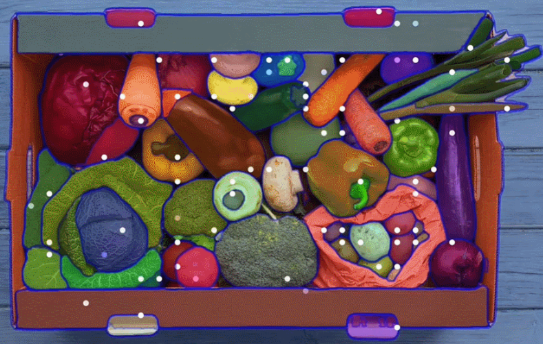
 

 文章目录

 前言：Segment Anything
一、FastSAM
1.基本原理
2.实验结果对比

 
二、MobileSAM
1.框架
2.实验
3.代码

 
 
前言：Segment Anything
 
Meta 今年发布了图像分割模型 Segment Anything Model (SAM) 。SAM 已经学会了关于物体的一般概念，可以为任何图像或视频中的任何物体生成 mask，甚至包括在训练过程中没有遇到过的物体和图像类型。SAM 足够通用，可以涵盖广泛的用例，具有强大的零样本迁移能力。
 
SAM的“分割一切”功能实现了基于点、框、文字等多类型指令的物体及区域分割。训练采用端对端的Transformer结构 在千万数量级监督样本上进行训练，在边缘检测、物体检测、显著物体识别、工业异常检测等下游任务上表现了很强泛化性。如图所示，SAM有三个组件：图像encoder、灵活的提示encoder和快速掩码decoder
 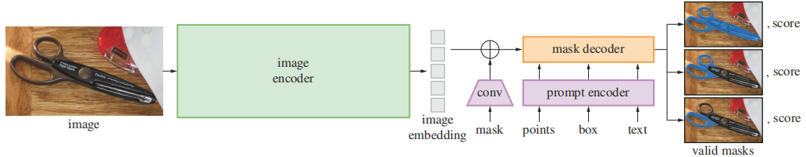
 
SAM因其令人印象深刻的零样本传输性能和与其他模型兼容的高度通用性，可用于高级视觉应用，如具有细粒度控制的图像编辑。许多分割模型需要在资源受限的边缘设备上运行，比如移动应用程序，这就需要对SAM进行轻量化改进。
 
具体原理和代码，可见博主的博客【【图像分割】Segment Anything（Meta AI）论文解读】
 
 
 
 
一、FastSAM
 
2023年6月22日，中科院自动化所的研究团队针对“分割一切”任务，提出了FastSAM方法， 对SAM设计范式进行了重新思考，设计了“全实例分割+基于指令的掩码输出”两阶段算法 。FastSAM通过引入人工先验的结构设计，大幅降低了原Transformer结构在该通用感知任务上的计算冗余，实现了50倍加速，有利于工业化应用落地。
 
“全实例分割+基于指令的掩码输出”两阶段算法，方法结构如图所示。
 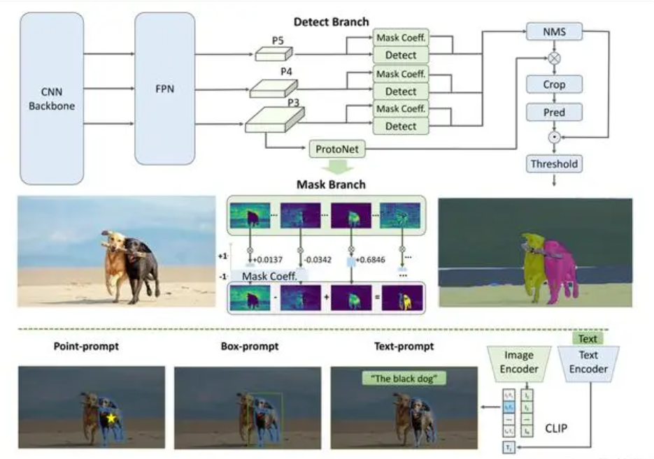
 
1.基本原理
 
FastSAM在每个阶段进行了任务和方法协同的方法设计：
 
（1）第一阶段，利用图像中大多数物体只占据图像局部区域的特点，采用天然具备局部连接特点的“卷积算子CNN作为backbone，进行全实例分割网络构建。该结构相较Transformer结构更加紧致，计算成本更低，但依旧保持对物体或图像区域的表示和判别能力。
 
（2）第二阶段，采用物理空间匹配和图文对齐空间匹配的策略进行基于指令的掩码输出。基于上一阶段的全实例分割掩码：对于point prompt，将point 位置所关联的最优分割区域进行输出，支持多点模式、背景点抑制；对于box prompt，将box 匹配到的最大IoU的分割掩码进行输出；对于text prompt，利用图文对齐网络CLIP将掩码图像区域与文本指令映射到同一个空间，进行相似性计算，进而输出最相似区域。
 
基于此方法结构，FastSAM在SAM团队开源的SA-1B数据集上随机挑选了2%的图片进行训练就取得了和SAM可匹配的效果，并且速度相较最常用的32×32指令版本的SAM提升了50倍，实现了实时的“分割一切”，对比如下图：
 
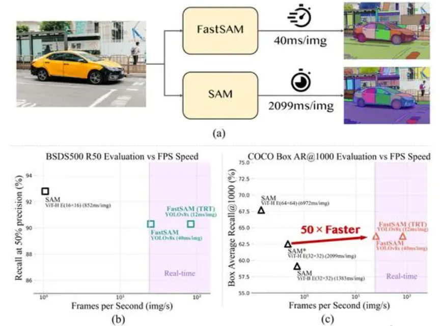
 
2.实验结果对比
 
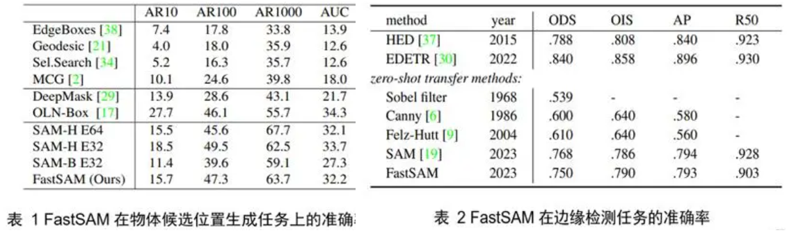
 
 
二、MobileSAM
 
论文地址：https://arxiv.org/pdf/2306.14289.pdf
 
代码地址：https://github.com/ChaoningZhang/MobileSAM
 
论文题目：
 
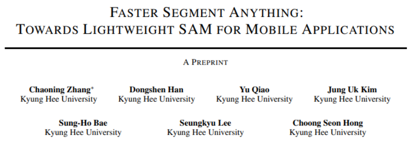
 论文发现， 从原始SAM文件中训练新的轻量SAM的方式，会导致性能不令人满意，这主要是由图像编码器和掩模解码器的耦合优化引起的，因此提出了 解耦蒸馏。具体地说，将原始SAM中的图像编码器ViT-H的知识提取到一个轻量级的图像编码器中，该编码器可以自动与原始SAM中的掩码解码器兼容。
 
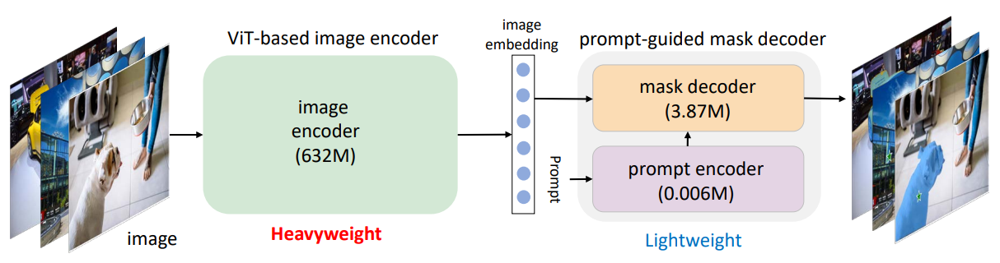
 不同 encoder 的SAM模型参数量对比：
 
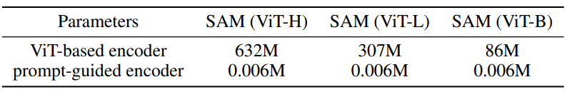
 
训练在不到一天的时间内在单个GPU上完成，由此产生的轻量级SAM被称为 MobileSAM，它比原始SAM小60多倍，但性能与原始SAM相当。就推理速度而言，MobileSAM每幅图像运行约10ms：图像编码器运行8ms，掩码解码器运行2ms。凭借卓越的性能和更高的通用性，我们的MobileSAM比并发的FastSAM小7倍，快4倍，更适合移动应用。
 
1.框架
 
SAM由一个基于ViT的图像编码器和一个提示引导掩码解码器组成。图像编码器将图像作为输入并生成嵌入，然后将嵌入提供给掩码解码器。掩码解码器生成一个掩码，根据点（或框）等提示从背景中剪切出任何对象。此外，SAM允许为同一提示生成多个掩码，以解决模糊性问题，这提供了宝贵的灵活性。考虑到这一点，MobileSAM保持了SAM的流水线，首先采用基于ViT的编码器来生成图像嵌入，然后采用提示引导解码器来生成所需的掩码。这条管道是为“segment anything”而优化设计的，可用于“SAM”的下游任务。
 
SAM的耦合知识蒸馏。左图表示完全耦合蒸馏，右图表示半耦合蒸馏。
 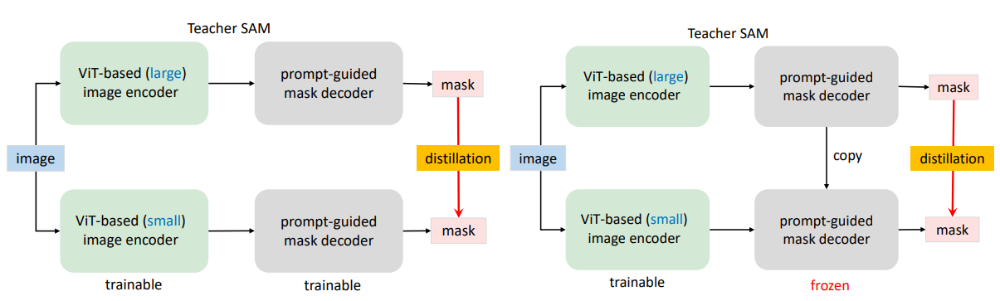
 
该项目的目标是生成一个移动友好型SAM（MobileSAM），以轻量级的方式快速实现SAM。原始SAM中的提示引导掩码解码器的参数小于4M，被认为是轻量级的。然而，原始SAM中的默认图像编码器是基于ViT-H的，具有超过600M的参数，这是非常重量级的。因此，获得移动友好SAM的关键在于用轻量级的图像编码器取代重量级的图像编码器。
 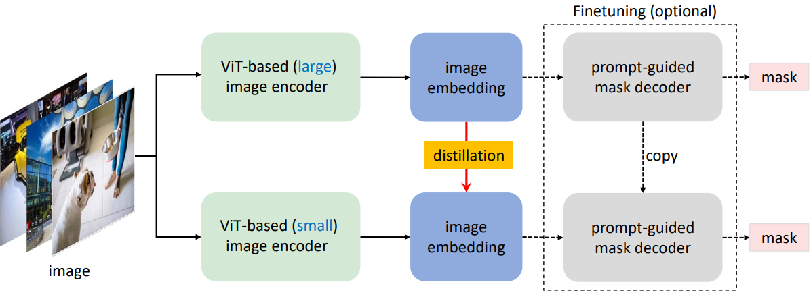
 以ViT-B为图像编码器的SAM的耦合蒸馏和解耦蒸馏的比较。与耦合蒸馏相比，解耦蒸馏性能更好，所需计算资源少于1%。
 
2.实验
 
下图给出了point与bbox提示词下MobileSAM与原生SAM的结果对比
 
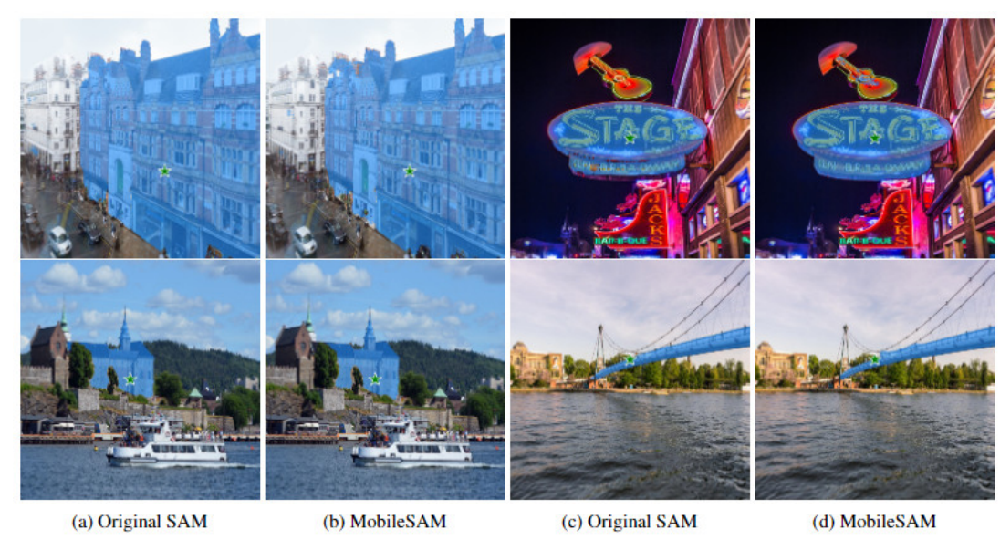
 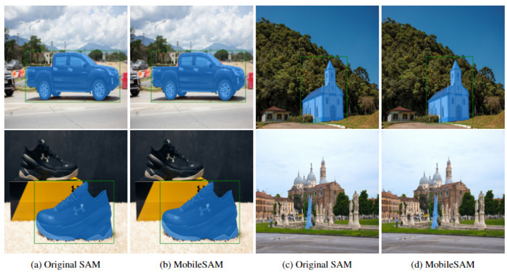
 
下图从分割角度对比了SAM、FastSAM以及MobileSAM三个模型，可以看到：
 
MobileSAM与原生SAM结果对齐惊人的好，而FastSAM会生成一些无法满意的结果
 FastSAM通常生成非平滑的边缘，而SAM与MobileSAM并没有该问题
 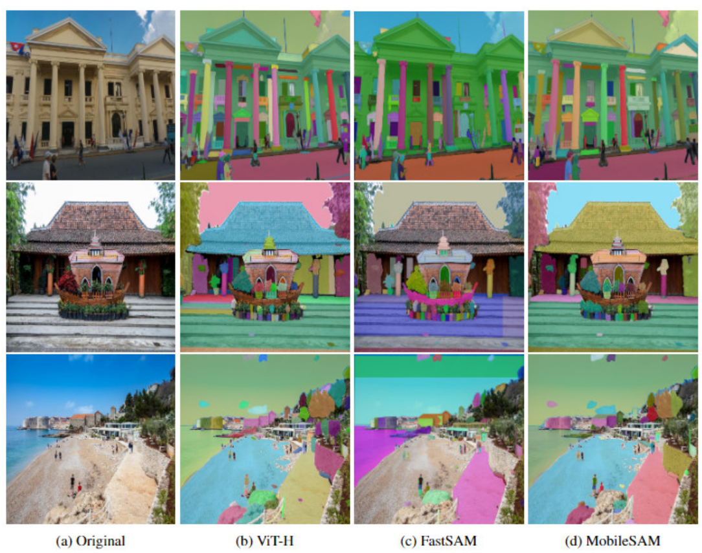
 
 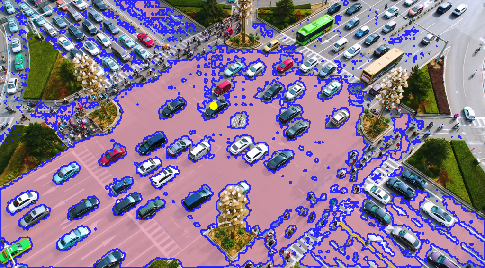
 
3.代码
 
前向代码非常简单，预训练模型只有14M，在原代码中已包含：
 
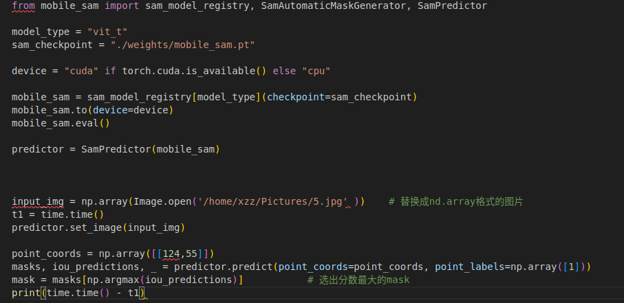
