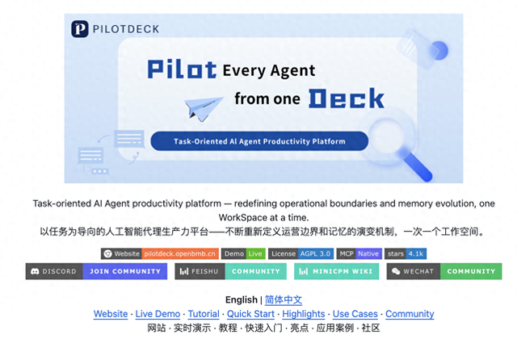
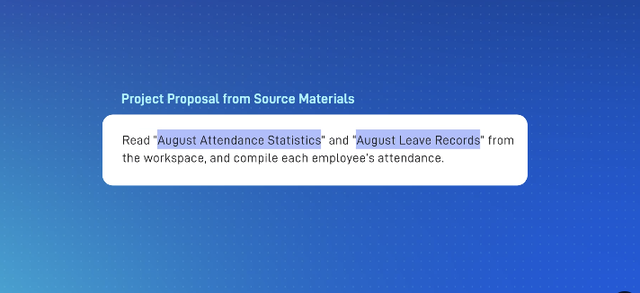
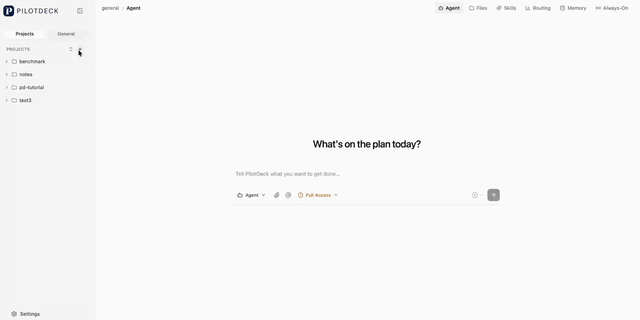
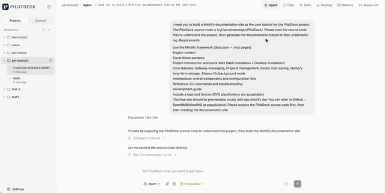
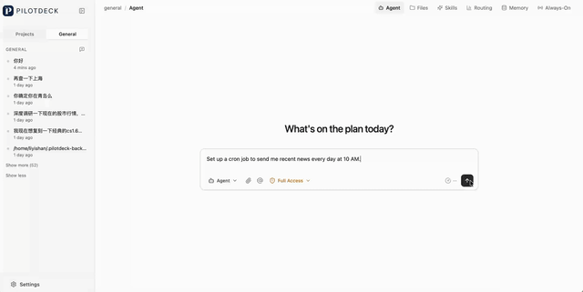
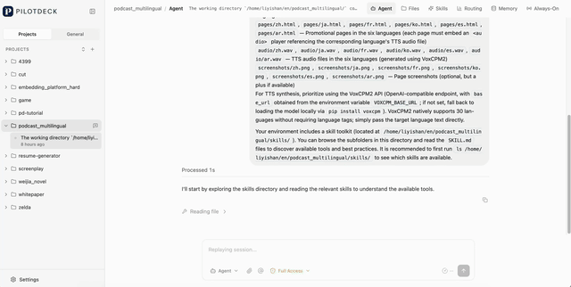
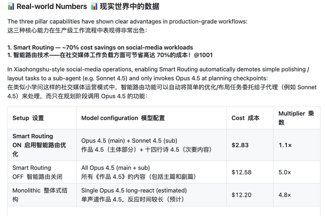
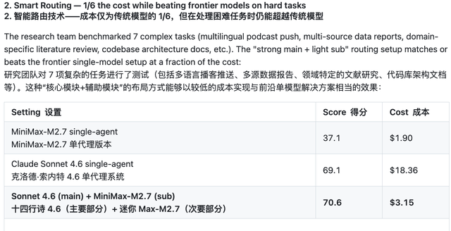

# 清华开源！智能体操作系统任务成本降83%，AI记忆可查可改

> 来源：量子位
> 链接（原文）：https://m.toutiao.com/article/7697597470469063187/
> 链接（原发）：https://toutiao.com/group/7697597470469063187/
> 日期：2026-10-17 19:30
> 原始素材：`assets/tsinghua-agent-os-memory/`（original.html + 9 张图）

梦瑶 发自 凹非寺
量子位 | 公众号 QbitAI
清华最近搞了个开源智能体操作系统，专治AI Agent干活儿时的各种「老大难」问题？！
这套名叫PilotDeck 2.0的系统，由清华大学THUNLP实验室联合面壁智能、OpenBMB等团队共同推出。
其解决的问题，好巧不巧的是正好和咱用AI Agent干活儿时最扎心的事儿「强相关」——
就比如啊...项目一多，文件、记忆、任务全搅在一起，傻眼捏...（笑）
活一复杂，Token哗哗往外烧，人刚离开电脑，AI又卡在半路等指令*1000......
而PilotDeck 2.0瞄准的，恰好就是这些让人头大的老bug——记忆管理、任务执行，以及模型调用成本。

贴心的我，也帮大家浅浅总结了一下这玩意儿到底能帮咱们干啥事儿，能解决啥日常的麻烦——
项目管理：同时处理多个项目，隔离文件、记忆与任务，减少资料混杂、任务串台。
长期记忆：记住项目背景、用户偏好和工作进度，支持查看与修改，避免反复交代。
后台执行：支持后台运行长周期任务、检查可执行事项，让AI在用户离开时继续干活。
智能路由：据任务难度选择合适的模型，复杂任务用强模型、简单任务用低成本模型，减少不必要的开支。

在Workbuddy Bench评测表现上，PilotDeck使用Qwen3.6-35B-A3B得分79.1，也优于Claude Code (77.3)。
此外，通过让强模型管决策、小模型干杂活的调度方式，还能把复杂长任务的成本砍掉近六分之五？？
听上去，好像，还蛮实用的，哈？？？
AI有了自己的工作舱，记忆、文件和任务都能管起来了
大家或许都有这种感觉...
就咱平时用各种AI工具，最害怕的事情之一就是「上下文污染」。
比如前脚刚让AI按严肃学术风写了篇技术架构，后脚让它写小红书文案，它张口闭口还是架构解耦。。。（笑）
而这抓马之事的背后，主要是和现有的大多数Agent记忆的黑盒问题有关系。
换句话说，AI到底记住了什么、什么时候记的、记在哪了，屏幕这头的我们两眼一抹黑。
万一中途记错了某个关键业务逻辑，想找到问题出在哪儿都费劲，最后只能忍痛把整段对话废掉，从头再来！！！

而PilotDeck最核心的底层架构，就是以WorkSpace（工作舱）为基本单位。
我们可以把它理解成给AI划分了独立的物理工位，每个项目都有自己专属的文件系统、记忆库和技能集。
具体官方给出的例子——
在A工作舱里折腾音视频剪辑，在B工作舱里iOS小游戏，两边的记忆和检索空间完全物理隔离，再也不会互相打架。
这样一来，即便同时处理好几摊活儿，也能各自保留上下文，减少记忆串台、任务跑偏的麻烦：

更击中痛点的是，PilotDeck把记忆彻底做成了「白盒化」。
比如AI突然说我记得你之前偏好这种写法，你可能根本不知道它从哪儿得出的结论，也不知道它有没有记错！！
白盒记忆解决的就是这个问题，直接给了用户一个随时「翻账本」的机会——
从记忆的生成、抽取、存储到最后被调用，整条链路完全对用户可见。
比如AI在干活儿过程中记下了哪些偏好、哪些事实，点开面板就能一条条查看。
万一发现它把某个关键参数记错了，也不用费劲巴拉地写一长串Prompt，试图让它忘掉错误信息。
直接手动修改、删除，甚至可以一键固定重要信息就行～

此外，其还内置了一个叫「Dream模式」的机制。
当AI处于空闲状态时，系统会在后台自动对零散的交互记忆进行归纳、提炼和去重。
如果整理过程中弄丢了关键细节，还能一键回滚，秒级恢复到整理前的状态，不用担心越整理越乱。
不仅如此，PilotDeck还引入了Always-on（常驻执行） 模式——
即使关掉聊天窗口、离开电脑，Agent依然会在后台持续推进长周期的监控与执行任务。
能把既定任务跑完，还能在执行过程中主动发现潜在的候选任务，并在全部搞定之后，把成果落地为本地文件，附带一份完整的进展与总结报告。

值得一提的是，整套系统原生支持MCP。
不管习惯在Web界面、命令行CLI还是企业微信、飞书等IM生态里操作，后端的逻辑和行为完全一致。
对开发者来说，意味着可以围绕现有工作流扩展工具和技能。
对长期使用AI的友友来说，也算是有机会减少反复交代背景、手动串联步骤的时间～
「主强子弱」智能路由：花1/6的钱，把顶配模型干趴下。。。
用Agent跑长任务，钱包扛不住往往是最大的劝退点。
很多时候任务并不难，可能只是把几段文字做个排版、把多语种翻译套个模板——
但是吧，因为系统架构简陋，全程都在狂跑最贵的旗舰模型，Token消耗往往还蛮夸张的。。。
值得一提的是，PilotDeck还搞了个Smart Routing（智能路由）。

其在底层内置了任务难度识别，把不同环节的任务拆解后分发给不同段位的模型，做了一套端云协同与分层编排。
复杂的规划决策让顶配大模型来做，底层的执行、润色、格式处理全部降级给轻量模型。
在自媒体社媒运营场景的实测中，如果不做省钱路由，全流程跑Claude Opus 4.5，单次费用高达$12.58。
而开启智能路由后，主Agent负责顶层规划走Opus 4.5，子Agent负责文本润色降级到Sonnet 4.5。
费用降到$2.83，差不多能省下70%的成本，be like：

此外，在更硬核的复杂任务测试中，这个差距体现的更悬殊一些？？
研究团队拿播客多语言推送、多源数据报告、领域论文综述、代码库架构文档等7个高难度复杂任务做了横向对比：
单体MiniMax-M2.7跑下来，成本是挺低（$1.90），但得分只有37.1，没法用，直接pass。。。
单体Claude Sonnet 4.6跑下来，得分冲到了69.1，但一趟测试就要烧掉$18.36。
而在PilotDeck的路由编排下，采用主Sonnet 4.6+子MiniMax-M2.7的主强子弱架构，综合得分飙到了70.6，成本只要$3.15。
效果比纯顶配单体模型好的同时，成本却只有顶配模型的六分之一左右。

对了，PilotDeck采用AGPL-3.0开源许可证，支持macOS、Linux和Windows，也提供Docker部署方式。
大家感兴趣的话，可以上手试试，GitHub链接放下面了哈～
参考链接：
[1]https://github.com/OpenBMB/PilotDeck
[2]https://x.com/OpenBMB/status/2110364065822646570
— 完 —
量子位 QbitAI · 头条号签约
关注我们，第一时间获知前沿科技动态
